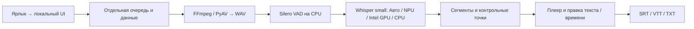

# Video Descriptor

Windows-приложение для локальной обработки видео: расшифровка, говорящие,
перевод и конспект с проверяемыми ссылками на исходную запись.
Рабочая папка: `E:\LocalAI\video desriptor`. Ниже сохранена инструкция исходного CLI;
переход к нативному запуску описывается отдельно, без обязательного devcontainer.

- [Сравнение 9 проектов и наше отличие](docs/competitive-analysis.md).
- [Архитектура Windows, API, ADR и установка](docs/architecture-windows.md).
- [Автовыбор NPU → GPU → CPU, настройки и план CI/CD](docs/device-policy-and-release.md).
- [Что перенесено из WSL](windows-migration/START-HERE.md).

## Открыть приложение на Windows

Для этой машины подготовлен [нативный прототип](windows-app/README.md):
двойной щелчок по `windows-app/Open-App.cmd` или ярлыку **Video Descriptor**.
Браузер откроется сам. PowerShell из корня:

```powershell
powershell -NoProfile -ExecutionPolicy Bypass -File '.\windows-app\Start-App.ps1'
```

Проверенный режим: видео/аудио → Whisper small на NPU, Intel GPU или CPU → правка текста
и таймкодов → SRT/VTT/TXT. Данные новой очереди — `windows-app/runtime/workspace`;
старые результаты не импортируются автоматически. Перевод/конспект требуют отдельно
работающей Ollama, Windows GPU-диаризация пока не подготовлена.

Проверены настоящие MP4: 20 секунд за **2.34 s**, 15 минут за **39.47 s** после
предварительной загрузки NPU-модели; тишина даёт пустой результат.
Это локальные измерения, не доказательство превосходства над другими движками.
[Методика, реальные проверки и ограничения](docs/verification-windows.md).
Теперь в настройках доступен **Авто: NPU → GPU → CPU** и явный выбор устройства.
Выбор сохраняется для новых заданий; ручной режим не подменяет устройство при сбое.
[Реальные прогоны CPU/GPU/NPU, восстановление и ограничения](docs/verification-devices.md).
Автоматические проверки: **174 прошли, 1 пропущена** (нет Windows-права создания symlink).
Ruff и `pip check` проходят. [Снимок интерфейса](docs/windows-preview.png).

## Архитектура первого Windows-режима



Полный проект также связывает речь со слайдами/OCR и конспектом, хранит источники
и версии. Это наш продуктовый фокус вместе с восстановлением после сбоев.
Для следующего проверенного режима нужны Windows GPU-диаризация и испытание
перевода/конспекта через Ollama. Подробные границы процессов, API и решения —
в [архитектуре](docs/architecture-windows.md), ориентиры и различия с Vibe,
Buzz, Subtitle Edit и шестью другими проектами — в [сравнении](docs/competitive-analysis.md).

## История изменений

Каждое существенное изменение сопровождается записью здесь, актуализацией
архитектуры при изменении контрактов и отдельным Git-коммитом с описанием причины.
Личные данные, модели, секреты и журналы в Git не входят.

| Дата | Изменение | Проверка |
|---|---|---|
| 2026-10-17 | Прототип 0.3: выбор Авто/NPU/GPU/CPU, сохранённый план задания, отдельные OpenVINO CPU/GPU workers, переход после отказа с сохранением готовых фрагментов и журнал действий | 174 теста прошли, 1 пропущен; реальный 20 s MP4 на CPU/GPU/NPU/Auto, экспорт SRT; сохранение настройки в UI; исправлена гонка публикации manifest; Ruff/pip check |
| 2026-10-17 | Уточнён целевой контракт: Auto NPU → GPU → CPU для речи, ручной выбор устройства, отдельные capabilities этапов и журнал действий; запланированы ZIP/installer и Windows CI-матрица | Архитектурное решение зафиксировано; текущий проверенный прототип остаётся NPU-only, новый выбор и сборка ещё не реализованы |
| 2026-10-16 | Перенос в Windows-каталог с Git-историей, видео и результатами; WSL-копия сохранена | 10 631 файл, SHA256 совпали; два log-symlink материализованы |
| 2026-10-16 | Исследованы 5 исходных и 4 дополнительных проекта; выбраны native Windows и существующий web UI; записаны ADR и схема API | Прочитаны upstream исходники/README/LICENSE, зафиксированы ревизии; XPU в текущем Windows torch отсутствует |
| 2026-10-16 | Нативный запускатель, простая стартовая страница, health-check, отдельный workspace, повторное открытие одного экземпляра, запуск существующего NPU worker | Реальные MP4 20/900 s и тишина 30 s; запуск модели в фоне, отказ остановки активной очереди |
| 2026-10-16 | Windows-блокировки и пути, PyAV вместо отсутствующего ffprobe, выбор языка NPU без смешивания кэша, SRT, правка границ с сохранением ID | Межпроцессная блокировка и API-тесты; SRT/VTT, устаревшая revision, retry с готовым кэшем; исходный speech.json не меняется |
| 2026-10-16 | Зафиксированы версии зависимостей, manifest компонентов, инструкции установки/отката и отдельный отчёт проверки | pip check, Ruff, pytest только в tests/; исторические диагностические скрипты исключены из сбора |
| 2026-10-16 | Исправлены Windows-путь метаданных FFmpeg и создание ярлыка в локализованном OneDrive Desktop | Реальная scene-selection проверка, Unicode-копирование ярлыка, повторный запуск одного UI |

## Исходный CLI и рабочий процесс

Локальный конспект англоязычных AWS-лекций и воркшопов: речь, текст слайдов
и демонстрации экрана связываются с исходными таймкодами. Первый CLI обрабатывает
локальный файл, сохраняет транскрипцию и OCR, создаёт русский конспект и HTML-отчёт
со встроенным видеоплеером и переходами к источникам.

## Первый запуск

Для полной обработки нескольких видео положить их в `data/` и из корня
проекта выполнить:

```bash
python scripts/process_videos.py
```

Видео обрабатываются последовательно целиком, с выборочным осмотром кадров,
конспектом и переводом субтитров. Прогресс виден в терминале. Повтор команды
использует сохранённые этапы. Без перевода: `--without-translation`.
Можно указать конкретные файлы: `python scripts/process_videos.py "data/первый.mp4" "data/второй.mp4"`.

Положить видео в `data/`. Из корня проекта выполнить:

```bash
python -m video_descriptor "data/2026-10-05 11-04-45.mp4" --duration 120 --model qwen3.5:9b
```

Имя файла заменить на своё. `--duration 120` обрабатывает первые две минуты;
без этого параметра обрабатывается всё видео. `--start 600 --duration 120`
выбирает две минуты начиная с десятой минуты, сохраняя исходные таймкоды.
Модель должна быть уже установлена в вашей Ollama. Без генерации конспекта:

```bash
python -m video_descriptor "data/2026-10-05 11-04-45.mp4" --duration 120 --skip-notes
```

При первом запуске Whisper скачивает `base.en`. Для более качественного
распознавания можно указать `--whisper-model small.en`; обработка на CPU будет
дольше. Для других языков использовать многоязычную модель, например
`--whisper-model small --language auto`.

Прогресс выводится сразу в терминал: пять этапов, проценты Whisper, счётчик
кадров OCR, счётчик блоков Ollama и число полученных символов во время генерации.
Во время долгой операции каждые 15 секунд
выводится время ожидания. Это признак работающего процесса, а не оценка завершения.
В начале запуска выводится путь к результатам. Лог сохраняется в `run.log`;
из другого терминала его можно смотреть через `tail -f "output/<папка>/run.log"`.

В `output/<имя-видео>-<идентификатор>/` сохраняются:

- `manifest.json` — исходный файл, настройки и длина обработанного фрагмента;
- `audio.wav`, `transcript.json` — аудио и сегменты `id/start/end/text`;
- `frames/`, `frames.json` — кадры и OCR с исходными таймкодами;
- `notes.json`, `notes.md` — структурированный и читаемый конспект;
- `chapters.json` — разделы видео с типом, заголовком, источниками и временем;
- `report.html` — плеер, конспект, раскрываемые источники и кнопки переходов;
- `run.log` — прогресс и ошибки.

Повтор той же команды использует завершённые этапы из кэша. Изменение файла,
фрагмента или параметров распознавания/OCR создаёт новую папку. Замена модели
Ollama пересоздаёт только конспект. Для принудительной повторной обработки
можно указать новый корень через `--output output/recheck`.
Whisper также сохраняет `transcript.partial.json` после каждой распознанной
реплики. После сбоя повтор той же команды продолжает по сохранённому аудио,
повторно проверяя небольшой хвост примерно за последние 30 секунд, начиная
с границы реплики. Таймкоды остаются исходными, реплики не дублируются.
Готовый `transcript.json` создаётся только после полного завершения этапа.

Промпт фильтрации: `video_descriptor/prompts/lecture_notes_ru.txt`. Он отделяет
учебный материал от организационного разговора и постороннего интерфейса,
сохраняя технические детали. Второй проход по
`video_descriptor/prompts/filter_notes_ru.txt` выбирает учебные пункты из
готового конспекта; программа сохраняет только выбранные пункты.
После изменения промпта повторить ту же команду:
конспект пересоздастся автоматически, транскрипция и OCR останутся в кэше.

В режиме `--vision auto` (по умолчанию) короткий первый запрос Ollama выбирает
кадры, для которых текста недостаточно. Модель получает речь, OCR и долю
изменившихся пикселей — это помогает заметить выделение ответа, не изменившее
OCR. Затем запрошенные картинки передаются в основной запрос анализа;
дублирующий OCR этих кадров из запроса убирается. При пустом выборе основной
запрос остаётся текстовым. `--vision off` отключает выбор и передачу изображений.
Требуется модель с vision: установленная `qwen3.5:9b` это поддерживает.

Отбор кадров по умолчанию — штатный FFmpeg: проверка изменений раз в секунду,
порог `scene=0.01`, контрольный снимок через 60 секунд без выбранного кадра.
OCR читает только отобранные изображения. Прежний режим доступен через
`--frame-strategy interval --frame-interval 15`.
Выбор стратегии, настройка параметров, ограничения и добавление нового способа:
[docs/frame-selection.md](docs/frame-selection.md).

Названия и типы разделов модель выбирает сама; фиксированного перечня нет.
План со списком тем сохраняется отдельно от учебных пунктов и не удаляется
фильтром организационной речи. Это описание наблюдаемого видео: темы из плана
не превращаются автоматически в разделы ещё не просмотренных модулей.
В отчёте появятся оглавление с переходами и список тем плана.
Границы вычисляются по источникам; точность ограничена частотой кадров OCR
и сегментами речи. В разделе квиза сохраняются вопрос, варианты, подтверждённый
правильный ответ и объяснение. Если подтверждения нет, ответ остаётся неизвестным.
Соседние разделы с одинаковым вопросом объединяются, включая паузу для голосования.
Если объяснение пропущено и есть речь, дополнительный текстовый запрос просит
модель восстановить объяснение по транскрипции. Ответ и варианты этот запрос
не меняет; результат сохраняется в `quiz-explained-*.json`.

Нагрузка: Whisper и OCR работают на CPU один раз, анализ — блоками. В auto
добавляется короткий запрос выбора картинок на блок; число картинок ограничено
`--vision-frames` (4 по умолчанию), размер — `--image-max-side` (960 по умолчанию).
Решения и причины сохраняются в `vision-route-*.json`, реально отправленные
ID и размеры картинок — в `vision-inputs-*.json`. Изменения пикселей не являются
распознаванием содержания: решение об осмотре принимает модель.

Сравнение на одних и тех же 10 минутах, последовательно, с общим кэшем:

```bash
python scripts/compare.py "data/2026-10-05 11-04-45.mp4" --duration 600 --model qwen3.5:9b
```

В папке результата появятся `off/` и `auto/`, каждый со своим отчётом, конспектом,
разделами и `metrics.json`: время анализа, число запросов и изображений, токены.
Сравнивать свежие запуски: прогон из кэша не измеряет скорость модели.
Для повторного замера удалить только кэш соответствующего анализа или изменить
корень `--output` при обычном запуске CLI. Подготовку аудио/кадров считать отдельно.
Качество проверять по исходной речи и кадрам: сохранение основных мыслей,
важных примеров и оговорок, отсутствие добавленных знаний, повторы и удобство
быстрого повторения. Больше пунктов или картинок не означает лучший конспект.

В отчёте есть расшифровка речи с подсветкой текущей реплики, переходом по времени
и субтитрами `original.vtt`. Русский перевод готовится отдельно по сохранённой
речи, без повторного анализа видео и картинок:

```bash
python -m video_descriptor.translate "output/ПАПКА_РЕЗУЛЬТАТА" --model qwen3.5:9b
```

После перевода обновятся отчёты, появятся переключатель оригинал/русский/оба
и `ru.vtt`. Перевод блоками по 90 секунд, с прогрессом и кэшем; остановленный
запуск можно продолжить той же командой. Модель переводит каждую реплику с её ID;
таймкоды копируются из распознавания речи. Перевод тоже может содержать ошибки.
Обновить только интерфейс старого отчёта без запросов модели:

```bash
python -m video_descriptor.translate "output/ПАПКА_РЕЗУЛЬТАТА" --refresh-only
```

Открыть `report.html` в обычном браузере. Если браузер ограничивает доступ
к локальному видео, запустить из корня проекта:

```bash
python -m video_descriptor.serve --port 8000
```

Открыть `http://localhost:8000/output/` и выбрать папку результата, затем
`report.html`. Ссылки на видео относительные; папки `data/` и `output/` должны
сохранять взаимное расположение. Сервер работает локально; при Dev Containers
VS Code предложит перенаправление порта 8000.
Этот сервер поддерживает запросы участков видео (HTTP Range), необходимые
для переходов по таймкодам без загрузки всего файла.

Новый экран [создания конспекта](docs/creation-ui.md) доступен по
`http://localhost:8000/create`: загрузка видео, очередь, шаги обработки,
плеер с указателем текущей позиции, поток речи и постепенное появление заметок.
Из него можно наблюдать также за существующим запуском из терминала.

В новом интерфейсе видео и речь находятся слева, конспект — справа.
Нажать **Редактировать**, изменить текст Markdown и нажать **Сохранить**.
Кнопка **+ Раздел в этом месте** добавляет заголовок с текущим временем видео;
в режиме редактирования раздел можно удалить через оглавление и отменить удаление.
Правки сохраняются в `notes.user.md` рядом с отчётом и остаются при его обновлении.
Исходный результат доступен во вкладке **Материал модели**.
Подробности: [редактор конспекта](docs/notes-editor.md).

Ограничения: короткие действия между проверками и изменения ниже порога FFmpeg
могут быть пропущены; движение камеры может дать лишние кадры.
Выбор картинок тоже может ошибаться: OCR не описывает все визуальные
детали, а число картинок ограничено. Для плотных демонстраций уменьшить
`--scan-interval`, подобрать `--scene-threshold` и увеличить лимит картинок.
Для `scene` конспект по умолчанию группируется по предполагаемым сменам слайдов;
для `interval` сохраняется прежнее разбиение по три минуты.
Режим задаётся через `--chunk-strategy slides|time`, подробности в
[описании группировки](docs/chunking.md). Общего смыслового объединения тем всей лекции нет.
Таймкоды берутся из сохранённых источников, неизвестные ID модели отклоняются;
точность содержания всё равно нужно проверять по видео.

При достижении лимита ответа Ollama программа один раз повторяет только текущий
запрос с увеличением бюджета с 4096 до 8192 токенов. Обрезанный ответ не сохраняется
как готовый конспект. Если повтор тоже не завершился или ответ блока некорректен,
блок помечается как пропущенный, а обработка переходит к следующему.
HTML-отчёт явно показывает необработанные фрагменты; `analysis-errors.json`
содержит их номера, время, ошибки и состояние запроса. Перевод также продолжает
следующие блоки после ошибок, сохраняя их в `translation-errors.json`.
Готовые блоки остаются в кэше. Повтор той же команды повторяет неготовые запросы.
При продолжении сохраняйте
параметры отбора кадров и `--chunk-seconds`, чтобы использовать тот же кэш анализа.
Уменьшение `--chunk-seconds` меняет разбиение и требует нового анализа блоков.

Каждая строка лога содержит текущий статус: файл, этап, блок и диапазон времени,
количество источников речи и кадров, задачу и номер запроса модели, отправленный
текст (символы системного промпта и материала), количество картинок и размер JSON
запроса в байтах, полученный текст и рассуждения, бюджет генерации и время запроса.
Точный счётчик токенов появляется после завершения запроса, когда его сообщает
Ollama; до этого стоит `?`, а объём полученного текста обновляется в символах.
Периодические сообщения каждые 15 секунд показывают тот же актуальный статус,
даже если модель ещё не прислала текст. При загрузке из кэша объём нового запроса
нулевой; каждый автоматический повтор получает отдельный номер запроса.

Все реальные запросы Ollama сохраняются в `requests/` внутри папки результата.
У каждой попытки отдельная папка: `request.json` содержит URL, статус блока и точное
тело запроса (промпт, материал, JSON-схему, настройки и base64 картинок);
`events.jsonl` — поток ответа с записью по мере получения, `response.txt` — собранный
текст ответа, `thinking.txt` — переданные моделью рассуждения, `result.json` — статус
завершения и ошибка. Даже обрезанный или невалидный ответ остаётся для диагностики.
При аварийном завершении процесса статус может остаться `running`, но уже записанный
поток доступен. Картинки в журнале могут занимать заметное место на диске.
Данные журнала — исходный материал лекции; текст модели в журнале сохраняется
до проверки схемы, поэтому окончательная ошибка проверки указывается в списке
ошибок блока. При загрузке результата из кэша нового запроса и журнала нет.

## Запуск в WSL через Dev Containers

1. Запустить Docker Desktop на Windows. В Settings → Resources → WSL Integration
   включить интеграцию для используемой дистрибуции. В WSL проверить `docker version`.
2. Открыть эту папку в VS Code из WSL. Установить расширение Dev Containers.
3. Выполнить **Dev Containers: Reopen in Container**.
4. В терминале контейнера выполнить `python scripts/doctor.py`.
5. Для проверки существующей Ollama на Windows выполнить
   `python scripts/doctor.py --ollama`.

Контейнер содержит Python 3.12, FFmpeg/ffprobe, Tesseract с английским языком,
faster-whisper, OpenCV и инструменты разработки. Зависимости устанавливаются
при сборке Dockerfile; изменение исходников не требует переустановки пакетов.
Изменения requirements-dev.txt требуют **Dev Containers: Rebuild Container**.
Диапазоны версий пока не являются lock-файлом: после первой проверенной сборки
нужно зафиксировать разрешённые версии для точного воспроизведения.

## Ollama и модели

По умолчанию используется существующая Ollama на Windows по адресу
`http://host.docker.internal:11434`. Доступность проверяется отдельно и не мешает
открыть контейнер. Модели Ollama остаются на Windows; контейнер не запускает
второй сервер и не скачивает их. Перед первым открытием Dev Container скопировать
`.devcontainer/runtime.env.example` в `.devcontainer/runtime.env` (локальный файл
исключён из Git). В `.devcontainer/runtime.env` указать имя
установленной модели в `OLLAMA_MODEL` и пересоздать контейнер.

Если подключение не работает, проверить, слушает ли Ollama интерфейс, доступный
Docker Desktop. Адрес прослушивания задаётся переменной `OLLAMA_HOST` в Windows
и применяется после полного перезапуска Ollama. При открытии сетевого интерфейса
ограничить доступ правилами брандмауэра своей машины. Для обычного Linux Docker
адрес сервера может отличаться — изменить `OLLAMA_BASE_URL`.

Whisper работает отдельно от Ollama. Начальная среда рассчитана на CPU/int8;
веса Whisper будут скачаны при первом запуске распознавания и сохранены в Docker
volume. Отдельные volumes сохраняют pip cache и Hugging Face cache между rebuild.
Для переноса на другой компьютер эти кэши не обязательны: они загрузятся заново.
GPU для Whisper требует отдельной настройки CUDA и Docker GPU; такой профиль
пока не добавлен. GPU Windows Ollama не требует передачи GPU этому контейнеру.

## Данные и первая проверка идеи

Локальные записи размещать в `data/`, результаты — в `output/`. Обе папки
исключены из Git. Docker build context содержит только необходимые для сборки
файлы, поэтому записи и кэши не передаются в сборку образа.

Первая цель — обработать 15–20 минут с объяснением, слайдами и демонстрацией:

- сохранить английскую транскрипцию как сегменты `id/start/end/text`;
- извлечь кадры с таймкодами, прочитать текст слайдов и экрана;
- выделить темы, объяснения, шаги и ограничения с идентификаторами источников;
- собрать русский конспект и переходы к нужным местам видео.

Технические имена AWS, команды и код сохранять в исходном виде. Для демонстраций
связывать речь и экран: «нажимаем здесь» без кадра не описывает действие.
Модель выбирает идентификаторы источников, а время берётся из сохранённых данных.
Качество оцениваем по сохранению существенных деталей и точности переходов.

Из reels-analyzer адаптирован подход к извлечению моно-аудио 16 kHz через FFmpeg,
Whisper на CPU/int8 и запросам Ollama через HTTP. Источник:
`src/reels_analyzer/media.py` и `reviewer.py`, commit
`61883348014931fb4c67726be3490aae93cd50f7`.
Временные сегменты, OCR, анализ блоков, проверка ID источников, кэш и просмотр
видео реализованы здесь под задачу лекций. Загрузчик TikTok и метрики reels
в этот проект не переносятся.

Проверка кода: `python -m pytest -q` и `ruff check video_descriptor tests`.

Основа devcontainer адаптирована из
[reels-analyzer](https://github.com/IavnFGV/reels-analyzer/tree/61883348014931fb4c67726be3490aae93cd50f7/.devcontainer).
Документация:
[Замер Whisper на CPU и Intel NPU](docs/whisper-npu.md),
[NPU из devcontainer](docs/whisper-npu-container.md),
[Перевод через Ollama или Gemini](docs/translation-providers.md),
[Dev Containers](https://code.visualstudio.com/docs/devcontainers/create-dev-container),
[Docker Desktop networking](https://docs.docker.com/desktop/features/networking/),
[Ollama FAQ](https://docs.ollama.com/faq).

В [экране записи](docs/creation-ui.md) `/create` три этапа: Источник, Речь и Конспект, каждый со своими настройками. Материал конспекта выбирается по речи или по речи и тексту слайдов; аудио использует только речь. Старые `/speech` и отчёты открываются в том же экране. Повторные запуски речи и конспекта сохраняют отдельные версии.
