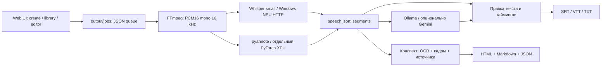

# Windows: фактическая архитектура и решение

## Sandbox harness, 19.10.2026

Последующее уточнение: Functional поддерживает явно разрешённый владельцем guest-only
SAC Off с единственным reboot и RunOnce/CLI resume; Security сохраняет стандартную
политику. Выбранные SAC mode и interaction входят в fingerprint. `Api` использует
реальные локальные API установленного приложения, отдельные порты в CI, настоящий
CPU worker и сохранённые результаты. Он не выдаётся за UI-проверку; `UI` остаётся
отдельным адаптером WinForms/WebView2. `verify_installed.py` проверяет версию/critical
hashes после EXE-install, запускается установленным Python и завершает собственные
процессы перед uninstall тестовой копии. Обычный Windows CI использует этот путь
без Sandbox и без изменения SAC на runner. Политики и состояние хоста не меняются.

`windows-app/sandbox/Run-Acceptance.ps1` создаёт frozen input, plan и `.wsb`
с официальным LogonCommand → guest bootstrap → DAG стадий → host reports.
Read-only input и отдельный проверенный read-only test cache не дают гостю доступа
к checkout/ключам; writable mapping ограничен каталогом отчётов данного запуска.
WebView2 уже готовит существующий installer. UI driver работает с установленным
WinForms/WebView2 через guest-only loopback CDP, с реальными pointer/form действиями;
API generation помечен отдельно как diagnostic. Формальные контракты стадий —
`stage-contracts.json`; применимость прежнего результата связывается с hashes
артефактов, harness, cache, Git SHA, ОС и профилем политики. Новый гость всегда
получает физическую подготовку, независимо от прежнего PASS.
Checkpoint идентифицирует экземпляр гостя, ограничивает resume двумя попытками
и не восстанавливает выдуманное состояние после уничтожения Sandbox.
Реальный Security профиль прошёл; Functional и UI/Ollama остаются BLOCKED
при недоступном подтверждённом SAC Evaluation/Audit. Подробнее:
[команды, кэш и границы проверки](../windows-app/sandbox/README.md).

## ADR-007: desktop preview 0.7, 18.10.2026

Дополнение 19.10.2026: installer проверяет WebView2 через официальный loader API и
наличие исполняемых файлов версии. При отсутствии рабочего Runtime скачивает
закреплённый официальный Fixed Version CAB (SHA256 + Authenticode Microsoft),
распаковывает в `windows-app/webview2-runtime` выбранной установки и повторяет проверку.
WinForms host передаёт этот путь в CreateAsync; при отсутствии app-local Runtime
использует обычное обнаружение Evergreen. Это позволяет поставить зависимость без
системного Edge Updater и изменения ACL/реестра. Fixed Runtime обслуживается обновлениями
нашего пакета; offline-повторный запуск не требует загрузки. Целевая проверка — Windows 11.
Фактические результаты отражаются отдельно в отчёте Sandbox 0.7, а не выводятся из кода.

Native launcher расширен WinForms/WebView2 окном и треем. Tauri 2 не введён:
готовые app.py, Python payload, locks, очередь и per-user installer позволяют добавить
только C# host без Rust и повторного управления сервисами. Ярлык → VideoDescriptor.exe →
desktop.py → прежний app.py → прежний UI/API. По умолчанию native backend без Docker;
Compose остаётся самостоятельным поддерживаемым путём.

Health дополнен installation/desktop_protocol; сверяются workspace и instance из state.
Mutex/activation event обеспечивают одно окно; прежний backend lock и exclusive Windows
bind обеспечивают один listener. Крестик скрывает в трей без stop; явный выход использует
прежний stop API с отказом при active queue. Внешние процессы не завершаются.
Host/Origin/Fetch-Site guard защищает весь native handler; WebView ограничен origin
приложения, native bridge отключён. Детали и границы проверки: [desktop](desktop-windows.md).

Дополнение 18.10.2026: добавлен независимый [Compose CPU путь](container-install.md).
Один Linux amd64 контейнер содержит HTTP и прежний subprocess-worker под supervisor.
Постоянный `/workspace` хранит uploads, output/queue, настройки и HF cache; код установлен
отдельно в образе. SIGTERM завершает группы HTTP/worker/обработчиков. Прерванные running
задания после старта получают error с сохранёнными checkpoints; queued продолжаются.
`VIDEO_DESCRIPTOR_MANAGED_WORKER=1` отключает дубли Popen из HTTP и idle-exit worker.
Вне контейнера прежняя схема запуска сохранена. Новые GET `/health` и `/api/diagnostics`
не зависят от native launcher; диагностика провайдеров не возвращает ключи/тела API-ошибок.
Нативный выбор устройств не заменяется контейнерным CPU: NPU доступен по существующему
HTTP-протоколу только при доступности Windows worker из сети контейнера.

Дата исследования: 16 октября 2026. Статусы: **код** — прочитано в исходниках,
**замер** — сохранённый опыт на этом ноутбуке, **план** — требует реализации/проверки.

Уточнение от 17 октября: обязательны Auto NPU → GPU → CPU для распознавания и
ручной выбор, отдельные capabilities для этапов, история действий и финальный
CI/CD с ZIP/Windows installer. Контракт и матрица тестов —
[ADR-003](device-policy-and-release.md). Ниже описан первый NPU-only прототип;
он ещё не реализует новый автовыбор.

## Существующий конвейер

| Граница | Контракт, запуск, хранение | Доказательство |
|---|---|---|
| UI/API | `python -m video_descriptor.serve`; порт 8000, старый default bind 0.0.0.0. `/create`, `/output/`, `/api/jobs`, `/api/job?id=...`, `/api/runs`. | `serve.py`, код. Native launcher ограничивает bind loopback. |
| Загрузка/очередь | `POST /api/upload?filename=...&mode=audio&engine=whisper-npu&speech_only=true&language=auto` с сырым телом файла; до 4 GiB. `POST /api/retry?id=...`; исходник в `data/uploads/<uuid>`, состояние `output/jobs/<uuid>/job.json`. | `serve.py`, `jobs.py`; uuid, video, engine, language, status, folder, timestamps. |
| Подготовка | FFprobe определяет длительность, FFmpeg извлекает PCM16 mono 16000 Hz. Общее аудио `output/speech-audio-<identity>/audio.wav`. | `media.py`, `speech.run`; ключ содержит абсолютный путь, размер и mtime. |
| ASR | `GET http://127.0.0.1:8766/health`; `POST /transcribe` — `audio/wav`, `X-Whisper-Model: small`, `X-Language: auto` или код; не больше 300 s / 10 MiB. | Windows `whisper_npu_server.py`; код и старые замеры. |
| ASR ответ | `{segments:[{start,end,text}], audio_seconds, seconds, engine:{protocol,device,model,multilingual,pipeline,num_beams,model_sha256,openvino,genai}}`; ошибки `{error}`. Таймкоды относительно отправленного WAV, offset восстанавливает клиент. | `speech_npu.py`, `whisper_http.py`; engine и duration сверяются. |
| NPU модель | OpenVINO/whisper-small-fp16-ov, FP16, static, beam=1, task=transcribe; около 493 MB, HF revision `2410d022171ca8a97343182f88eec8807a324db9`. Окружение и модель в `C:\Users\ivand\Downloads\windows-benchmark`. | `HANDOFF_WHISPER_SMALL_FRIGG.md`, замер: 41.11 s загрузка, 45.52/41.39 s на 900 s WAV. |
| VAD/checkpoint | Silero VAD через `faster_whisper.vad`, CPU; речевые диапазоны имеют исходные sample offsets. Блоки/запросы/ответы/параметры сохраняются отдельно. | `speech_npu.py`; музыка не равна цифровой тишине. |
| Диаризация | pyannote/speaker-diarization-community-1, `Pipeline.to(torch.device('xpu'))`, exclusive speaker turns → назначение репликам по перекрытию. `diarization.json`, measurement JSON, отдельная venv. | `speech.py`, `probe_diarization_xpu.py`. Segment timing не даёт точной смены человека внутри реплики. |
| Перевод | Windows Ollama 11434, `/api/tags`, `/api/chat`; выбираемая модель. В старом CLI очереди встречается жёстко заданная `qwen3.5:9b`. Gemini — отдельный opt-in по ключу/настройкам. | `notes.py`, `translate.py`, `construction.py`, `translation_settings.py`. Работа Qwen на NPU не предполагается. |
| Результат/правки | speech.json, words.json, transcript.json (`id/start/end/text`), translations.json (id→text), transcript-edits.json (отдельная правка/revision), speaker-names.json; конспекты и версии отдельно. | `speech.py`, `versions.py`, `editor.py`, `subtitles.py`. |
| Настройки/секреты | Исторически `.devcontainer/*settings.json`, `.env.gemini`, `.env.huggingface`; модели Hugging Face в cache volume/старых venv. | Сохранены, не опубликованы. Native sandbox не наследует секреты автоматически. |

В Windows `.venv-npu` сейчас: torch 2.14.1+cpu, XPU=false, pyannote отсутствует;
OpenVINO перечислил CPU/GPU/NPU. Это проверка доступности устройств, не новый ASR benchmark.

## ADR-001: нативный Windows runtime, Docker опционален

Выбор: нативный координатор/UI и NPU-сервис; существующий Ollama остаётся внешним.
Для первого прототипа не требуются Docker, WSL, права администратора или переустановка
драйверов. Требуются установленный Python, драйвер NPU и уже существующая модель/служба.
Это **не полностью переносимый пакет** и пока не финальный installer.

Основания:

- [Docker GPU guide](https://docs.docker.com/desktop/features/gpu/) описывает NVIDIA GPU-PV/WSL2.
  Это не свидетельство поддержки Intel NPU.
- [OpenVINO accelerator guide](https://docs.openvino.ai/2026/model-server/ovms_docs_target_devices.html)
  отдельно показывает Intel GPU через `/dev/dxg` и `/usr/lib/wsl`. Такой GPU-контейнер
  технически возможен, но не даёт автоматического доступа к NPU или pyannote/XPU.
- [WSL request](https://github.com/microsoft/WSL/issues/40842) и
  [Intel NPU request](https://github.com/intel/linux-npu-driver/issues/56) остаются открытыми.
  Это отчёты о недостающем доступе, а не универсальный запрет всех будущих версий;
  поддержанный NPU-путь контейнера на этой машине не установлен.
- [OpenVINO requirements](https://docs.openvino.ai/2026/about-openvino/release-notes-openvino/system-requirements.html)
  требуют подходящей ОС/драйверов. Работа Windows NPU уже измерена локально.
- [PyTorch XPU](https://github.com/pytorch/pytorch/blob/main/docs/source/notes/get_start_xpu.md)
  включает Windows 11/Lunar Lake. Поддержка PyTorch не гарантирует все операции pyannote;
  нужен отдельный probe с реальным аудио и сравнение с CPU.
- [Docker Windows install](https://docs.docker.com/desktop/setup/install/windows-install/) и
  [WSL backend](https://docs.docker.com/desktop/features/wsl/) добавляют системные требования,
  виртуализацию и возможную перезагрузку. Для данного первого режима это лишний шаг.
- [Docker Desktop terms](https://docs.docker.com/subscription-billing/desktop-license/):
  бесплатно для личного использования и ряда других случаев, для малого бизнеса
  пороги одновременно <250 сотрудников и <$10M оборота; крупным организациям/госсектору
  может требоваться подписка. Условия проверять перед распространением в организации.

Compose можно предложить позже как дополнительный серверный профиль API/UI/очереди,
с внешними Windows NPU/Ollama. Для одного пользователя не вводим PostgreSQL/Redis.

## ADR-002: первый интерфейс и границы прототипа

| Вариант | Что получает пользователь | Стоимость/ограничения |
|---|---|---|
| Локальный web UI + Windows ярлык | Уже существующий интерфейс, drop/file picker, очередь, прогресс, плеер, редактор, экспорт; браузер открывается сам | Самый короткий путь; сервер только 127.0.0.1. PWA/service worker не нужен для доступа к локальному runtime. |
| Tauri/WebView2 или небольшая desktop-оболочка | Отдельное окно, taskbar/tray, файловые диалоги | Дополнительные сборка, runtime, подпись, updater и lifecycle; оболочка не решает совместимость ML. |

Выбран первый вариант. Внешний вид и сценарий можно улучшать без замены обработчиков.
Прототип хранится в `windows-app/`, использует существующий Python package с небольшими
изменениями совместимости. Его `runtime/workspace/{data,output,.devcontainer}` изолирован:
старые задания не подхватываются и Linux-пути не переписываются автоматически.

План: зафиксировать исследование → минимальные Windows adapters/launcher → SRT и
правка границ → реальные короткий/длинный прогоны → отчёт проверок → commit.
GPU-диаризация, clean-machine installer, desktop shell и перенос исторического кэша —
отдельные этапы. Предварительная оценка полного Windows MVP: 2–4 рабочих дня,
с отдельным риском совместимости XPU. Это не обещание завершить всё в одном прототипе.

## Установка, обновление и сохранность данных

1. Preflight: Python/архитектура ОС, CPU/RAM/свободное место, доступность ffmpeg/ffprobe,
   драйвер/health NPU, URL/model Ollama. Не объявлять отсутствие pyannote ошибкой обычного ASR.
2. Только отдельная `.venv-windows`; pip-зависимости приложения, без системной установки.
   NPU `.venv-npu` не менять. Драйверы/WSL/Docker и большие модели — только после согласования.
3. Версии dependencies фиксировать после проверенного запуска. Для скачиваемых бинарников
   и моделей — manifest с size, SHA256, source/revision; показать размер до скачивания,
   писать `.partial`, проверять checksum, переименовывать атомарно. Прототип модели не скачивает.
4. Code, runtime data, logs, модели — отдельные каталоги. Импорт моделей по пути,
   без копирования гигабайтов и без автоматического удаления общего HF/Ollama cache.
5. Readiness: идентичность NPU, а не только открытый порт. Проверять имя приложения/root
   перед повторным открытием; lock не допускает вторую очередь. Чужой занятый порт — ошибка.
6. Обновление: сохранить config/data, остановить только собственный UI в idle,
   новая venv/версия кода, health-check, переключение ярлыка; предыдущую версию сохранить.
   Не делать `git pull`/миграцию схем во время обработки. Это проект installer, не текущий updater.
7. Остановка UI не должна убивать внешний NPU/Ollama. При активной обработке отказать
   в штатной остановке; после аварии job явно error, завершённые chunks доступны retry.
8. Удаление: убрать ярлык/код/venv, пользовательский runtime и модели оставить до отдельного
   явного выбора. Откат основного проекта — сохранённый WSL checkout.
9. Логи и диагностика локальны; секреты/видео/модели не коммитить и не включать в общий bug report.

## Важные нерешённые вопросы

- Перенос абсолютных Linux-путей/identity делать явной утилитой с backup, dry-run и
  проверкой содержимого, а не массовой заменой JSON.
- В новом UI выбор auto/RU/UK/EN передаётся в NPU-запрос; смена языка отклоняет
  старый кэш. Отдельные качественные EN/UK/mixed-language испытания ещё не выполнены.
- `end_ts=-1` означает отсутствующую границу. Не обрезать её до длительности файла;
  при неисправимом блоке сохранять diagnostics и выдавать понятную ошибку/needs_review.
- Для нового публичного релиза нужны лицензия самого проекта и полный third-party notice
  (OpenVINO, Whisper, pyannote model CC-BY-4.0, Ollama/Qwen, FFmpeg и прочие зависимости).
- Энергопотребление, точность и преимущество NPU относительно Vibe/Buzz не измерены.

## Реализованный прототип и эксплуатационные границы

`windows-app/app.py` → существующий `RangeRequestHandler`, порт 8780/loopback.
Новый стартовый UI использует те же `/api/upload`, `/api/speech`, `/api/retry`,
`/api/speech-edit`, `/api/subtitles` и не вводит второй конвейер распознавания.
`/health` возвращает app/version/instance/workspace; `/api/doctor` проверяет зависимости
и внешние сервисы без загрузки моделей. Для управляемого NPU-старта и остановки UI —
`POST /api/native/start-npu` и `/api/native/stop` с instance header и same-origin проверкой.
Эти endpoints не принимают произвольные команды/пути от web-страницы.

Нативная блокировка использует msvcrt, Unix-профиль сохраняет fcntl; Windows process
inspection — psutil. Межпроцессная блокировка очереди не даёт обработать одно задание
двумя workers. После простоя worker выходит, повторная загрузка запускает новый.
FFmpeg берётся из PATH/явной переменной или pinned imageio-ffmpeg, контейнерный PATH
не нужен. При отсутствии ffprobe probe делает уже имеющийся PyAV.

Расширение export API: `format=srt|vtt` (default vtt), язык original/ru.
Правка `action=edit` принимает опциональные числовые start/end, проверяет конечность,
порядок и длительность; ID сохраняется, сырые результаты не меняются.
Native speech-only результаты получают стабильные IDs `s00001...`; в SRT остаётся
стандартная нумерация cues. Неисправимые временные метки не подменяются.

Реальные прогоны 20/900 s и тишины, результаты, UI-проверки и честные ограничения:
[отчёт](verification-windows.md), [машиночитаемая сводка](verification-windows.json).
Окружение приложения устанавливается отдельно, не затрагивая NPU venv; clean-machine
installer/updater, полный SBOM и автоматическая миграция истории остаются планом.
CPU/GPU probe и маршрутизация речи добавлены ниже в версии 0.3.

## Прототип 0.3: устройства, восстановление и журнал

UI → `ComputeManager` → `device_policy` → проверка реального worker/model profile.
Порядок Auto фиксирован: NPU → GPU → CPU. `available` означает обнаруженные runtime,
модель и устройство; `ready` требует успешного `/health` с совпадением профиля.
Ошибка подготовки в Auto ведёт к следующему кандидату; ручной выбор возвращает ошибку.
Это правило относится к Whisper; диаризация и LLM сохраняют отдельные требования.

- `GET /api/compute-settings`: настройка, capabilities, выбранный вариант, loading/error.
- `POST /api/compute-settings`: только `speech_device=AUTO|NPU|GPU|CPU`, JSON ≤1 KiB.
  Файл: `runtime/workspace/.devcontainer/compute-settings.json`.
- `POST /api/native/prepare`: фоновая загрузка выбранной модели, same-origin и instance token.
- `POST /api/upload?engine=whisper-local&device=...`: сервер создаёт доверенный device plan,
  сохраняет его в job до запуска очереди; команды/пути worker не принимаются от браузера.
- `GET /api/native/events`: последние 80 событий, чтение ограничено 128 KiB.

Worker NPU остаётся внешним сервисом на 8766, профиль small FP16/static/beam 1.
Новые CPU/GPU workers (`windows-app/whisper_worker.py`) — отдельные процессы на 8767/8768,
small FP16/dynamic/beam 1, те же веса без копирования/скачивания. Они используют существующий
OpenVINO Python для этой машины; `openvino_python` и `whisper_model_directory` позволяют
задать независимый runtime/модель для CPU/GPU. Пустые значения используют уже установленное
окружение benchmark. Его пакеты, оригинальный NPU script и веса не изменяются.
Загрузка защищена межпроцессным lock; PID с временем создания сохраняется, чтобы повтор
после timeout/перезапуска UI не запустил вторую компиляцию. Timeout не убивает worker.
Запуск на порту чужого сервиса отклоняется. Workers используют loopback без proxy.

`speech_devices.py` кэширует VAD и каждый завершённый речевой фрагмент по исходным offsets.
`device-state.json` содержит identity аудио/языка/начального профиля, активный backend,
профили реально использованных устройств и переходы. Ответ каждого фрагмента хранит
engine/model digest/версии. При ConnectionError/Timeout или runtime 5xx Auto повторяет
только незавершённый фрагмент на следующем устройстве. Готовые не пересылаются.
Требуется тот же model digest; изменение pinned профиля требует новой версии речи.
Ошибки таймингов (`end_ts=-1`), качества или identity не маскируются сменой устройства.
Невалидные данные сохраняются отдельно и не признаются завершённым checkpoint.
Job публикует имя результата после записи manifest: опрос прогресса не должен получать
несуществующую папку во время подготовки аудио.

Общий журнал `runtime/logs/events.jsonl` использует UTC, ID события и межпроцессный lock.
В нём выбор/загрузка/отказ/переход, настройка, этапы job, retry, правка и экспорт.
Поля ограничены белым списком: текст речи, токены, тела запросов сюда не попадают.
Полные локальные диагностические ответы остаются в папках результатов, вне Git.
Это отдельный журнал от истории разработки в README/Git.

Проверки и известные ограничения: [прогоны устройств](verification-devices.md).

## ADR-004: упаковка 0.4 и границы установки

Выбран CPython embeddable x64 + vendored wheel payload вместо переноса venv с абсолютными
путями. `python312._pth` задаёт только stdlib, site-packages и каталог приложения;
дочерние queue/speech workers используют этот же interpreter независимо от системного PATH.
Launch script предпочитает bundled Python, а для исходников сохраняет `.venv-windows`.
CPU/GPU/NPU adapter может использовать bundled OpenVINO, существующий внешний NPU остаётся
приоритетным при наличии benchmark. Веса подключаются отдельно, автоматически не скачиваются.
CPU/GPU URL теперь тоже настраиваются и валидируются как loopback: тестовая копия не должна
обнаруживать рабочие сервисы другой установки на стандартных портах.

Build получает только явный список исходников и reviewed wheel/hash inputs. Пакет
содержит file manifest, dependency notices и Python LICENSE; Git/медиа/личные настройки/
runtime/большие модели исключены. Маленький VAD ONNX остаётся частью faster-whisper.
ZIP метаданные нормализованы. EXE строится Inno Setup 6.7.3, installer запускается per-user,
не ставит системный Python/драйверы и не меняет PATH. Наш EXE пока не подписан.

`runtime/` и `config.local.json` создаются пользователем после установки, не входят в
installer file table и остаются после uninstall. Обновление меняет code/runtime binaries
только после отказа при процессах из каталога установки; чужие внешние сервисы не убиваются.
Windows Restart Manager auto-close выключен. Встроенного updater/автомиграции схем нет.
Upgrade 0.4.0 → 0.4.1 в проверках — fixture installer lifecycle, не новый продуктовый release.

CI Windows runner строит artifacts и проверяет install/reinstall/upgrade/uninstall,
сохранность sentinel/config, отказ занятой установки и повторяемость ZIP. Реальные
аппаратные тесты и минимальная чистая Windows VM — отдельные уровни. Локальная проверка
на этом ноутбуке не означает, что hosted workflow уже прошёл. Коммиты не отправляются сами.
Детали, входные hashes, команды и ограничения: [Windows release](windows-release.md).

## Проверочный хост Windows Sandbox

`Prepare-Sandbox.ps1` создаёт отдельный `runtime/sandbox/<run-id>`: копирует только
проверенные по SHA256 ZIP/EXE, verification script и bootstrap. WSB получает 4096 MiB,
отключённые network/vGPU/audio/video/clipboard/printer и две mapped folders: input
read-only, reports writeable. Исходный checkout, модели, ключи и рабочие данные не шарятся.
Guest bootstrap распаковывает runtime внутрь гостя и запускает существующий lifecycle
verifier на ZIP/installer; stdout/stderr/status/JSON пишутся в папку reports хоста.
Это проверка установки/безмодельного запуска, а не доказательство NPU/GPU совместимости.

Включение `Containers-DisposableClientVM -All -NoRestart` идёт отдельным elevated helper
после явного согласия пользователя. Статус сохраняется на хосте; требование reboot
не выполняется автоматически. Sandbox не запускается до готовности компонента.
Гость запускается по WSB, не меняет основной app на 8780 и внешние workers.
Подготовка WSB, успешное включение и прошедший guest run — три разных состояния.
Bootstrap публикует preparing до распаковки, использует уникальную временную папку
и named mutex вместе с проверкой уже работающего verifier. Повторный конкурентный
старт не должен перезаписывать статус или запускать вторую установку. Первый реальный
guest run после reboot проверен отдельно от хостового smoke; результаты не распространяются
на NPU/GPU и минимальную независимую Windows VM. Для наблюдения доступен официальный wsb CLI.
Инструкция и сохранность отчётов: [Windows Sandbox](windows-sandbox.md).

## Мастер первого запуска: существующая модель

UI использует GET `/api/setup` и POST `/api/setup/pick-model`, `/api/setup/inspect`,
`/api/setup/model`. POST требует токен экземпляра и проверку Origin; тело ограничено
4096 байтами. Выбор папки — стандартный WinForms dialog отдельного PowerShell STA,
без подстановки пользовательского пути в исполняемый код. Допустим абсолютный локальный путь.

SetupService проверяет 13 обязательных файлов, конфигурацию multilingual small и
engine SHA256 XML/BIN/JSON из component-manifest. Проверка и импорт не скачивают,
не копируют и не изменяют веса. Импорт атомарно обновляет только путь/digest в
config.local.json, сохраняя прочие поля, и обновляет ComputeManager в памяти.
Повреждённые настройки не перезаписываются. Подготовка и queued/running задания
блокируют импорт; существующие планы заданий остаются самостоятельными снимками.

При другом расположении модели NPU использует встроенный adapter; исходный benchmark
сохраняется для своего исходного пути. Backend после настройки сравнивает health digest
с выбранным, поэтому чужой worker на том же порту не принимается как готовый.
Импорт пишет model_configured без текста/секретов в журнал действий. Проверка наличия
при открытии UI лёгкая; реальная SHA256 проверяется по действию пользователя и worker.
Мастер ограничен проверенным профилем; загрузка весов и выбор каталога данных остаются
следующими задачами. Собранные ранее артефакты 0.4 этот код ещё не содержат.

### Подключение существующей Ollama

GET `/api/setup/ollama` получает локальный `/api/tags`, возвращает имена/размеры,
выбранную модель и отдельно service_ready/ready. Диагностика использует тот же
контракт: доступность HTTP-сервиса без выбранной модели не означает готовность.
Запросы к loopback не используют системный HTTP proxy, timeout — 5 секунд.

POST `/api/setup/ollama` защищён токеном экземпляра/Origin и общим лимитом JSON.
Выбор разрешён только среди установленных моделей; `/api/show` обязан сообщить
capability completion. Настройка сохраняется через существующий translation_settings
в workspace/.devcontainer/translation-settings.json, поэтому перевод и расширенный
редактор читают тот же выбор. Прочие поля, включая облачный ключ, сохраняются;
ответ настройки и журнал translation_model_configured не содержат ключей.
Конструктор конспекта сохраняет независимый выбор модели. Настройка не запускает,
не останавливает и не устанавливает Ollama, не скачивает веса и не доказывает успешную
генерацию. На хосте через UI выбрана qwen3.5:9b; полный прогон перевода/конспекта
из установленной поставки остаётся отдельной приёмкой.

### Контроль полного speech-only сценария в 0.5

Перевод передаёт в запрос именно active_model/active_base из настроек, а не CLI fallback.
При пропущенном блоке возвращается exit code 1 при сохранении успешно переведённых
блоков и translation-errors.json. Отсутствие frames.json допустимо при обновлении
speech-only отчёта; transcript.json остаётся обязательным.

verify_language_workflow.py — opt-in проверка на реальном Windows host с уже
установленными весами. Временная копия ZIP с Unicode/пробелами запускает bundled
Python, подключает модель через setup API, делает CPU ASR, создаёт отдельную версию
конспекта через очередь, переводит bundled CLI, проверяет полноту перевода/notes/
chapters/report и русский SRT. Это не чистая VM и не OCR/NPU проверка. Завершение
затрагивает только Python-процессы этой временной копии; внешняя Ollama сохраняется.

## Основной UI: конспект и перевод через очередь в 0.6

POST `/api/native/postprocess` принимает `{folder, task}`: translate или notes
(конспект вместе с переводом). Требует instance token и Origin-проверку, лимит 4096 байт.
Сервер выбирает текущую установленную Ollama-модель, проверяет completion и фиксирует
её имя и loopback base URL в job.json. Параметр модели из клиентского JSON не используется.

postprocess.enqueue создаёт processed-UUID из готовой речи с текущими правками и
исходными ID/таймкодами. Пишет канонические speech/transcript/manifest и frames=[];
старые переводы не копируются в новую версию. Исходные результаты и правки сохраняются.
Публикация job.json происходит последней; межпроцессная блокировка и проверка активных
заданий этого видео защищают от конкурентного запуска. Задания без речи отклоняются.

Worker обрабатывает mode=postprocess без ASR/FFmpeg. Для notes запускает существующий
construction, затем translate; для translate — только translate. Стадия и ошибки
сохраняются в job.json. `--local-model` закрепляет local provider/model независимо от
последующих настроек, а `--base-url` — сервис. Retry использует ту же версию/модель и
сохранённые блоки; готовый конспект остаётся при ошибке перевода. В истории есть start/
finish/failure с типом этапа. API состояния речи теперь принимает и notes/postprocess
для навигации из общего списка, не выдаёт ложное 404 для заданий конспекта.

UI показывает этап очереди, отдельную версию, переведённые реплики, русский SRT и
ссылку на конспект; при обработке прогресс неопределённый. Режим конспекта здесь
speech-only. Конструктор слайдов/OCR остаётся расширенной возможностью.

## Мастер AI, 18.10.2026

Расширен прежний `SetupService`, новый supervisor не добавлен. `ComputeManager`
сохраняет runtime inventory, health/profile проверки и запуск собственных workers.
Его lock/reservation разделяют загрузку, probe, смену модели и постановку ASR в очередь.
Windows PnP — отдельное read-only обнаружение: наличие устройства не даёт readiness.

Защищённые instance/Host/Origin POST API `/api/setup/download`, `/probe`, `/complete`,
`/refresh`, `/gemini` дополняют прежние import/inspect/Ollama API. Download требует
`confirmed: true`; адреса и имена файлов берутся только из поставляемого манифеста.
GET `/api/setup` возвращает прогресс без запуска inference; `/api/setup/diagnostics`
возвращает отдельные возможности. Короткий probe принимает только WAV до 15 секунд.
`POST /api/setup/probe` с JSON `{}` использует поставляемый
`windows-app/samples/speech-check.wav`; бинарное тело сохраняет выбор собственного
WAV. Частота, каналы, разрядность и длительность проверяются с отдельными пояснениями.
Ни конвертации, ни обрезки нет. WAV и MP4 с синтетической речью включены в явный
allowlist сборки, поэтому доступны и после установки, и в ZIP без скачивания.

Один `model_download.py` реализует pinned Whisper, per-file SHA256, bounded streaming,
повтор с проверенными файлами и атомарную публикацию. Настройки по-прежнему находятся
в `config.local.json` и workspace `.devcontainer`; notes selection в `notes-settings.json`.
Завершение мастера — `runtime/setup-state.json`. Installer сохраняет runtime и настройки.
Сохранение Gemini через существующий translation_settings на Windows шифрует ключ DPAPI;
public API возвращает только `has_key`. Модели не входят в installer. Подробности и
границы проверок: [мастер](ai-setup-windows.md).
