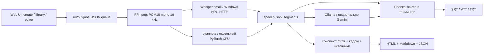

# Windows: фактическая архитектура и решение

Дата исследования: 16 октября 2026. Статусы: **код** — прочитано в исходниках,
**замер** — сохранённый опыт на этом ноутбуке, **план** — требует реализации/проверки.

## Существующий конвейер

| Граница | Контракт, запуск, хранение | Доказательство |
|---|---|---|
| UI/API | `python -m video_descriptor.serve`; порт 8000, старый default bind 0.0.0.0. `/create`, `/output/`, `/api/jobs`, `/api/job?id=...`, `/api/runs`. | `serve.py`, код. Native launcher ограничивает bind loopback. |
| Загрузка/очередь | `POST /api/upload?filename=...&mode=audio&engine=whisper-npu&speech_only=true&language=auto` с сырым телом файла; до 4 GiB. `POST /api/retry?id=...`; исходник в `data/uploads/<uuid>`, состояние `output/jobs/<uuid>/job.json`. | `serve.py`, `jobs.py`; uuid, video, engine, language, status, folder, timestamps. |
| Подготовка | FFprobe определяет длительность, FFmpeg извлекает PCM16 mono 16000 Hz. Общее аудио `output/speech-audio-<identity>/audio.wav`. | `media.py`, `speech.run`; ключ содержит абсолютный путь, размер и mtime. |
| ASR | `GET http://127.0.0.1:8766/health`; `POST /transcribe` — `audio/wav`, `X-Whisper-Model: small`, `X-Language: auto` или код; не больше 300 s / 10 MiB. | Windows `whisper_npu_server.py`; код и старые замеры. |
| ASR ответ | `{segments:[{start,end,text}], audio_seconds, seconds, engine:{protocol,device,model,multilingual,pipeline,num_beams,model_sha256,openvino,genai}}`; ошибки `{error}`. Таймкоды относительно отправленного WAV, offset восстанавливает клиент. | `speech_npu.py`, `whisper_http.py`; engine и duration сверяются. |
| NPU модель | OpenVINO/whisper-small-fp16-ov, FP16, static, beam=1, task=transcribe; около 493 MB, HF revision `2410d022171ca8a97343182f88eec8807a324db9`. Окружение и модель в `C:\Users\ivand\Downloads\windows-benchmark`. | `HANDOFF_WHISPER_SMALL_FRIGG.md`, замер: 41.11 s загрузка, 45.52/41.39 s на 900 s WAV. |
| VAD/checkpoint | Silero VAD через `faster_whisper.vad`, CPU; речевые диапазоны имеют исходные sample offsets. Блоки/запросы/ответы/параметры сохраняются отдельно. | `speech_npu.py`; музыка не равна цифровой тишине. |
| Диаризация | pyannote/speaker-diarization-community-1, `Pipeline.to(torch.device('xpu'))`, exclusive speaker turns → назначение репликам по перекрытию. `diarization.json`, measurement JSON, отдельная venv. | `speech.py`, `probe_diarization_xpu.py`. Segment timing не даёт точной смены человека внутри реплики. |
| Перевод | Windows Ollama 11434, `/api/tags`, `/api/chat`; выбираемая модель. В старом CLI очереди встречается жёстко заданная `qwen3.5:9b`. Gemini — отдельный opt-in по ключу/настройкам. | `notes.py`, `translate.py`, `construction.py`, `translation_settings.py`. Работа Qwen на NPU не предполагается. |
| Результат/правки | speech.json, words.json, transcript.json (`id/start/end/text`), translations.json (id→text), transcript-edits.json (отдельная правка/revision), speaker-names.json; конспекты и версии отдельно. | `speech.py`, `versions.py`, `editor.py`, `subtitles.py`. |
| Настройки/секреты | Исторически `.devcontainer/*settings.json`, `.env.gemini`, `.env.huggingface`; модели Hugging Face в cache volume/старых venv. | Сохранены, не опубликованы. Native sandbox не наследует секреты автоматически. |

В Windows `.venv-npu` сейчас: torch 2.14.1+cpu, XPU=false, pyannote отсутствует;
OpenVINO перечислил CPU/GPU/NPU. Это проверка доступности устройств, не новый ASR benchmark.

## ADR-001: нативный Windows runtime, Docker опционален

Выбор: нативный координатор/UI и NPU-сервис; существующий Ollama остаётся внешним.
Для первого прототипа не требуются Docker, WSL, права администратора или переустановка
драйверов. Требуются установленный Python, драйвер NPU и уже существующая модель/служба.
Это **не полностью переносимый пакет** и пока не финальный installer.

Основания:

- [Docker GPU guide](https://docs.docker.com/desktop/features/gpu/) описывает NVIDIA GPU-PV/WSL2.
  Это не свидетельство поддержки Intel NPU.
- [OpenVINO accelerator guide](https://docs.openvino.ai/2026/model-server/ovms_docs_target_devices.html)
  отдельно показывает Intel GPU через `/dev/dxg` и `/usr/lib/wsl`. Такой GPU-контейнер
  технически возможен, но не даёт автоматического доступа к NPU или pyannote/XPU.
- [WSL request](https://github.com/microsoft/WSL/issues/40842) и
  [Intel NPU request](https://github.com/intel/linux-npu-driver/issues/56) остаются открытыми.
  Это отчёты о недостающем доступе, а не универсальный запрет всех будущих версий;
  поддержанный NPU-путь контейнера на этой машине не установлен.
- [OpenVINO requirements](https://docs.openvino.ai/2026/about-openvino/release-notes-openvino/system-requirements.html)
  требуют подходящей ОС/драйверов. Работа Windows NPU уже измерена локально.
- [PyTorch XPU](https://github.com/pytorch/pytorch/blob/main/docs/source/notes/get_start_xpu.md)
  включает Windows 11/Lunar Lake. Поддержка PyTorch не гарантирует все операции pyannote;
  нужен отдельный probe с реальным аудио и сравнение с CPU.
- [Docker Windows install](https://docs.docker.com/desktop/setup/install/windows-install/) и
  [WSL backend](https://docs.docker.com/desktop/features/wsl/) добавляют системные требования,
  виртуализацию и возможную перезагрузку. Для данного первого режима это лишний шаг.
- [Docker Desktop terms](https://docs.docker.com/subscription-billing/desktop-license/):
  бесплатно для личного использования и ряда других случаев, для малого бизнеса
  пороги одновременно <250 сотрудников и <$10M оборота; крупным организациям/госсектору
  может требоваться подписка. Условия проверять перед распространением в организации.

Compose можно предложить позже как дополнительный серверный профиль API/UI/очереди,
с внешними Windows NPU/Ollama. Для одного пользователя не вводим PostgreSQL/Redis.

## ADR-002: первый интерфейс и границы прототипа

| Вариант | Что получает пользователь | Стоимость/ограничения |
|---|---|---|
| Локальный web UI + Windows ярлык | Уже существующий интерфейс, drop/file picker, очередь, прогресс, плеер, редактор, экспорт; браузер открывается сам | Самый короткий путь; сервер только 127.0.0.1. PWA/service worker не нужен для доступа к локальному runtime. |
| Tauri/WebView2 или небольшая desktop-оболочка | Отдельное окно, taskbar/tray, файловые диалоги | Дополнительные сборка, runtime, подпись, updater и lifecycle; оболочка не решает совместимость ML. |

Выбран первый вариант. Внешний вид и сценарий можно улучшать без замены обработчиков.
Прототип хранится в `windows-app/`, использует существующий Python package с небольшими
изменениями совместимости. Его `runtime/workspace/{data,output,.devcontainer}` изолирован:
старые задания не подхватываются и Linux-пути не переписываются автоматически.

План: зафиксировать исследование → минимальные Windows adapters/launcher → SRT и
правка границ → реальные короткий/длинный прогоны → отчёт проверок → commit.
GPU-диаризация, clean-machine installer, desktop shell и перенос исторического кэша —
отдельные этапы. Предварительная оценка полного Windows MVP: 2–4 рабочих дня,
с отдельным риском совместимости XPU. Это не обещание завершить всё в одном прототипе.

## Установка, обновление и сохранность данных

1. Preflight: Python/архитектура ОС, CPU/RAM/свободное место, доступность ffmpeg/ffprobe,
   драйвер/health NPU, URL/model Ollama. Не объявлять отсутствие pyannote ошибкой обычного ASR.
2. Только отдельная `.venv-windows`; pip-зависимости приложения, без системной установки.
   NPU `.venv-npu` не менять. Драйверы/WSL/Docker и большие модели — только после согласования.
3. Версии dependencies фиксировать после проверенного запуска. Для скачиваемых бинарников
   и моделей — manifest с size, SHA256, source/revision; показать размер до скачивания,
   писать `.partial`, проверять checksum, переименовывать атомарно. Прототип модели не скачивает.
4. Code, runtime data, logs, модели — отдельные каталоги. Импорт моделей по пути,
   без копирования гигабайтов и без автоматического удаления общего HF/Ollama cache.
5. Readiness: идентичность NPU, а не только открытый порт. Проверять имя приложения/root
   перед повторным открытием; lock не допускает вторую очередь. Чужой занятый порт — ошибка.
6. Обновление: сохранить config/data, остановить только собственный UI в idle,
   новая venv/версия кода, health-check, переключение ярлыка; предыдущую версию сохранить.
   Не делать `git pull`/миграцию схем во время обработки. Это проект installer, не текущий updater.
7. Остановка UI не должна убивать внешний NPU/Ollama. При активной обработке отказать
   в штатной остановке; после аварии job явно error, завершённые chunks доступны retry.
8. Удаление: убрать ярлык/код/venv, пользовательский runtime и модели оставить до отдельного
   явного выбора. Откат основного проекта — сохранённый WSL checkout.
9. Логи и диагностика локальны; секреты/видео/модели не коммитить и не включать в общий bug report.

## Важные нерешённые вопросы

- Перенос абсолютных Linux-путей/identity делать явной утилитой с backup, dry-run и
  проверкой содержимого, а не массовой заменой JSON.
- В новом UI выбор auto/RU/UK/EN передаётся в NPU-запрос; смена языка отклоняет
  старый кэш. Отдельные качественные EN/UK/mixed-language испытания ещё не выполнены.
- `end_ts=-1` означает отсутствующую границу. Не обрезать её до длительности файла;
  при неисправимом блоке сохранять diagnostics и выдавать понятную ошибку/needs_review.
- Для нового публичного релиза нужны лицензия самого проекта и полный third-party notice
  (OpenVINO, Whisper, pyannote model CC-BY-4.0, Ollama/Qwen, FFmpeg и прочие зависимости).
- Энергопотребление, точность и преимущество NPU относительно Vibe/Buzz не измерены.

## Реализованный прототип и эксплуатационные границы

`windows-app/app.py` → существующий `RangeRequestHandler`, порт 8780/loopback.
Новый стартовый UI использует те же `/api/upload`, `/api/speech`, `/api/retry`,
`/api/speech-edit`, `/api/subtitles` и не вводит второй конвейер распознавания.
`/health` возвращает app/version/instance/workspace; `/api/doctor` проверяет зависимости
и внешние сервисы без загрузки моделей. Для управляемого NPU-старта и остановки UI —
`POST /api/native/start-npu` и `/api/native/stop` с instance header и same-origin проверкой.
Эти endpoints не принимают произвольные команды/пути от web-страницы.

Нативная блокировка использует msvcrt, Unix-профиль сохраняет fcntl; Windows process
inspection — psutil. Межпроцессная блокировка очереди не даёт обработать одно задание
двумя workers. После простоя worker выходит, повторная загрузка запускает новый.
FFmpeg берётся из PATH/явной переменной или pinned imageio-ffmpeg, контейнерный PATH
не нужен. При отсутствии ffprobe probe делает уже имеющийся PyAV.

Расширение export API: `format=srt|vtt` (default vtt), язык original/ru.
Правка `action=edit` принимает опциональные числовые start/end, проверяет конечность,
порядок и длительность; ID сохраняется, сырые результаты не меняются.
Native speech-only результаты получают стабильные IDs `s00001...`; в SRT остаётся
стандартная нумерация cues. Неисправимые временные метки не подменяются.

Реальные прогоны 20/900 s и тишины, результаты, UI-проверки и честные ограничения:
[отчёт](verification-windows.md), [машиночитаемая сводка](verification-windows.json).
Окружение приложения устанавливается отдельно, не затрагивая NPU venv; clean-machine
installer/updater, GPU probe, полный SBOM и автоматическая миграция истории остаются планом.
