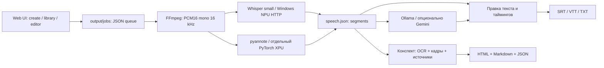

# Windows: фактическая архитектура и решение

10.11.2026: workspace имеет вкладки Конспект/Статья над единым редактором. `recording.js` сохраняет независимые selectedReports и активный kind; query `material=notes|article` сохраняет вид без нового endpoint/запуска задания. `studioUI.chooseIndependentReport(null)` теперь явно означает отсутствие материала, без fallback к конспекту другой вкладки; dirty editor не очищается и блокирует переключение. Frame/revisions/Undo, API генерации, распознавание и выбранная речь сохранены.

10.11.2026: контракт CI разделён по решению владельца. Release Full Acceptance проверяет штатные installed API/worker/UI/результаты и реальный CPU Whisper; только внешний LLM HTTP endpoint заменяется disposable loopback fixture со streaming Ollama protocol. Mock не включается в production configuration и не является доказательством inference/качества модели. Negative case сохраняет ошибочный ответ и неизменённую исходную речь. Независимый manual model-behavior.yml выполняет реальную генерацию на версионированном synthetic corpus (Ollama; CLI также поддерживает существующий LM Studio), фиксирует identity/хеш промпта/case/result и не публикует артефакты продукта. См. model-behavior.md.

09.11.2026: Windows 0.8.34 — успешная проверка диаризации сохраняется между запусками и UI-обновлениями. Готовность привязана к модели, Python/метаданным пакетов, lock-файлу, worker и устройству/драйверу; отсутствие proof не выдаётся за готовность. При неизменных входах не запускать повторный inference и не требовать Hugging Face, токен или ручную проверку. Доступ HF показывать только для необходимой загрузки модели. Ошибка проверки сбрасывает кеш.

Обязательное правило журналирования (09.11.2026): все изменяющие API-операции автоматически проходят общий HTTP audit; worker, взаимодействие с моделью, проверка и сохранение результата вызывают video_descriptor.action_history.record — единую точку структурированной записи. Фиксировать начало, успешный результат и ошибку; сохранять operation/job/request id, этап и статус. Не писать ключи, credentials, тела запросов, промпты и расшифровку в общий журнал. Общий журнал задаётся VIDEO_DESCRIPTOR_EVENTS (Windows: application_log_directory или runtime/logs/events.jsonl), события записи — рядом с её артефактами. Общий файл находится вне переносимой папки записей, чтобы журналирование не нарушало проверку её контрольных сумм. Новый endpoint/фоновая операция проверяются на наличие событий и видимость в UI; отдельный logger вместо общего механизма не допускается. Legacy run.log/construction.log остаются диагностическими дополнениями.

09.11.2026: штатный локальный preview после merge main: post-merge запускает installer в фоне, затем Run-Dev.ps1 -Restart -Open открывает код main в браузере. Конфигурация/статус и два перезаписываемых лога — .git/local-dev; порт отдельный, records_directory общий с установленным приложением. Guard проверяет development/instance/installation/workspace; активная очередь не прерывается. Модели и системные компоненты не устанавливаются. UI показывает версию и коммит.

09.11.2026: Windows 0.8.33 — восстановление конспекта показывает все ошибки меток с разделом/строкой, точным переходом и подтверждёнными кандидатами с текстом речи. POST construction-recovery action=validate проверяет черновик без записи/запуска worker; revision guards сохранены. Замены выбирает пользователь; исходный ответ модели не меняется.

09.11.2026: запуск приложения восстанавливает зависший running в ошибку прерванного задания только при свободной блокировке worker и отсутствии живого pipeline. Очередь автоматически не запускается; речь, ответы модели и кэш сохраняются.

09.11.2026: Windows 0.8.31 — создание статьи открывает настройки статьи с отдельным редактируемым промптом и явной кнопкой запуска. Конспект сохраняет собственный промпт; article_prompt хранится отдельно, backend применяет его только для статьи. Выбранная расшифровка, версии и dirty guards сохранены.

08.11.2026: согласован независимый выбор версий расшифровки, конспекта и статьи. Служебные снимки сохраняются в хранилище, но скрыты в выборе расшифровки; выбор материала не переключает речь. Новые материалы используют выбранную речь, старые не изменяются. Общий редактор показывает выбранный конспект или статью; dirty guards и синхронизация по времени сохранены. Удаление адресует выбранный материал.

08.11.2026: POST `/api/construction-recovery` открывает сохранённый Markdown ошибочного notes job с revision и началами реплик. Сохранение проверяет parsed_notes, source revision и отсутствие активных задач, записывает отдельный construction-manual.json и возвращает то же задание в очередь. Construction worker принимает проверенный ручной ответ до проверки AI-провайдера и собирает отчёт без генерации; последующий перевод, если был заказан, остаётся отдельным этапом. Оригинальный construction-result.md не изменяется.

08.11.2026: профиль упаковки `--domestic` не меняет runtime-контракты приложения.
Builder добавляет только проверенные модельные файлы, isolated embedded CPython с CPU
pyannote wheels и WebView2 CAB. Inno Setup вызывает отдельный `domestic_setup.py`,
который заполняет отсутствующие пути config.local.json и проверяет inference через
существующие workers/ComponentManager. Сохранённые устройства и внешние модели
сохраняются. На новой установке диаризация — CPU, распознавание — прежний Auto.
Hook main передаёт профиль в локальную очередь; результаты и reuse разделены по
профилю. Подробнее: [domestic installer](domestic-installer.md).

22.10.2026, 0.8.13: история правок конспекта остаётся локальной CodeMirror history,
включая правку раздела native dialog и сброс к savedText. Дисковый save по-прежнему
использует editor.json/revision и сохраняет отдельный пользовательский Markdown.
История субтитров в памяти frontend хранит before/after снимки по folder; restore
проходит прежний speech-edit endpoint с актуальным revision и проверкой всего снимка
под EDIT_LOCK. Сохранённые изменения другого клиента не отменяются молча. Новые
действия после внешней правки начинают новую цепочку истории.

22.10.2026, 0.8.12: единая расшифровка повторно использует общий speech-edit.js для
быстрого Ctrl-редактора и inline управления голосами. Live API возвращает revision
и допустимые speaker_options из существующего editable_result; новое хранилище или
API правок не добавлены. Polling сохраняет DOM активного редактора, смена варианта
учитывает dirty guard. Изменение текста сохраняет голос, границы и перевод.

21.10.2026, 0.8.11: единый frontend рабочего места /create обслуживает также native
выбор записи. Native библиотека группирует задания по исходному video, выбор job
перенаправляет на /create?job= без второго экрана результата. recording.py предоставляет
read-only каталог речи и отчётов по одному исходнику через /api/recording. recording.js
переставляет существующие DOM-панели, сохраняя process-video и редакторы; отдельного
плеера/копии данных нет. Старые stage URL, API правок и экспортов работают. Настройки
нового результата используют прежние pipeline: native postprocess с instance/cloud
guards либо legacy notes-run; новая native речь закрепляет ComputeManager.make_plan
на исходном файле без повторного upload. Стандартные пути хранения не меняются.

## UI-система, 19.10.2026

Согласованная главная сохраняет HTML/CSS/JS и WebView2. Клиентские области
`#records`, `#settings`, `#diagnostics` сохраняют `?job=`; API и persisted job states
прежние. `scripts/build-ui-css.py` собирает общие design-system tokens/components
и `windows-app/ui/layout.css` в существующий `app.css`, обслуживаемый `/native.css`.
Новых маршрутов и runtime-зависимостей нет. `--check` предотвращает рассогласование
bundle. Общие assets `/create` и редактор отчёта пока не мигрировали.
Контракты и проверки: `design-system/IMPLEMENTATION.md`, `migrations/main.json`.
`scripts/preview-ui.py` — отдельный localhost fixture server, не production backend.

## Sandbox harness, 19.10.2026

Последующее уточнение: Functional поддерживает явно разрешённый владельцем guest-only
SAC Off с единственным reboot и RunOnce/CLI resume; Security сохраняет стандартную
политику. Выбранные SAC mode и interaction входят в fingerprint. `Api` использует
реальные локальные API установленного приложения, отдельные порты в CI, настоящий
CPU worker и сохранённые результаты. Он не выдаётся за UI-проверку; `UI` остаётся
отдельным адаптером WinForms/WebView2. `verify_installed.py` проверяет версию/critical
hashes после EXE-install, запускается установленным Python и завершает собственные
процессы перед uninstall тестовой копии. Обычный Windows CI использует этот путь
без Sandbox и без изменения SAC на runner. Политики и состояние хоста не меняются.

`windows-app/sandbox/Run-Acceptance.ps1` создаёт frozen input, plan и `.wsb`
с официальным LogonCommand → guest bootstrap → DAG стадий → host reports.
Read-only input и отдельный проверенный read-only test cache не дают гостю доступа
к checkout/ключам; writable mapping ограничен каталогом отчётов данного запуска.
WebView2 уже готовит существующий installer. UI driver работает с установленным
WinForms/WebView2 через guest-only loopback CDP, с реальными pointer/form действиями;
API generation помечен отдельно как diagnostic. Формальные контракты стадий —
`stage-contracts.json`; применимость прежнего результата связывается с hashes
артефактов, harness, cache, Git SHA, ОС и профилем политики. Новый гость всегда
получает физическую подготовку, независимо от прежнего PASS.
Checkpoint идентифицирует экземпляр гостя, ограничивает resume двумя попытками
и не восстанавливает выдуманное состояние после уничтожения Sandbox.
Реальный Security профиль прошёл; Functional и UI/Ollama остаются BLOCKED
при недоступном подтверждённом SAC Evaluation/Audit. Подробнее:
[команды, кэш и границы проверки](../windows-app/sandbox/README.md).

## ADR-007: desktop preview 0.7, 18.10.2026

Дополнение 19.10.2026: installer проверяет WebView2 через официальный loader API и
наличие исполняемых файлов версии. При отсутствии рабочего Runtime скачивает
закреплённый официальный Fixed Version CAB (SHA256 + Authenticode Microsoft),
распаковывает в `windows-app/webview2-runtime` выбранной установки и повторяет проверку.
WinForms host передаёт этот путь в CreateAsync; при отсутствии app-local Runtime
использует обычное обнаружение Evergreen. Это позволяет поставить зависимость без
системного Edge Updater и изменения ACL/реестра. Fixed Runtime обслуживается обновлениями
нашего пакета; offline-повторный запуск не требует загрузки. Целевая проверка — Windows 11.
Фактические результаты отражаются отдельно в отчёте Sandbox 0.7, а не выводятся из кода.

Native launcher расширен WinForms/WebView2 окном и треем. Tauri 2 не введён:
готовые app.py, Python payload, locks, очередь и per-user installer позволяют добавить
только C# host без Rust и повторного управления сервисами. Ярлык → VideoDescriptor.exe →
desktop.py → прежний app.py → прежний UI/API. По умолчанию native backend без Docker;
Compose остаётся самостоятельным поддерживаемым путём.

Health дополнен installation/desktop_protocol; сверяются workspace и instance из state.
Mutex/activation event обеспечивают одно окно; прежний backend lock и exclusive Windows
bind обеспечивают один listener. Крестик скрывает в трей без stop; явный выход использует
прежний stop API с отказом при active queue. Внешние процессы не завершаются.
Host/Origin/Fetch-Site guard защищает весь native handler; WebView ограничен origin
приложения, native bridge отключён. Детали и границы проверки: [desktop](desktop-windows.md).

Дополнение 18.10.2026: добавлен независимый [Compose CPU путь](container-install.md).
Один Linux amd64 контейнер содержит HTTP и прежний subprocess-worker под supervisor.
Постоянный `/workspace` хранит uploads, output/queue, настройки и HF cache; код установлен
отдельно в образе. SIGTERM завершает группы HTTP/worker/обработчиков. Прерванные running
задания после старта получают error с сохранёнными checkpoints; queued продолжаются.
`VIDEO_DESCRIPTOR_MANAGED_WORKER=1` отключает дубли Popen из HTTP и idle-exit worker.
Вне контейнера прежняя схема запуска сохранена. Новые GET `/health` и `/api/diagnostics`
не зависят от native launcher; диагностика провайдеров не возвращает ключи/тела API-ошибок.
Нативный выбор устройств не заменяется контейнерным CPU: NPU доступен по существующему
HTTP-протоколу только при доступности Windows worker из сети контейнера.

Дата исследования: 16 октября 2026. Статусы: **код** — прочитано в исходниках,
**замер** — сохранённый опыт на этом ноутбуке, **план** — требует реализации/проверки.

Уточнение от 17 октября: обязательны Auto NPU → GPU → CPU для распознавания и
ручной выбор, отдельные capabilities для этапов, история действий и финальный
CI/CD с ZIP/Windows installer. Контракт и матрица тестов —
[ADR-003](device-policy-and-release.md). Ниже описан первый NPU-only прототип;
он ещё не реализует новый автовыбор.

## Существующий конвейер

| Граница | Контракт, запуск, хранение | Доказательство |
|---|---|---|
| UI/API | `python -m video_descriptor.serve`; порт 8000, старый default bind 0.0.0.0. `/create`, `/output/`, `/api/jobs`, `/api/job?id=...`, `/api/runs`. | `serve.py`, код. Native launcher ограничивает bind loopback. |
| Загрузка/очередь | `POST /api/upload?filename=...&mode=audio&engine=whisper-npu&speech_only=true&language=auto` с сырым телом файла; до 4 GiB. `POST /api/retry?id=...`; исходник в `data/uploads/<uuid>`, состояние `output/jobs/<uuid>/job.json`. | `serve.py`, `jobs.py`; uuid, video, engine, language, status, folder, timestamps. |
| Подготовка | FFprobe определяет длительность, FFmpeg извлекает PCM16 mono 16000 Hz. Общее аудио `output/speech-audio-<identity>/audio.wav`. | `media.py`, `speech.run`; ключ содержит абсолютный путь, размер и mtime. |
| ASR | `GET http://127.0.0.1:8766/health`; `POST /transcribe` — `audio/wav`, `X-Whisper-Model: small`, `X-Language: auto` или код; не больше 300 s / 10 MiB. | Windows `whisper_npu_server.py`; код и старые замеры. |
| ASR ответ | `{segments:[{start,end,text}], audio_seconds, seconds, engine:{protocol,device,model,multilingual,pipeline,num_beams,model_sha256,openvino,genai}}`; ошибки `{error}`. Таймкоды относительно отправленного WAV, offset восстанавливает клиент. | `speech_npu.py`, `whisper_http.py`; engine и duration сверяются. |
| NPU модель | OpenVINO/whisper-small-fp16-ov, FP16, static, beam=1, task=transcribe; около 493 MB, HF revision `2410d022171ca8a97343182f88eec8807a324db9`. Окружение и модель в `C:\Users\ivand\Downloads\windows-benchmark`. | `HANDOFF_WHISPER_SMALL_FRIGG.md`, замер: 41.11 s загрузка, 45.52/41.39 s на 900 s WAV. |
| VAD/checkpoint | Silero VAD через `faster_whisper.vad`, CPU; речевые диапазоны имеют исходные sample offsets. Блоки/запросы/ответы/параметры сохраняются отдельно. | `speech_npu.py`; музыка не равна цифровой тишине. |
| Диаризация | pyannote/speaker-diarization-community-1, `Pipeline.to(torch.device('xpu'))`, exclusive speaker turns → назначение репликам по перекрытию. `diarization.json`, measurement JSON, отдельная venv. | `speech.py`, `probe_diarization_xpu.py`. Segment timing не даёт точной смены человека внутри реплики. |
| Перевод | Windows Ollama 11434, `/api/tags`, `/api/chat`; выбираемая модель. В старом CLI очереди встречается жёстко заданная `qwen3.5:9b`. Gemini — отдельный opt-in по ключу/настройкам. | `notes.py`, `translate.py`, `construction.py`, `translation_settings.py`. Работа Qwen на NPU не предполагается. |
| Результат/правки | speech.json, words.json, transcript.json (`id/start/end/text`), translations.json (id→text), transcript-edits.json (отдельная правка/revision), speaker-names.json; конспекты и версии отдельно. | `speech.py`, `versions.py`, `editor.py`, `subtitles.py`. |
| Настройки/секреты | Исторически `.devcontainer/*settings.json`, `.env.gemini`, `.env.huggingface`; модели Hugging Face в cache volume/старых venv. | Сохранены, не опубликованы. Native sandbox не наследует секреты автоматически. |

В Windows `.venv-npu` сейчас: torch 2.14.1+cpu, XPU=false, pyannote отсутствует;
OpenVINO перечислил CPU/GPU/NPU. Это проверка доступности устройств, не новый ASR benchmark.

## ADR-001: нативный Windows runtime, Docker опционален

Выбор: нативный координатор/UI и NPU-сервис; существующий Ollama остаётся внешним.
Для первого прототипа не требуются Docker, WSL, права администратора или переустановка
драйверов. Требуются установленный Python, драйвер NPU и уже существующая модель/служба.
Это **не полностью переносимый пакет** и пока не финальный installer.

Основания:

- [Docker GPU guide](https://docs.docker.com/desktop/features/gpu/) описывает NVIDIA GPU-PV/WSL2.
  Это не свидетельство поддержки Intel NPU.
- [OpenVINO accelerator guide](https://docs.openvino.ai/2026/model-server/ovms_docs_target_devices.html)
  отдельно показывает Intel GPU через `/dev/dxg` и `/usr/lib/wsl`. Такой GPU-контейнер
  технически возможен, но не даёт автоматического доступа к NPU или pyannote/XPU.
- [WSL request](https://github.com/microsoft/WSL/issues/40842) и
  [Intel NPU request](https://github.com/intel/linux-npu-driver/issues/56) остаются открытыми.
  Это отчёты о недостающем доступе, а не универсальный запрет всех будущих версий;
  поддержанный NPU-путь контейнера на этой машине не установлен.
- [OpenVINO requirements](https://docs.openvino.ai/2026/about-openvino/release-notes-openvino/system-requirements.html)
  требуют подходящей ОС/драйверов. Работа Windows NPU уже измерена локально.
- [PyTorch XPU](https://github.com/pytorch/pytorch/blob/main/docs/source/notes/get_start_xpu.md)
  включает Windows 11/Lunar Lake. Поддержка PyTorch не гарантирует все операции pyannote;
  нужен отдельный probe с реальным аудио и сравнение с CPU.
- [Docker Windows install](https://docs.docker.com/desktop/setup/install/windows-install/) и
  [WSL backend](https://docs.docker.com/desktop/features/wsl/) добавляют системные требования,
  виртуализацию и возможную перезагрузку. Для данного первого режима это лишний шаг.
- [Docker Desktop terms](https://docs.docker.com/subscription-billing/desktop-license/):
  бесплатно для личного использования и ряда других случаев, для малого бизнеса
  пороги одновременно <250 сотрудников и <$10M оборота; крупным организациям/госсектору
  может требоваться подписка. Условия проверять перед распространением в организации.

Compose можно предложить позже как дополнительный серверный профиль API/UI/очереди,
с внешними Windows NPU/Ollama. Для одного пользователя не вводим PostgreSQL/Redis.

## ADR-002: первый интерфейс и границы прототипа

| Вариант | Что получает пользователь | Стоимость/ограничения |
|---|---|---|
| Локальный web UI + Windows ярлык | Уже существующий интерфейс, drop/file picker, очередь, прогресс, плеер, редактор, экспорт; браузер открывается сам | Самый короткий путь; сервер только 127.0.0.1. PWA/service worker не нужен для доступа к локальному runtime. |
| Tauri/WebView2 или небольшая desktop-оболочка | Отдельное окно, taskbar/tray, файловые диалоги | Дополнительные сборка, runtime, подпись, updater и lifecycle; оболочка не решает совместимость ML. |

Выбран первый вариант. Внешний вид и сценарий можно улучшать без замены обработчиков.
Прототип хранится в `windows-app/`, использует существующий Python package с небольшими
изменениями совместимости. Его `runtime/workspace/{data,output,.devcontainer}` изолирован:
старые задания не подхватываются и Linux-пути не переписываются автоматически.

План: зафиксировать исследование → минимальные Windows adapters/launcher → SRT и
правка границ → реальные короткий/длинный прогоны → отчёт проверок → commit.
GPU-диаризация, clean-machine installer, desktop shell и перенос исторического кэша —
отдельные этапы. Предварительная оценка полного Windows MVP: 2–4 рабочих дня,
с отдельным риском совместимости XPU. Это не обещание завершить всё в одном прототипе.

## Установка, обновление и сохранность данных

1. Preflight: Python/архитектура ОС, CPU/RAM/свободное место, доступность ffmpeg/ffprobe,
   драйвер/health NPU, URL/model Ollama. Не объявлять отсутствие pyannote ошибкой обычного ASR.
2. Только отдельная `.venv-windows`; pip-зависимости приложения, без системной установки.
   NPU `.venv-npu` не менять. Драйверы/WSL/Docker и большие модели — только после согласования.
3. Версии dependencies фиксировать после проверенного запуска. Для скачиваемых бинарников
   и моделей — manifest с size, SHA256, source/revision; показать размер до скачивания,
   писать `.partial`, проверять checksum, переименовывать атомарно. Прототип модели не скачивает.
4. Code, runtime data, logs, модели — отдельные каталоги. Импорт моделей по пути,
   без копирования гигабайтов и без автоматического удаления общего HF/Ollama cache.
5. Readiness: идентичность NPU, а не только открытый порт. Проверять имя приложения/root
   перед повторным открытием; lock не допускает вторую очередь. Чужой занятый порт — ошибка.
6. Обновление: сохранить config/data, остановить только собственный UI в idle,
   новая venv/версия кода, health-check, переключение ярлыка; предыдущую версию сохранить.
   Не делать `git pull`/миграцию схем во время обработки. Это проект installer, не текущий updater.
7. Остановка UI не должна убивать внешний NPU/Ollama. При активной обработке отказать
   в штатной остановке; после аварии job явно error, завершённые chunks доступны retry.
8. Удаление: убрать ярлык/код/venv, пользовательский runtime и модели оставить до отдельного
   явного выбора. Откат основного проекта — сохранённый WSL checkout.
9. Логи и диагностика локальны; секреты/видео/модели не коммитить и не включать в общий bug report.

## Важные нерешённые вопросы

- Перенос абсолютных Linux-путей/identity делать явной утилитой с backup, dry-run и
  проверкой содержимого, а не массовой заменой JSON.
- В новом UI выбор auto/RU/UK/EN передаётся в NPU-запрос; смена языка отклоняет
  старый кэш. Отдельные качественные EN/UK/mixed-language испытания ещё не выполнены.
- `end_ts=-1` означает отсутствующую границу. Не обрезать её до длительности файла;
  при неисправимом блоке сохранять diagnostics и выдавать понятную ошибку/needs_review.
- Для нового публичного релиза нужны лицензия самого проекта и полный third-party notice
  (OpenVINO, Whisper, pyannote model CC-BY-4.0, Ollama/Qwen, FFmpeg и прочие зависимости).
- Энергопотребление, точность и преимущество NPU относительно Vibe/Buzz не измерены.

## Реализованный прототип и эксплуатационные границы

`windows-app/app.py` → существующий `RangeRequestHandler`, порт 8780/loopback.
Новый стартовый UI использует те же `/api/upload`, `/api/speech`, `/api/retry`,
`/api/speech-edit`, `/api/subtitles` и не вводит второй конвейер распознавания.
`/health` возвращает app/version/instance/workspace; `/api/doctor` проверяет зависимости
и внешние сервисы без загрузки моделей. Для управляемого NPU-старта и остановки UI —
`POST /api/native/start-npu` и `/api/native/stop` с instance header и same-origin проверкой.
Эти endpoints не принимают произвольные команды/пути от web-страницы.

Нативная блокировка использует msvcrt, Unix-профиль сохраняет fcntl; Windows process
inspection — psutil. Межпроцессная блокировка очереди не даёт обработать одно задание
двумя workers. После простоя worker выходит, повторная загрузка запускает новый.
FFmpeg берётся из PATH/явной переменной или pinned imageio-ffmpeg, контейнерный PATH
не нужен. При отсутствии ffprobe probe делает уже имеющийся PyAV.

Расширение export API: `format=srt|vtt` (default vtt), язык original/ru.
Правка `action=edit` принимает опциональные числовые start/end, проверяет конечность,
порядок и длительность; ID сохраняется, сырые результаты не меняются.
Native speech-only результаты получают стабильные IDs `s00001...`; в SRT остаётся
стандартная нумерация cues. Неисправимые временные метки не подменяются.

Реальные прогоны 20/900 s и тишины, результаты, UI-проверки и честные ограничения:
[отчёт](verification-windows.md), [машиночитаемая сводка](verification-windows.json).
Окружение приложения устанавливается отдельно, не затрагивая NPU venv; clean-machine
installer/updater, полный SBOM и автоматическая миграция истории остаются планом.
CPU/GPU probe и маршрутизация речи добавлены ниже в версии 0.3.

## Прототип 0.3: устройства, восстановление и журнал

UI → `ComputeManager` → `device_policy` → проверка реального worker/model profile.
Порядок Auto фиксирован: NPU → GPU → CPU. `available` означает обнаруженные runtime,
модель и устройство; `ready` требует успешного `/health` с совпадением профиля.
Ошибка подготовки в Auto ведёт к следующему кандидату; ручной выбор возвращает ошибку.
Это правило относится к Whisper; диаризация и LLM сохраняют отдельные требования.

- `GET /api/compute-settings`: настройка, capabilities, выбранный вариант, loading/error.
- `POST /api/compute-settings`: только `speech_device=AUTO|NPU|GPU|CPU`, JSON ≤1 KiB.
  Файл: `runtime/workspace/.devcontainer/compute-settings.json`.
- `POST /api/native/prepare`: фоновая загрузка выбранной модели, same-origin и instance token.
- `POST /api/upload?engine=whisper-local&device=...`: сервер создаёт доверенный device plan,
  сохраняет его в job до запуска очереди; команды/пути worker не принимаются от браузера.
- `GET /api/native/events`: последние 80 событий, чтение ограничено 128 KiB.

Worker NPU остаётся внешним сервисом на 8766, профиль small FP16/static/beam 1.
Новые CPU/GPU workers (`windows-app/whisper_worker.py`) — отдельные процессы на 8767/8768,
small FP16/dynamic/beam 1, те же веса без копирования/скачивания. Они используют существующий
OpenVINO Python для этой машины; `openvino_python` и `whisper_model_directory` позволяют
задать независимый runtime/модель для CPU/GPU. Пустые значения используют уже установленное
окружение benchmark. Его пакеты, оригинальный NPU script и веса не изменяются.
Загрузка защищена межпроцессным lock; PID с временем создания сохраняется, чтобы повтор
после timeout/перезапуска UI не запустил вторую компиляцию. Timeout не убивает worker.
Запуск на порту чужого сервиса отклоняется. Workers используют loopback без proxy.

`speech_devices.py` кэширует VAD и каждый завершённый речевой фрагмент по исходным offsets.
`device-state.json` содержит identity аудио/языка/начального профиля, активный backend,
профили реально использованных устройств и переходы. Ответ каждого фрагмента хранит
engine/model digest/версии. При ConnectionError/Timeout или runtime 5xx Auto повторяет
только незавершённый фрагмент на следующем устройстве. Готовые не пересылаются.
Требуется тот же model digest; изменение pinned профиля требует новой версии речи.
Ошибки таймингов (`end_ts=-1`), качества или identity не маскируются сменой устройства.
Невалидные данные сохраняются отдельно и не признаются завершённым checkpoint.
Job публикует имя результата после записи manifest: опрос прогресса не должен получать
несуществующую папку во время подготовки аудио.

Общий журнал `runtime/logs/events.jsonl` использует UTC, ID события и межпроцессный lock.
В нём выбор/загрузка/отказ/переход, настройка, этапы job, retry, правка и экспорт.
Поля ограничены белым списком: текст речи, токены, тела запросов сюда не попадают.
Полные локальные диагностические ответы остаются в папках результатов, вне Git.
Это отдельный журнал от истории разработки в README/Git.

Проверки и известные ограничения: [прогоны устройств](verification-devices.md).

## ADR-004: упаковка 0.4 и границы установки

Выбран CPython embeddable x64 + vendored wheel payload вместо переноса venv с абсолютными
путями. `python312._pth` задаёт только stdlib, site-packages и каталог приложения;
дочерние queue/speech workers используют этот же interpreter независимо от системного PATH.
Launch script предпочитает bundled Python, а для исходников сохраняет `.venv-windows`.
CPU/GPU/NPU adapter может использовать bundled OpenVINO, существующий внешний NPU остаётся
приоритетным при наличии benchmark. Веса подключаются отдельно, автоматически не скачиваются.
CPU/GPU URL теперь тоже настраиваются и валидируются как loopback: тестовая копия не должна
обнаруживать рабочие сервисы другой установки на стандартных портах.

Build получает только явный список исходников и reviewed wheel/hash inputs. Пакет
содержит file manifest, dependency notices и Python LICENSE; Git/медиа/личные настройки/
runtime/большие модели исключены. Маленький VAD ONNX остаётся частью faster-whisper.
ZIP метаданные нормализованы. EXE строится Inno Setup 6.7.3, installer запускается per-user,
не ставит системный Python/драйверы и не меняет PATH. Наш EXE пока не подписан.

`runtime/` и `config.local.json` создаются пользователем после установки, не входят в
installer file table и остаются после uninstall. Обновление меняет code/runtime binaries
только после отказа при процессах из каталога установки; чужие внешние сервисы не убиваются.
Windows Restart Manager auto-close выключен. Встроенного updater/автомиграции схем нет.
Upgrade 0.4.0 → 0.4.1 в проверках — fixture installer lifecycle, не новый продуктовый release.

CI Windows runner строит artifacts и проверяет install/reinstall/upgrade/uninstall,
сохранность sentinel/config, отказ занятой установки и повторяемость ZIP. Реальные
аппаратные тесты и минимальная чистая Windows VM — отдельные уровни. Локальная проверка
на этом ноутбуке не означает, что hosted workflow уже прошёл. Коммиты не отправляются сами.
Детали, входные hashes, команды и ограничения: [Windows release](windows-release.md).

## Проверочный хост Windows Sandbox

`Prepare-Sandbox.ps1` создаёт отдельный `runtime/sandbox/<run-id>`: копирует только
проверенные по SHA256 ZIP/EXE, verification script и bootstrap. WSB получает 4096 MiB,
отключённые network/vGPU/audio/video/clipboard/printer и две mapped folders: input
read-only, reports writeable. Исходный checkout, модели, ключи и рабочие данные не шарятся.
Guest bootstrap распаковывает runtime внутрь гостя и запускает существующий lifecycle
verifier на ZIP/installer; stdout/stderr/status/JSON пишутся в папку reports хоста.
Это проверка установки/безмодельного запуска, а не доказательство NPU/GPU совместимости.

Включение `Containers-DisposableClientVM -All -NoRestart` идёт отдельным elevated helper
после явного согласия пользователя. Статус сохраняется на хосте; требование reboot
не выполняется автоматически. Sandbox не запускается до готовности компонента.
Гость запускается по WSB, не меняет основной app на 8780 и внешние workers.
Подготовка WSB, успешное включение и прошедший guest run — три разных состояния.
Bootstrap публикует preparing до распаковки, использует уникальную временную папку
и named mutex вместе с проверкой уже работающего verifier. Повторный конкурентный
старт не должен перезаписывать статус или запускать вторую установку. Первый реальный
guest run после reboot проверен отдельно от хостового smoke; результаты не распространяются
на NPU/GPU и минимальную независимую Windows VM. Для наблюдения доступен официальный wsb CLI.
Инструкция и сохранность отчётов: [Windows Sandbox](windows-sandbox.md).

## Мастер первого запуска: существующая модель

UI использует GET `/api/setup` и POST `/api/setup/pick-model`, `/api/setup/inspect`,
`/api/setup/model`. POST требует токен экземпляра и проверку Origin; тело ограничено
4096 байтами. Выбор папки — стандартный WinForms dialog отдельного PowerShell STA,
без подстановки пользовательского пути в исполняемый код. Допустим абсолютный локальный путь.

SetupService проверяет 13 обязательных файлов, конфигурацию multilingual small и
engine SHA256 XML/BIN/JSON из component-manifest. Проверка и импорт не скачивают,
не копируют и не изменяют веса. Импорт атомарно обновляет только путь/digest в
config.local.json, сохраняя прочие поля, и обновляет ComputeManager в памяти.
Повреждённые настройки не перезаписываются. Подготовка и queued/running задания
блокируют импорт; существующие планы заданий остаются самостоятельными снимками.

При другом расположении модели NPU использует встроенный adapter; исходный benchmark
сохраняется для своего исходного пути. Backend после настройки сравнивает health digest
с выбранным, поэтому чужой worker на том же порту не принимается как готовый.
Импорт пишет model_configured без текста/секретов в журнал действий. Проверка наличия
при открытии UI лёгкая; реальная SHA256 проверяется по действию пользователя и worker.
Мастер ограничен проверенным профилем; загрузка весов и выбор каталога данных остаются
следующими задачами. Собранные ранее артефакты 0.4 этот код ещё не содержат.

### Подключение существующей Ollama

GET `/api/setup/ollama` получает локальный `/api/tags`, возвращает имена/размеры,
выбранную модель и отдельно service_ready/ready. Диагностика использует тот же
контракт: доступность HTTP-сервиса без выбранной модели не означает готовность.
Запросы к loopback не используют системный HTTP proxy, timeout — 5 секунд.

POST `/api/setup/ollama` защищён токеном экземпляра/Origin и общим лимитом JSON.
Выбор разрешён только среди установленных моделей; `/api/show` обязан сообщить
capability completion. Настройка сохраняется через существующий translation_settings
в workspace/.devcontainer/translation-settings.json, поэтому перевод и расширенный
редактор читают тот же выбор. Прочие поля, включая облачный ключ, сохраняются;
ответ настройки и журнал translation_model_configured не содержат ключей.
Конструктор конспекта сохраняет независимый выбор модели. Настройка не запускает,
не останавливает и не устанавливает Ollama, не скачивает веса и не доказывает успешную
генерацию. На хосте через UI выбрана qwen3.5:9b; полный прогон перевода/конспекта
из установленной поставки остаётся отдельной приёмкой.

### Контроль полного speech-only сценария в 0.5

Перевод передаёт в запрос именно active_model/active_base из настроек, а не CLI fallback.
При пропущенном блоке возвращается exit code 1 при сохранении успешно переведённых
блоков и translation-errors.json. Отсутствие frames.json допустимо при обновлении
speech-only отчёта; transcript.json остаётся обязательным.

verify_language_workflow.py — opt-in проверка на реальном Windows host с уже
установленными весами. Временная копия ZIP с Unicode/пробелами запускает bundled
Python, подключает модель через setup API, делает CPU ASR, создаёт отдельную версию
конспекта через очередь, переводит bundled CLI, проверяет полноту перевода/notes/
chapters/report и русский SRT. Это не чистая VM и не OCR/NPU проверка. Завершение
затрагивает только Python-процессы этой временной копии; внешняя Ollama сохраняется.

## Основной UI: конспект и перевод через очередь в 0.6

POST `/api/native/postprocess` принимает `{folder, task}`: translate или notes
(конспект вместе с переводом). Требует instance token и Origin-проверку, лимит 4096 байт.
Сервер выбирает текущую установленную Ollama-модель, проверяет completion и фиксирует
её имя и loopback base URL в job.json. Параметр модели из клиентского JSON не используется.

postprocess.enqueue создаёт processed-UUID из готовой речи с текущими правками и
исходными ID/таймкодами. Пишет канонические speech/transcript/manifest и frames=[];
старые переводы не копируются в новую версию. Исходные результаты и правки сохраняются.
Публикация job.json происходит последней; межпроцессная блокировка и проверка активных
заданий этого видео защищают от конкурентного запуска. Задания без речи отклоняются.

Worker обрабатывает mode=postprocess без ASR/FFmpeg. Для notes запускает существующий
construction, затем translate; для translate — только translate. Стадия и ошибки
сохраняются в job.json. `--local-model` закрепляет local provider/model независимо от
последующих настроек, а `--base-url` — сервис. Retry использует ту же версию/модель и
сохранённые блоки; готовый конспект остаётся при ошибке перевода. В истории есть start/
finish/failure с типом этапа. API состояния речи теперь принимает и notes/postprocess
для навигации из общего списка, не выдаёт ложное 404 для заданий конспекта.

UI показывает этап очереди, отдельную версию, переведённые реплики, русский SRT и
ссылку на конспект; при обработке прогресс неопределённый. Режим конспекта здесь
speech-only. Конструктор слайдов/OCR остаётся расширенной возможностью.

## Мастер AI, 18.10.2026

Расширен прежний `SetupService`, новый supervisor не добавлен. `ComputeManager`
сохраняет runtime inventory, health/profile проверки и запуск собственных workers.
Его lock/reservation разделяют загрузку, probe, смену модели и постановку ASR в очередь.
Windows PnP — отдельное read-only обнаружение: наличие устройства не даёт readiness.

Защищённые instance/Host/Origin POST API `/api/setup/download`, `/probe`, `/complete`,
`/refresh`, `/gemini` дополняют прежние import/inspect/Ollama API. Download требует
`confirmed: true`; адреса и имена файлов берутся только из поставляемого манифеста.
GET `/api/setup` возвращает прогресс без запуска inference; `/api/setup/diagnostics`
возвращает отдельные возможности. Короткий probe принимает только WAV до 15 секунд.
`POST /api/setup/probe` с JSON `{}` использует поставляемый
`windows-app/samples/speech-check.wav`; бинарное тело сохраняет выбор собственного
WAV. Частота, каналы, разрядность и длительность проверяются с отдельными пояснениями.
Ни конвертации, ни обрезки нет. WAV и MP4 с синтетической речью включены в явный
allowlist сборки, поэтому доступны и после установки, и в ZIP без скачивания.

Один `model_download.py` реализует pinned Whisper, per-file SHA256, bounded streaming,
повтор с проверенными файлами и атомарную публикацию. Настройки по-прежнему находятся
в `config.local.json` и workspace `.devcontainer`; notes selection в `notes-settings.json`.
Завершение мастера — `runtime/setup-state.json`. Installer сохраняет runtime и настройки.
Сохранение Gemini через существующий translation_settings на Windows шифрует ключ DPAPI;
public API возвращает только `has_key`. Модели не входят в installer. Подробности и
границы проверок: [мастер](ai-setup-windows.md).

UI acceptance uses the installed EXE with an explicit --ui-test-port=1024..65535.
The native host requires .acceptance-installation.json in that installation root
and passes only a loopback remote-debugging port through CoreWebView2EnvironmentOptions.
Normal launches keep the test port disabled and retain existing WebView2 settings.
This supports elevated CI/Sandbox without environment overrides, registry/policy
changes, browser security changes or a generic command bridge.

CI contract (19.10.2026): PR/main use one CI workflow with Fast Linux/Windows suites
and path-selected reusable Windows/Container smoke jobs. The stable `required` job
aggregates failures even when expensive jobs are skipped for documentation. Native
ZIP smoke does not install the app; packaging changes opt into one install smoke.
Full installer lifecycle/reproducibility/Whisper/Ollama/API/UI remain in explicitly
invoked or release acceptance. Release assets require checksum + source provenance;
published binaries are downloaded and tested, never replaced by a new build.
No product runtime/API/device policy changed. See [CI policy](ci-policy.md).

### Восстановление NPU после ошибки временных меток (19.10.2026)

Путь whisper-local сохраняет поведение прежнего whisper-npu: HTTP-ошибка
временных меток повторяет незавершённый блок с той же позиции, уменьшая
его границу вдвое (300 → 150 → 75 → 37.5 → 30 секунд) и заново определяя VAD.
Это восстановление ответа модели, а не отказ устройства: Auto не переключается.
Исходная длина блока остаётся 300 секунд. После успешного блока она восстанавливается.
complete.json фиксирует завершённые границы для возобновления; response.json сохраняет
подлинные ответы и профиль устройства. Текст от разных границ не смешивается.
end_ts=-1 не заменяется выдуманным концом; некорректный успешный ответ сохраняется
отдельно и отклоняется. Ошибки HTTP 4xx больше не маскируются под ошибки таймкодов.

### VAD и контекст Whisper (19.10.2026)

VAD остаётся обязательным gate для новых блоков whisper-local: блок без
обнаруженной речи отмечается обработанным без HTTP-запроса Whisper. Это не
классификатор музыкального жанра и не гарантия отсутствия ложных детекций.
При обнаруженной речи отправляется исходный PCM блока с окружающим контекстом,
а не плотно вырезанная VAD-область. Ошибка границ 2212.7–2242.5 сек воспроизвелась
в вырезанном запросе; исходный 300-секундный блок с 2212.5 сек прошёл на том же
NPU, с теми же весами и настройками: 65 реплик, корректные временные метки.
Новые checkpoint-папки local-context-* хранят policy=full-context-v1 и исходные
speech_regions. Завершённые local-* блоки переиспользуются без повторного запроса;
незавершённый кэш с обрезанными входами не смешивается с новой политикой.
Адаптивный повтор при ошибке временных меток и строгая проверка end_ts сохранены.

### Нативная диаризация готовой расшифровки

Уточнение 20.10.2026: после перевода pipeline на XPU worker оставляет дискретный
Powerset conversion на CPU из-за воспроизведённого дефекта `one_hot` Torch 2.14.1+xpu
для singleton batch. Segmentation/embedding нейросети продолжают работать на XPU;
явный выбор устройства не подменяется. Короткие интервалы не фильтруются.
`load_seconds` и `powerset_device` дополняют worker proof.
См. [качество диаризации](diarization-quality.md).

POST /api/native/postprocess с task=diarize использует те же same-origin и
X-App-Instance проверки, что перевод/конспект. Ollama и NPU не требуются.
Задание mode=postprocess/task=diarize сохраняет immutable snapshot исправленных
реплик, ID, таймкодов и переводов в отдельной diarized-* версии. Python, локальная
папка модели, её digest и устройство фиксируются при постановке в очередь.
Исходные файлы не изменяются. Новая обработка использует общий WAV-кэш,
запускает windows-app/diarization_worker.py отдельным Python и сообщает стадии
через атомарный progress JSON. Подмена CPU при явном XPU запрещена.

Модель загружается только с диска с HF_HUB_OFFLINE=1; большие веса автоматически
не скачиваются. Результат проверяется по SHA256 аудио, длительности, устройству
и допустимым границам. Версия модели сверяется с зафиксированным digest.
Говорящий назначается существующей реплике по максимальному временному
перекрытию, без выдумывания границ слов. Смена человека внутри одной длинной
реплики может потребовать ручного разделения/исправления. Нативные Windows CPU и Intel GPU/XPU
проверены реальной pyannote; перед включением выполняются вычисление и
проба модели. См. docs/verification-native-diarization-gpu.json.

### Автоустановка GPU-окружения диаризации (20.10.2026)

Prepare-Diarization.ps1 передаёт подготовку стандартному Python-модулю
diarization_setup.py. По умолчанию Device=auto: инвентаризация Windows
Win32_VideoController выбирает кандидата Intel XPU или CPU. Отдельные pinned
requirements и venv не смешивают GPU, CPU и Whisper NPU. Установка не затрагивает
окружение с queued/running заданием. Перед сохранением config.local.json
обязательны doctor с вычислением на выбранном устройстве и новая модельная
проба: старый probe.json удаляется, чтобы не маскировать неуспешную проверку.
В режиме Auto отказ XPU допускает CPU лишь с сохранённым объяснением причины;
явный XPU не меняется. Конфигурация остальных компонентов сохраняется.

### Остановка задания
POST `/api/native/cancel?id=<job>` требует X-App-Instance и same-origin. Маркер stop-request.json отменяет очередь или останавливает принадлежащий заданию процесс с дочерними процессами. Совместимое состояние: status=error, cancelled=true; UI показывает «Остановлено». Retry удаляет маркер. Общие NPU/Ollama сервисы не завершаются. Для диаризации, запущенной до обновления, допустима остановка только по точному пути worker и аргументу output выбранной версии.

Ручные говорящие: speaker_names в speech.json служит также реестром добавленных пользователем ID в пределах версии записи. UI создаёт UUID с префиксом speaker_; editable_result включает эти ID в speaker_options, edit_utterance принимает их наравне с ID диаризации. Исходные реплики при добавлении не меняются.

## AI Component Manager (20.10.2026)

`windows-app/component_manager.py` расширяет SetupService/ComputeManager: GET/POST `/api/components`, прежние instance/origin guards и блокировка активных jobs. Состояния компонентов не меняют job.status. Журнал, скачивания, CPython, pyannote venv и модели находятся в `%LOCALAPPDATA%/VideoDescriptor/ai-components`; конфигурация указателей сохраняется существующим механизмом config.local.json. Операции сериализованы также файловой блокировкой. HF-токен — только current-user DPAPI. CPU/XPU используют полный CPython, а не embedded venv. Новое окружение создаётся по уникальному конечному пути (venv нельзя переносить), проверяется существующим diarization_worker на встроенном WAV и только затем публикуется. Whisper использует прежний manifest/SHA256/downloader и прежний ComputeManager Auto NPU→GPU→CPU. Ollama использует существующий API либо собственный процесс с отдельным loopback-портом и каталогом моделей; чужие процессы не останавливаются.

PR #5, подключения Ollama: ollama_mode=existing|service|managed и ollama_url — выбранное подключение в config.local.json; .devcontainer/ollama-connection.json передаёт его планировщику. Job snapshot передаёт OLLAMA_BASE_URL и VIDEO_DESCRIPTOR_JOB_OLLAMA_URL обоим дочерним процессам; последующие смены адреса не изменяют уже закреплённый endpoint. На старте нет inference владения по порту и нет автоматического запуска внешнего сервиса. Остановка приложения вызывает close только для сохранённого объекта принадлежащего менеджеру процесса.

Managed pyannote candidates carry the installer's reviewed Microsoft VC++ DLLs in
venv-local `Library/bin` before dependency installation, with SHA256 checks against
`release-inputs.json`. This supports clean Windows without a system redistributable.

Managed pip installation uses an explicit extended-length Windows prefix, with matching
size/removal paths. Runtime configuration keeps normal absolute paths; no registry policy
is changed and venvs are never relocated.

## Background bootstrap and contextual preparation (21 October 2026)

`SetupService.bootstrap()` runs once per server process after manager construction. It inventories the bundled runtime, imports a detected model only when no verified configuration exists, and uses `ComputeManager.prepare()` with the saved device preference. Speech and Ollama failures are isolated. Ollama discovery uses the selected connection and capability metadata only; no generation or Gemini request runs during bootstrap. Existing diagnostics inspect local diarization and saved Gemini configuration without sending recording data.

The UI opens immediately. Settings retain original control IDs within native disclosures. Speaker processing uses a native dialog and the existing `ComponentManager` lease and job guard. A preparation request may persist a validated workspace-scoped `resume` target. Only successful verification enqueues the original action, creating a separate result version. Cancellation clears that target. Consent records the reviewed manifest revision; restart never initiates a new download by itself. The `prepare` Ollama action explicitly opts into managed installation and then pulls/verifies one catalog model under the same lease.

Advanced settings can save `ai_components_directory` for the next process start through the guarded SetupService API and the existing ComponentManager root argument. This does not move user data or modify live environments. Reinstalling a diarization runtime reuses an existing model when it still matches the reviewed manifest, including after a component-directory change.

21.10.2026: пользовательские названия устройств унифицированы (CPU/GPU/NPU), внутреннее API значение `xpu` сохранено для совместимости. NPU диаризации недоступен, capability распознавания проверяется отдельно. GPU check не использует сохранённый CPU runtime; смена на GPU из записи открывает подготовку с согласием. Ошибка последней операции и ранее проверенное устройство отображаются раздельно; сообщения subprocess различают установку пакетов и пробный inference, не сохраняя сырой вывод с возможными credentials.

21.10.2026, 0.8.2: /api/components action=prepare_selected принимает выбранные функции, устройство, режим/модель Ollama, общее согласие и отдельное HF consent. Backend сохраняет preparation.json без токена и последовательно использует существующие guarded операции. preparation.lock защищает очередь между экземплярами; компонентный lease и прежние guards сохранены. cancel_selected отменяет текущий шаг и остаток. После перезапуска незавершённая очередь становится явной ошибкой с повтором, без самовольной новой загрузки. GET /api/components.preparation возвращает общий прогресс; уход со страницы не останавливает backend.

21.10.2026, 0.8.3: ComponentManager.run асинхронно читает bounded stdout/stderr pipe дочернего процесса. В состояние попадают только разрешённые фазы/имена пакетов/счётчики pip raw progress; неизвестный сырой вывод отбрасывается. Отдельный reader не блокирует cancel/timeout. activity_at отражает реальный вывод или изменение структурированного progress.json, step_started_at — начало subprocess, process_running — состояние дочернего процесса. diarization_worker сохраняет stage/completed/total с прежним message; родитель принимает только известные фазы и конечные счётчики. progress_scope=file означает текущий файл, stage — текущий этап; глобальный процент не синтезируется.

21.10.2026, 0.8.4: install_packages.py запускает pip в отдельном процессе и нормализует результат wheel._record_to_fs_path через ntpath.normpath перед rehash. Причина: pip 25 после изменения shebang читает RECORD путь с ../.., а Windows extended prefix не нормализует такие сегменты и возвращает errno 22. Префикс длинных путей сохранён; pip на диске и политика Windows не изменяются. Новый helper включён в release source_paths и распознаётся ComponentManager.run для потокового прогресса.

21.10.2026: хранение — GET /api/storage возвращает текущие независимые roots и прогресс; POST /api/setup/storage (instance/Origin guards) action=pick|transfer|cleanup. Перенос выполняется в фоне только без активных jobs/подготовки, с leases worker/components, в пустую непересекающуюся локальную папку. Старые данные сохраняются до явной очистки после полного перезапуска; config публикуется атомарно после SHA256 и исправления путей/venv. records_directory переопределяет workspace; стандартный runtime/workspace и LOCALAPPDATA/VideoDescriptor/ai-components сохраняются по умолчанию. Пока выполняется перенос или ожидается перезапуск, мутации HTTP заблокированы; остановка во время копирования запрещена. Внешняя Ollama не переносится и не останавливается. Очистка проверяет маркеры, набор файлов и хеши; новые/изменённые исходные файлы не удаляются.

21.10.2026: перед конспектом native dialog выбирает Ollama/Gemini, модель, strategy, context_tokens и translate_after. POST /api/native/postprocess принимает construction; cloud_confirmed=true обязателен для Gemini, API-ключ остаётся в защищённых настройках. Provider/model закрепляются в job, глобальные настройки не меняются. GET /api/translation-settings возвращает только public preferences. /api/speech дополнительно возвращает progress из progress.json: phase, completed/total, chunk, request_state, received. Последовательные части конспекта получают ограниченную выдержку предыдущей части и недавние заголовки; план учитывает резерв памяти. Cache key включает эту память, поэтому возобновление восстанавливает тот же контекст из сохранённых ответов. Объединение — отдельный этап, процент показывается только для текущего этапа.

21.10.2026: auto_context=true выбирает реальный лимит модели, false сохраняет ручной context_tokens. Старые конфигурации с явным context_tokens без флага остаются ручными. Для Gemini strategy=auto|whole планируется по countTokens полного payload (включая system prompt), с резервом ответа и 1024 токена; результат переиспользуется при генерации без повторного countTokens. Если помещается, один блок и один generateContent, без consolidation. Ручное strategy=chunks сохраняется. Локальная обработка ограничивает num_ctx фактически нужным размером, не выделяя максимальный KV cache без необходимости; уточнение локального подсчёта ниже.

26.10.2026: `local_tokens.py` запрашивает выбранный endpoint `/api/show` с `verbose=true` один раз на операцию. По GGUF vocabulary/merges и известному pre-tokenizer (`qwen2`, `deepseek-r1-qwen`, `qwen35`) восстанавливается byte BPE через уже включённую в runtime библиотеку tokenizers. NFC применяется только при соответствующем флаге GGUF; HF normalizer не предполагается по названию модели. Неизвестный формат, некорректные metadata, неполный byte alphabet или недоступность API возвращают прежнюю byte-bound оценку. Никаких запросов генерации для подсчёта, HF-доступа или загрузки весов нет. Считаются токены текста плюс 256 на обрамление; это не точный размер Ollama chat template. Сохраняются дополнительные резервы инструкции, памяти и ответа. Один счётчик используется при планировании, разбиении, проверке перед отправкой и consolidation. `construction-plan.json` дополнен `token_counting`, `planned_input_tokens`, `effective_context_tokens`; `input_upper_bound` остаётся байтовым. Auto ограничивает контекст также для частей с резервом последовательной памяти; ручной контекст не изменён.

Локальный перевод с известным словарём собирает блоки до 1000 токенов текста с маркерами (ещё 256 учитываются счётчиком), максимум 96 реплик, оставляя место для расширения русского ответа в контексте 8192. Неизвестный tokenizer и Gemini сохраняют прежние 90 секунд. Порядок и ids исходных реплик, проверка маркеров, разделение неудачных блоков и checkpoint-файлы сохранены. При частично готовом блоке отправляются только отсутствующие ids; сохранённые переводы, включая пустые реплики объединённого перевода, не перегенерируются. Настройки следующих блоков и закрепление provider/model в job работают как прежде. В completion-журнал Ollama добавлены load/prompt/eval duration и output tokens/sec; реальная аппаратная скорость не выводится из unit-тестов.

Формат metadata: [Ollama Show Model](https://github.com/ollama/ollama/blob/main/docs/api.md#show-model-information); pre-tokenizers и normalizer keys сверены с [llama.cpp](https://github.com/ggml-org/llama.cpp/blob/master/src/llama-vocab.cpp). Проверка установленного Qwen3.5-9B GGUF и локального HF tokenizer на обычном русском тексте дала 51000 токенов вместо 306000 байт (165000 символов); это проверка подсчёта, а не замер генерации. Различие NFC в HF и GGUF на combining accents учитывается по metadata, без изменения материала.

21.10.2026: progress.json — вспомогательный атомарный снимок. Windows PermissionError при replace повторяется до 6 попыток (задержки 10–100 мс); после исчерпания или другого OSError старый JSON сохраняется, в журнал однократно пишется предупреждение и обработка модели продолжается. Следующее сообщение повторяет публикацию; успешная запись сбрасывает предупреждение. Сериализация, результаты и ошибки запросов не переводятся в best-effort.

07.11.2026: unified workspace разделяет локальное назначение говорящего реплике и глобальное переименование в панели говорящих. Создание с назначением использует существующие операции speech-names и speech-edit с revision; новых API нет.

07.11.2026, 0.8.16: PrepareToInstall использует lifecycle helper из нового EXE, извлечённый в temp и запущенный встроенным Python целевой установки. Снимок PID/create_time/exe и список процессов создаются до подтверждения. Интерактивное «Да» разрешает завершение только этого снимка с повторной проверкой принадлежности executable каталогу установки и идентичности; новые/изменившиеся процессы блокируют замену. Проверка без согласия и silent setup ничего не останавливают. Обработка прерывается только после предупреждения о потере несохранённых правок. Внешние сервисы и произвольные деревья процессов не завершаются; uninstall сохраняет прежнюю блокировку. Проверки: tests/test_release_packaging.py и scripts/verify-installer-processes.py; последний использует только временные Windows-процессы, не рабочий NPU.

07.11.2026: unified recording action устанавливает actionPending до POST /api/native/postprocess, показывает aria-busy и явный статус запуска, блокирует повтор до ответа и выводит ошибку в отдельном recording-action-status (vd-error), не перезаписываемом polling списка вариантов. Backend guard, API и состояния job сохранены.

07.11.2026: локальный release driver scripts/local_build.py хранит конфигурацию/очередь/статус в Git common directory, использует OS-lock и detached worktree точного SHA. Post-merge main очищает унаследованные Git-local переменные и запускает Build-Local.ps1 в фоне. Готовый ZIP/EXE публикуются только в локальную папку версии dist/local/<версия> с SHA в provenance; рабочего installer lifecycle и auto-update нет. Clean-Local.ps1 использует тот же lock, preview по умолчанию и allowlist старых артефактов. Подробности: local-build.md.

07.11.2026: диаризация публикует diarization_progress {stage,label,completed?,total?,updated_at,stage_started_at} из реальных hooks pyannote. Parent сохраняет структуру в speech.json и live snapshot. На экране один текущий этап с SVG-кольцом: unknown total — вращение без aria-valuenow, известный положительный total — измеренный процент; при reduced-motion вращения нет. Длительность этапа и давность последнего события не объявляются ETA/heartbeat модели. Стандартная линейная полоса скрыта только на активной диаризации; завершение/ошибка убирают кольцо. Unique speaker counts до clustering не показываются.

07.11.2026: construction-model — native select с автоматическим /api/construction-models?provider=. Исходные IDs и API сохранены; construction-models datalist остаётся совместимым скрытым inventory. Refresh рядом с полем, модель не переключается молча. Список провайдера проверяется перед Save/Run; stale-response guard modelRequest, недоступная сохранённая модель показана и блокирует запуск. Черновик model сохраняется до асинхронного inventory.

07.11.2026: error/cancelled различаются в presentation и recording inventory; error alert и явный retry находятся вне disclosure. Старые notes failures используют construction-error.json через live.construction_error; новые job.error сохраняют конкретную причину из этого файла. Retry вызывает прежний /api/retry, учитывает dirty guards и не запускается автоматически. parsed_notes допускает ### [start - end] как формат заголовка, проверяя обе границы по start/end исходных реплик и прежние ограничения ссылок/хронологии. Исходный Markdown и неизвестные end_ts не изменяются.

07.11.2026: update_status локального конвейера атомарно публикует JSON и self-refresh HTML в dist/local/build-status.html на каждом этапе. last-success.json сохраняет ссылки на последнюю проверенную сборку во время следующей попытки или ошибки. HTML локальный, без сервера/CDN; динамический текст экранируется. Подписи diarization/participants унифицированы без смены speaker API.

07.11.2026: исправлены счётчики перевода: worker сохраняет точный translation-plan.json с source_ids и диапазонами исходных блоков; live использует этот план, для старых запусков — фактические completed/total без выдуманного разбиения. Алгоритм перевода и кэш не меняются. Панель расшифровки компактно группирует просмотр, историю и экспорт; текст можно свернуть, действие перевода находится в разделе «Перевод». Встроенный конспект занимает ширину панели и позволяет вручную менять высоту панели; прокрутка синхронизируется с видео; standalone и guards сохранены.

07.11.2026: добавлено действие «Создать статью» по полной исправленной расшифровке. Один запрос выбранной модели, отдельный результат с подписью «Статья», общий редактор и экспорт текущего текста в Markdown/HTML; существующие конспекты не заменяются. Нет выбора длины и автоматического перевода реплик. Backend закрепляет result_kind=article, input=speech, strategy=whole и инструкцию статьи; превышение контекста останавливает запуск без обрезания или скрытого разбиения. Многошаговая статья из длинной лекции отложена: https://github.com/IavnFGV/video-descriptor/issues/9.

08.11.2026: исправлен Linux CI: быстрый перезапуск backend после переноса хранилища больше не падает с Address already in use из-за TCP TIME_WAIT. SO_REUSEADDR включён только на POSIX; Windows сохраняет SO_EXCLUSIVEADDRUSE и запрет повторного bind. Регрессия воспроизведена в изолированной Ubuntu, проверены перезапуск и отказ второго живого listener.

08.11.2026: build/verification scratch owns temporary directories through TemporaryDirectory/final cleanup. Local build removes its own detached worktree and TEMP root after child completion, including failure; published artifacts and compact result evidence live outside these roots. Launcher output is not duplicated into separate files.

## Кеш полного автономного установщика (0.8.29)

`build_cached.py` готовит content-addressed `component-bundles/<input-hash>/components.zip` из принятого полного ZIP либо из локальных pinned inputs при холодном кеше. Каждый runtime member проверяется по SHA256 один раз перед упаковкой кеша; при повторной сборке проверяется SHA256 готового архива. Python/Lib и domestic runtime/models не распаковываются и не сжимаются заново ради правки приложения. Inno Setup встраивает этот ZIP с `nocompression` и извлекает его нативным `extractarchive`; результат — один полный автономный EXE, без внешних файлов и обязательного интернета.

Перед обновлением новый stdlib-only helper проверяет идентичность component inputs, подготовку исходной установки, присутствие/размер компонентов и SHA256 Python executables. Неизменившийся runtime остаётся на месте; при отсутствии/несовместимости извлекается полный комплект из того же EXE. Настройки, устройства, записи и model paths не перезаписываются. Inno process consent/identity guards сохранены. CPU model proof привязан к backend hashes, runtime hash и конкретному хосту; UI-only изменение не требует повторного inference. На новом компьютере первая установка выполняет настоящую подготовку/CPU-проверку. NPU/GPU совместимость из CPU-proof не выводится.

Локальный post-merge по умолчанию запускает `--cached`; `-Domestic` остаётся явным старым полным циклом ZIP+EXE и всеми проверками. Автоматическая проверка кешируемого пакета запускает точный готовый EXE с изолированным AppId через `/VDLocalTest=1`, без повторной компиляции, проверяет install/reinstall/health/uninstall и сохранность данных. Это проверка на текущем Windows-хосте, не замена clean-VM acceptance опубликованного EXE.

### LM Studio (09.11.2026)

Третий независимый provider `lmstudio` использует `video_descriptor.lmstudio`: локальный OpenAI-compatible `/v1/models` и `/v1/chat/completions`. Он не обращается к Ollama для проверки/генерации и не управляет установкой, процессами, моделями или устройствами LM Studio. Настройки хранятся в существующем translation-settings.json; публичный API скрывает API-токен, Windows хранит его через DPAPI. Разрешены только loopback HTTP URL без credentials/query; redirects и proxy environment отключены.

Конспекты/статьи используют существующие construction config, очередь, проверки Markdown, revision/dirty guards и сохранение результатов. Автоматический контекст читается из `loaded_instances[].config.context_length` native `/api/v1/models`; теоретический максимум не выдаётся за загруженный размер. При отсутствии метаданных требуется ручной контекст. Планирование использует консервативную байтовую границу без скачивания токенизатора. Перевод сохраняет marker validation и готовые блоки; worker получает зафиксированные provider/model/base URL. Токен не включается в задания и диагностические payload.

Метаданные и inference вызывают общую `action_history.record` с operation id, stage и status; RequestJournal сохраняет request lifecycle и артефакты рядом с записью. Общий журнал не содержит URL с credentials, токен, prompt или transcript. Неполный, пустой или некорректный ответ — ошибка; наличие модели в inventory не устанавливает readiness proof. Существующие `/api/translation-settings`, `/api/construction-models` и `/api/native/postprocess` расширены без новых HTTP endpoints и состояний заданий.

### Публичная поставка и личный offline-пакет (09.11.2026)

Public GitHub Release использует только standard ZIP/EXE. Domestic/cached offline packages с Whisper/community-1 не являются входом публичной публикации. Общий CI artifact verifier проверяет профиль и фактический ZIP, запрещает private cache/config/weights и неизвестные model assets; publish повторяет этот gate. Встроенный зависимый Silero VAD и три ONNX-примера runtime разрешены только по закреплённым SHA256, с notice Silero. Имена артефактов сами по себе не подтверждают профиль. Installer lifecycle сравнивает manifest EXE с принятым ZIP.

Публичное приложение сохраняет существующее первоначальное подключение/скачивание моделей с официальных источников по запросу пользователя. Согласие Hugging Face и личный token нужны только для требующей доступа загрузки community-1, а не для переиспользования локальной модели. Общий HTTP/action audit настройки не меняется. Полный сторонний license/notices audit остаётся отдельным условием готовности публичной поставки.

### Автоматический native Windows release 0.9.0

Один workflow windows-release.yml владеет version tags vX.Y.Z: main ancestry/version gate → reusable Windows Full (windows_only) → public artifact policy → draft/upload/download SHA256 verification → publish. Container release переведён в manual-only, native путь не требует Docker/GHCR. Стандартный комплект из четырёх assets: ZIP, EXE, SHA256SUMS.json, acceptance-provenance.json. Private Domestic/cached bundles не участвуют. Модели fixture для CI не являются release assets. Повторный запуск не заменяет опубликованные байты; версия в native diagnostics читается из release-inputs.json, как и health/build.

### Номер билда из репозитория (0.9.0)

По уточнению владельца единственный источник — текстовый BUILD в Git. Он инкрементируется и коммитится только при подготовке нового релиза, до создания version tag. Local/Domestic/cached и GitHub читают одно значение; retry и deterministic rebuild его не меняют. BUILD включён в source allowlist, manifest.build, acceptance-provenance.build, API /health и /api/doctor, footer и Inno AppVerName. Дополнительных локальных счётчиков или build-info.json нет. Ключи моделей/component cache не включают номер.
