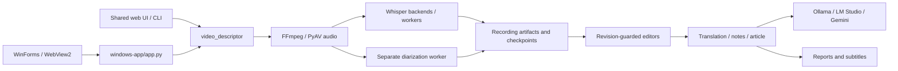

# Architecture map

This is a source-navigation map, not a replacement for the detailed
[Windows architecture and dated decisions](../architecture-windows.md).
Defaults below are configurable; inspect the selected engine and runtime config.

## Code boundaries

| Responsibility | Source | Read next |
| --- | --- | --- |
| Desktop shell, tray and launcher | [DesktopHost.cs](../../windows-app/DesktopHost.cs), [desktop.py](../../windows-app/desktop.py), [Start-App.ps1](../../windows-app/Start-App.ps1) | [Desktop](../desktop-windows.md) |
| Native local HTTP host/configuration | [app.py](../../windows-app/app.py) | [Windows architecture](../architecture-windows.md) |
| Shared web API and filesystem queue | [serve.py](../../video_descriptor/serve.py), [jobs.py](../../video_descriptor/jobs.py) | [Creation UI](../creation-ui.md) |
| CLI pipeline and audio extraction | [__main__.py](../../video_descriptor/__main__.py), [media.py](../../video_descriptor/media.py) | [Audio-only](../audio-only.md) |
| Device planning and local backend protocol | [compute.py](../../windows-app/compute.py), [device_policy.py](../../video_descriptor/device_policy.py), [local_backends.py](../../video_descriptor/local_backends.py) | [Device policy](../device-policy-and-release.md) |
| NPU audio segments and recovery | [speech_npu.py](../../video_descriptor/speech_npu.py), [speech_resume.py](../../video_descriptor/speech_resume.py), [whisper_http.py](../../video_descriptor/whisper_http.py) | [Debugging](../development/debugging.md) |
| Worker and model execution | [whisper_worker.py](../../windows-app/whisper_worker.py), [whisper_npu_server.py](../../scripts/whisper_npu_server.py) | [NPU profile](../whisper-multilingual-npu.md) |
| Speech, manual overlays and subtitles | [speech.py](../../video_descriptor/speech.py), [subtitles.py](../../video_descriptor/subtitles.py), [speech-edit.js](../../video_descriptor/assets/speech-edit.js) | [Shared assets](../../video_descriptor/assets/README.md) |
| Recording variants and report editor | [recording.py](../../video_descriptor/recording.py), [versions.py](../../video_descriptor/versions.py), [editor.py](../../video_descriptor/editor.py), [recording.js](../../video_descriptor/assets/recording.js) | [Notes editor](../notes-editor.md) |
| Diarization setup, proof and execution | [diarization_setup.py](../../windows-app/diarization_setup.py), [diarization_readiness.py](../../video_descriptor/diarization_readiness.py), [diarization_worker.py](../../windows-app/diarization_worker.py) | [Native diarization](../native-diarization.md) |
| Postprocessing and model-answer recovery | [postprocess.py](../../video_descriptor/postprocess.py), [construction.py](../../video_descriptor/construction.py), [construction_recovery.py](../../video_descriptor/construction_recovery.py), [notes_validation.py](../../video_descriptor/notes_validation.py) | [Chunking](../chunking.md), [Model behavior](../model-behavior.md) |
| Runtime components and recording storage | [component_manager.py](../../windows-app/component_manager.py), [storage_service.py](../../windows-app/storage_service.py) | [Component manager](../ai-component-manager.md) |
| Common structured audit | [action_history.py](../../video_descriptor/action_history.py), [request_log.py](../../video_descriptor/request_log.py) | [Audit contract](../development/safety.md) |

## Engines and external services

Native default backend is loopback port 8780. Speech worker defaults are NPU 8766,
CPU 8767 and GPU 8768 (`config.example.json` and `ComputeManager`). Auto selects a
usable backend in NPU → GPU → CPU order; explicit selection does not silently fall
back. Readiness includes model/protocol checks. `speech.py` also supports legacy
Whisper/Gemini engine variants; do not route all paths through the NPU-only client.

`whisper_http.py` retains a legacy `WHISPER_HTTP_URL` default on
`host.docker.internal:8765`; `speech_npu.py` uses `SPEECH_NPU_URL` and 8766.
Native `app.py` supplies its configured loopback environment. These defaults belong
to different launch paths, not interchangeable ports for one endpoint.

Ollama is normally loopback 11434; [ollama_connection.py](../../video_descriptor/ollama_connection.py)
and [notes.py](../../video_descriptor/notes.py) integrate it.
[LM Studio](../lmstudio-windows.md) uses a separate OpenAI-compatible local server
(default 1234/v1), with device/offload controlled by LM Studio.
[Gemini](../translation-providers.md) is an external cloud path with consent/access
requirements. Translation and notes/article model selections are independent.
Do not infer successful generation from model listing or speech device support.

## Storage, validation and edits

Native `app.config()` merges `config.example.json` with local configuration
(`VIDEO_DESCRIPTOR_CONFIG` can override its location). `records_directory` selects
the recording workspace; otherwise `runtime/workspace` is used. Runtime settings can
still live under that workspace's `.devcontainer/`. Installed and development
configurations must be distinguished from repository-local prototype paths.

`jobs.py` stores queue state, `speech.py` stores `speech.json` and reads
`transcript.json`, `transcript-edits.json` and translations to build the editable
view and revision. Report editing uses its own revision and user Markdown path.
Recording/report selection is independent; preserve original speech and model answers.
See [recovery](../development/debugging.md) before changing these artifacts.

Recognition chunks and LLM/report chunks are separate mechanisms. `media.py` writes
transcription checkpoints using a temporary file, flush/fsync and replacement.
`whisper_http.py` restores only matching identity and validated completed intervals.
`speech_npu.py` retains per-chunk responses, rejects invalid times and uses VAD
speech-region retries without inventing word boundaries. This is not a blanket
claim that every engine shares one checkpoint schema or preserves every HTTP body.

Remaining limitations: historical acceptance notes are evidence for their stated
version/hardware, not a current platform guarantee. Transitive runtime licensing
still needs review; see [documentation audit](../development/documentation-audit.md).
