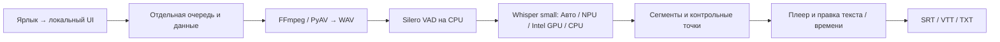

# История изменений

13.11.2026: OpenCode использует `build` как лёгкого координатора Luna (`gpt-6-luna#low`),
`executor` как восьмишагового Terra worker и `architecture-advisor` как контекстного
Sol expert без инструментов. Luna может вызывать только эти роли и сохранённый
`executor-free`; Terra сохраняет committed default-deny с временными точными grants.
Effective agent API подтвердила роли и модели. Два no-tool smoke child завершились
успешно: Terra — `gpt-6.1-terra`, Sol — `gpt-6.1-sol`; родительский существующий
session использовал Luna default variant, не перенастраивался. Это проверяет model
routing, но не исполнение tool permissions. Проверки: `tests/test_agent_config.py` —
7 passed; config-only — 29 passed; полный Fast — 853 passed, 4 skipped.
Операционные детали — в [agent workflows](agents.md#luna-coordinator-and-terra-standard-worker-with-sol-advisor).

13.11.2026: [WORKSPACE-TABS](../../design-system/WORKSPACE-TABS.md) фиксирует
совместимость будущих workspace tabs: URL/preferences precedence, default/reset,
историю, сохранение v1-комбинаций и просмотр оригинала с переводом. Node harness
расширен до 256 panel/layout cases и отдельных storage failures. Production UI,
маршруты и schema не меняются; статусы и evidence — в UI-UX-EPIC, команды — в
[testing guide](testing.md#workspace-preferences-and-compatibility).

13.11.2026: `executor` (Terra Standard) использует восемь шагов для scoped
implementation вместо однократного text-only proposal. Последний шаг OpenCode
зарезервирован для отчёта; конфигурация `steps: 1` не оставляла рабочего шага.
Committed policy остаётся default-deny без постоянных grants. Sol временно задаёт
exact read/edit paths, проверяет effective policy в task Location, затем снимает
grants; shell/network/external directories/subagents не разрешаются. Sol сохраняет
architecture, review, validation commands и commits. `executor-free` не менялся.
Текущая процедура — в [agent workflows](agents.md#task-specific-permissions).
Live smoke на OpenCode 2.2.7: Terra выполнила read/edit/read/revise/read разрешённого
synthetic fixture; ungranted read и read-only edit получили `permission.rejected`.
Независимая проверка подтвердила итоговый текст и неизменные bytes обоих negative
fixtures. Семь model steps, шесть успешных tool calls, два отказа; grants и fixtures
удалены после завершения child. Это проверка инструментов OpenCode, не OS sandbox.
Проверки: Fast — 852 passed, 4 skipped и 29 config checks; focused agent tests —
6 passed, Ruff и локальные ссылки PASS. CSS bundles и UI contract audit не изменились.

13.11.2026: добавлен изолированный прототип workspace tabs на общих `.vd-tabs`:
расшифровка, перевод и материалы с вложенными конспектом/статьёй. Плеер и
stop/recovery остаются вне переключаемых областей; ready/empty/busy/error —
демонстрационные состояния без API, storage, генерации или production integration.
Edge driver проверяет 60 сочетаний viewport/state/area, keyboard/focus и сохранение
DOM/черновика; сохраняет снимки для визуальной проверки. Ограничения и повторяемая
команда описаны в testing guide; статусы и evidence — в UI-UX-EPIC.

13.11.2026: вкладки «Конспект / Статья» используют общий `.vd-tabs`, как настройки:
единые selected/hover/focus/forced-colors и компактная высота. Локальные стили
сохраняют равную ширину и отступ до содержимого; прежнее подчёркивание убрано.
DOM IDs, ARIA, JavaScript, версии, preferences и общий редактор не менялись.
Edge fixture проверяет оба материала и пустую статью, dirty guard/Undo/save,
клавиатуру, четыре размера окна, видимость панелей и отступы. Проверки визуальных
состояний ждут готовности редактора и завершения CSS transition, без fixed sleep.
Полный Fast: 847 passed, 4 skipped и 29 проверок конфигурации. Один повтор
browser fixture параллельно с Fast потерял HTTP-ответ сохранения; итоговые
последовательные material-tabs-only/material-tabs-empty прошли без ослабления проверок.
Это локальная fixture-проверка, не приёмка установленного WebView2 или моделей.

13.11.2026: OpenCode использует существующие роли `build` и `executor` для
Sol architect + Terra Standard worker. Основная модель проекта —
`openai/gpt-6.1-sol`, worker — `openai/gpt-6.1-terra` без Fast и принудительного
reasoning variant. Worker возвращает предложение за один шаг без инструментов;
`executor-free` сохранён отдельно. Инструкции и тест конфигурации синхронизированы.
Один smoke-вызов завершился `DELEGATION_SMOKE_PASS`; metadata сервера подтвердила
Sol у родителя и Terra с default variant у дочерней сессии. UI и Task 5 не менялись.
Проверки: полный Fast — 846 passed, 4 skipped и 29 проверок конфигурации;
CSS/DOM/API audit и локальные ссылки обновлённых инструкций прошли проверку.

13.11.2026: в HTML-инструкции Ollama и LM Studio добавлены ссылки возврата к
настройкам AI и записям в начале и конце страницы. Прямое открытие инструкции
больше не требует истории браузера для выхода. Markdown и прежние маршруты
сохранены; подключение провайдеров и модели не менялись.
Проверки: 50 first-run/API tests; полный Fast — 846 passed, 4 skipped и 29 проверок
конфигурации. В отдельном Edge проверены ссылки сверху/снизу и Tab на 375/760/1440 px.
Это проверка HTML/CSS и переходов, не новая приёмка установленного WebView2.

13.11.2026: синхронизированы обязательные инструкции:
standard — единственный текущий профиль, Domestic/cached удалены, публикация старых
личных пакетов запрещена. MASTER/page overrides/CONTRACTS приведены к верхней
навигации без sidebar и меню «Вид» только в открытой записи. Stage 0 помечен как
исторический. Код приложения и сборки не менялся.

13.11.2026: в AGENTS.md добавлено обязательное правило
синхронизации документации при каждой доработке: обновлять связанные инструкции
и примеры, удалять устаревшие фрагменты, исправлять ссылки, отделять историю
от текущего поведения и явно сообщать о непроверенном. Руководство разработки
ссылается на единый checklist. Для фактического стиля документации и отчётов
добавлен skill `factual-writing`: записи описывают изменения и проверки без
пересказа поручений и одобрений. Требования безопасности и согласия на загрузки сохранены.

13.11.2026: аудит документации по текущим исходникам: исправлены версия Windows,
CI/релизные триггеры, границы installed/fixture-проверок, WebView2 provisioning,
Windows DPAPI и снимки LLM-заданий. Ранние benchmark/приёмочные отчёты отделены
от текущих инструкций; дубликат LM Studio объединён с Windows-руководством.
Зафиксирован конфликт локального isolated builder с checkout-specific `.venv`
guard; код в рамках аудита не менялся. См. [результат аудита](documentation-audit.md).

13.11.2026: меню «Вид» отображается только при открытой записи; в библиотеке,
настройках и пустой форме создания оно скрыто, а сохранённые настройки не меняются.
Верхняя строка больше не изменяет высоту при раскрытии пунктов меню.

13.11.2026: для новых Windows-сборок с номера 12 идентификатор записывается с
ведущими нулями (`0012`) в BUILD, теге, именах артефактов, описаниях и интерфейсе;
числовое сравнение и старые теги сохранены. Ранее выпущенные приложения со старой
проверкой обновлений не распознают новые теги автоматически.

12.11.2026: «Настройки AI» разделены на вкладки: «Функции и
подготовка», «Распознавание речи», «Локальный AI», «Облачный AI (Gemini)»,
«Участники», «Папки хранения», «Дополнительно». Одновременно виден только один
раздел, поэтому страница больше не нагромождает все формы подряд. Блок
«Распознавание и участники» больше не висит отдельной карточкой над вкладками:
выбор функций, устройства, согласие, подготовка и её прогресс стали содержимым
первой вкладки «Функции и подготовка», а прогресс и ошибка дополнительно видны
меткой на самой вкладке. Раздел «Языковая модель · локальные серверы» переименован
в «Локальный AI» вместе со ссылками в подсказке и документации. Реализация в
общем `desktop-shell.js`: настоящий tablist (`button role=tab`, `tabpanel`,
`aria-selected`/`aria-controls`, один `tabIndex=0`, Left/Right/Home/End), прежние
`details/summary` разделы и все их ID сохранены, добавлены только ID панелей
(`setup-preparation`, `setup-local-models`, `setup-cloud`, `setup-participants`,
`setup-storage`, `setup-extra`). Поле из неактивной вкладки раскрывается до
получения фокуса (`desktopSettingsShow`), поэтому переходы «Подключение и языковая
модель →», условия Hugging Face, конспект и перевод продолжают работать. API,
маршруты, контракты заданий, revision/dirty guards и версия не менялись.
Проверки: `scripts/check-ui-audit.py`, `scripts/build-ui-css.py --check`, новый
тест `tests/test_desktop_design.py`, реальный headless Edge
(`scripts/verify-recording-ui.py --desktop-design`) — PASS, снимки настроек
показывают одну активную вкладку.

12.11.2026: в проектную `.venv` установлен
`markdown-it-py==4.2.0` с `mdurl`; та же версия добавлена в `requirements-dev.txt`,
чтобы локальные тесты Windows-справки не падали после создания dev-окружения.
Версия совпадает с Windows runtime lock; AI-компоненты и модели не менялись.
Ранее падавший тест `/help/ollama` после установки проходит.
Повторный полный Fast — PASS: 838 passed, 4 skipped и 29 конфигурационных тестов;
статические UI/CSS/JS-проверки и Ruff также прошли.

12.11.2026: постоянная левая навигация убрана,
Записи / настройки / диагностика перенесены в верхние меню; общий «Вид» доступен
на всех полных страницах. Подключения записи ведут в общую форму с Ollama,
LM Studio и Gemini вместо старого отдельного диалога без Ollama. IDs/handlers,
preferences, API и редакторские guards сохранены. `executor`
сохранён на рабочем OpenRouter; рядом добавлен `executor-free` на
`opencode/minimax-m3.1-flash-free#low`.
Один шаг и запрет инструментов сохранены, платного fallback нет. Пробные
бесплатные вызовы DeepSeek и MiniMax отклонены провайдером из-за лимита.
Локальная проверка: 17 focused tests и оба Edge/CDP сценария desktop/workspace —
PASS. Первый Fast через существующую `.venv`: 29 configuration + 837 passed, 4 skipped,
1 failed (в окружении отсутствует `markdown_it` для существующего `/help/ollama`).
На этом этапе зависимости ещё не устанавливались; последующее устранение
проблемы окружения и зелёный полный прогон описаны выше.

12.11.2026: Windows product version повышена 0.9.3 → 0.9.4
после cohesive desktop redesign. Заметки `docs/releases/next-build.md` обновлены
для следующей сборки. BUILD остаётся 8 до отдельной процедуры подготовки релиза;
теги, выпуск и публикация этой операцией не запускаются.

12.11.2026: cohesive desktop redesign в отдельной ветке: общая строка команд,
sidebar только для навигации, короткий заголовок записи и grid видео/речи 40/60,
расшифровка с независимой прокруткой и явным копированием, индекс разделов настроек,
единые материалы/диалоги. Старые IDs/API/обработчики и View preferences сохранены;
никаких изменений конвейера или системных компонентов. До/после и границы проверки:
[design-system/DESKTOP-REDESIGN.md](../../design-system/DESKTOP-REDESIGN.md).
Проверка: check-fast **836 passed, 4 skipped** + 29 configuration; 56 focused tests;
реальный Edge/CDP, 1200×800/1440×900 и узкие окна, dirty/Undo, View, clipboard,
участники, интервалы, отступы и update UI — PASS. Установленный WebView2 и модели
на реальном оборудовании не проверялись; коммит локальный, без merge/push/release.

12.11.2026: настраиваемое меню «Вид» и transcription-first workspace:
[карта областей, ограничения и локальные проверки](workspace-view.md).
Пункт «Вид» расположен в левой навигации рабочего пространства рядом с «Записи»,
«Настройки AI» и «Диагностика»; панель открывается рядом с рейкой, в узком окне —
под пунктом. Библиотека и настройки панелей записи не имеют и не получают пункта.
В существующем Windows dev-окружении check-fast: 29 configuration + 833 passed,
4 skipped; Edge fixture: workspace/preferences/layout/dirty state, material tabs,
участники, нераспознанные интервалы и уведомления обновлений — PASS.

12.11.2026: Windows-оболочка стала единым окном. Постоянная нативная панель с кнопками
«Главная» и «Подключиться снова» удалена: WebView2 занимает всю клиентскую область под
стандартным системным заголовком, своя рамка и обработка перетаскивания/размера не менялись.
Навигация «Главная» осталась в веб-интерфейсе, дублирование в native окне убрано. Восстановление
связи не изменилось: нативный экран ошибки с сообщением, путём к логам и кнопкой
«Подключиться снова» работает без WebView2 и без backend и возвращает WebView2 в окно после
успешного подключения. Трей, закрытие в трей, единственный экземпляр, health-опрос, защита
активной очереди, выход, WebView2-ограничения и desktop smoke сохранены; HTML/CSS/JS, маршруты,
DOM id и API не менялись. Проверки: `tests/test_desktop_shell.py` (статические контракты и
скомпилированный WinForms-харнесс) и `windows-app/verify_desktop.py`.

12.11.2026: добавлены уведомления об официальных Windows-обновлениях GitHub Releases.
Один фоновый checker сравнивает полную product version/BUILD, проверяет стандартный
installer asset и все страницы API, сохраняет пользовательский кэш и соблюдает
суточный интервал/backoff. Локальные GET status и защищённый POST manual check
не ждут сети и не занимают device/job locks. На главной — ненавязчивый бейдж и
ручная проверка в меню приложения; release notes только текст, внешний браузер
открывает только URL проверенного официального тега. Legacy теги без BUILD и
development builds не дают небезопасных предложений. Автоустановки/загрузки нет,
VERSION/BUILD не менялись. Контракт и ограничения: `docs/architecture-windows.md`.

Здесь сохранены прежние записи о разработке и исторические инструкции из README.
Они описывают состояние соответствующего периода и могут отличаться от текущего
поведения приложения. Актуальное состояние — на [главной странице](../../README.md),
выпуски и их описания — в [GitHub Releases](https://github.com/IavnFGV/video-descriptor/releases).

12.11.2026: у каждой сборки Windows свои release notes. Во время разработки
описание следующей сборки готовится в `docs/releases/next-build.md`; знать
следующий номер BUILD заранее не требуется. Подготовка выпуска переносит эти
заметки дословно в `docs/releases/X.Y.Z-build.N.md`, расходует `next-build.md` и
коммитит их вместе с увеличенным BUILD в теге `vX.Y.Z-build.N`. Публикация
читает заметки из tagged commit, поэтому повтор старого тега никогда не берёт
заметки более нового коммита. Пустые, шаблонные и повторённые заметки
останавливают подготовку без изменения BUILD. После выпуска шаблон следующей
сборки готовится локально: `python scripts/windows_release.py next-notes` — команда
не создаёт коммитов, тегов и push. Прежние release notes и версионные
`docs/releases/X.Y.Z.md` остаются обязательными для legacy тегов `vX.Y.Z`;
исторические описания и публикации не меняются.

12.11.2026: из счётчика расшифровки можно перейти к участкам без таймкодов.
Причина: число нераспознанных интервалов показывалось в заголовке панели, но
перейти к самому участку в списке было нельзя — пользователь искал его
прокруткой. Теперь рядом с числом показана кнопка на каждый интервал с его
началом; нажатие прокручивает список расшифровки к участку, отмечает его и
переводит видео на его время. Интервалы различаются по времени, поэтому переход
работает и при нескольких участках. Счётчик перерисовывается только при
изменении снимка: опрос не забирает фокус с кнопки. API, payload,
revision/dirty guards, прежний порядок интервалов и редактор реплик не изменены.

12.11.2026: устранена потеря двухчасовой расшифровки из-за блокировки файла на
Windows. Артефакты публикуются атомарно через `ReplaceFileW`, читатели открывают
файлы с `FILE_SHARE_DELETE`, временные держатели (антивирус, проводник)
выдерживаются повторами, временные файлы уникальны и удаляются при отказе.
Индикатор прогресса больше не роняет распознавание, а неудачное сохранение
результата не подменяет исходную причину сбоя. Регрессии: публикация под
блокировкой, параллельные издатели, недоступный прогресс и сохранённая причина
ошибки.

12.11.2026: все изменения разработки, включая документацию и настройки агентов,
выполняются через отдельную task-ветку: проверки и коммит → merge проверенных
изменений → безопасное удаление полностью влитой ветки. Незавершённые ветки и
данные worktree сохраняются; merge сам по себе не запускает выпуск.

12.11.2026: OpenCode получил постоянный профиль `executor` на DeepSeek Flash через
OpenRouter и skill `delegate-small-task`. Экономный режим: один шаг без инструментов,
предложение patch по переданным фрагментам; основной агент выбирает необходимость
делегирования, проверяет diff и применяет изменения в отдельном worktree. Это не
денежный лимит и не настройка запрета кредитов ChatGPT.

12.11.2026: профили упаковки Domestic (встроенные Whisper/community-1) и cached
(content-addressed полный офлайн-пакет) удалены как продукты. Единственный профиль —
стандартный установщик (`build_release.py` со `PublicRelease`, без `--domestic` и
`--cached`). Локальная очередь `local_build.py` и `Build-Local.ps1` собирают только
стандартный профиль; флаги `--domestic`/`--cached`/`-Domestic` отклоняются. Стандартный
ZIP/staging, pinned wheels, общий download/кэш компонентов, общественный artifact gate
и workflow/lifecycle сохранены. Устаревшие записи ниже описывают прежнее состояние.

11.11.2026: исправлен отказ обновления при открытом VS Code/PowerShell: ссылка на папку приложения или файл записи в аргументах больше не считается запуском установленного приложения. Собственные executable и внешние интерпретаторы, реально исполняющие код установки, по-прежнему блокируют замену. Подтверждённая остановка сохраняет проверку executable/PID/create_time и никогда не завершает чужие редакторы/терминалы. Регрессии воспроизводят открытый vad.json, папку PowerShell и запуск кода через Python/PowerShell/cmd.

11.11.2026: повторные Windows-сборки одной версии используют BUILD: prepare создаёт новый неизменяемый тег `vX.Y.Z-build.N`, не требует повышения product version и не переносит старые теги. Public ZIP/EXE, checksums, provenance и publication gate учитывают номер сборки. Повторный запуск tagged workflow сохраняет прежние исходники/BUILD; новая подготовка на main увеличивает BUILD. Локальные имена пакетов сохранены по умолчанию.

11.11.2026: исправлена установленная acceptance-проверка после перехода на внешний Ollama: вместо удалённого `mode` сохраняются endpoint и `ownership=external`, подключение не выдаётся за проверенную генерацию. Перевод и конспект проверяются с общей моделью по умолчанию; Sandbox UI больше не обращается к удалённому назначению и запускает проверку модели отдельно от сохранения. Регрессии используют настоящий HTTP backend и fake Ollama, проверяют успешное подключение и ошибку без подмены адреса.

11.11.2026: главная страница сокращена до назначения продукта, текущего состояния,
начала работы и ссылок на документацию. Прежнее содержимое перенесено сюда без
удаления записей; относительные ссылки пересчитаны для нового расположения.
Новые записи о разработке добавляются в этот файл, а не в начало README.

## Архив прежней главной страницы

11.11.2026: подготовлена версия Windows 0.9.2 и [release notes](../../docs/releases/0.9.2.md) для объединённых LLM-настроек и восстановления Whisper. BUILD остаётся под управлением release workflow; тег, сборка и публикация этой правкой не запускаются.

11.11.2026: проверка Whisper recovery перед интеграцией: исправлены Undo/Redo первого ручного заполнения записи, состоящей только из unresolved-интервалов, доступность ручного редактора при отсутствии распознанных реплик и ошибочный no_speech для нераспознанной речи. Пустой снимок разрешён только для исходно пустой расшифровки с известными пропусками; guards обычной расшифровки сохранены.

11.11.2026: нераспознанные интервалы видны и могут быть дописаны вручную. Причина: после исправления непригодных таймкодов интервал без корректного времени оставался вне расшифровки и был виден только в служебном поле `speech.json`, поэтому пользователь не знал, где именно пропала речь. Теперь интервал показывается в рабочей папке и в отчёте между распознанными репликами — по хронологии, отдельным стилем, с точным диапазоном времени записи и объяснением на русском. Текст вводится тем же редактором реплик: кнопка «✎» открывает существующий диалог с границами участка. Сохранённый текст становится обычной репликой с прежним id интервала, поэтому перевод, конспект, статья и субтитры видят его как распознанный текст. До заполнения интервал не входит в расшифровку, перевод, конспект и VTT/SRT — пустые таймкоды не выдумываются. Отмена правки возвращает интервал в нераспознанные; заполнить его повторно нельзя. Границы — абсолютное время записи, а не время фрагмента. Новый endpoint не добавлен: прежний `/api/speech-edit` получил действие `resolve` под прежними EDIT_LOCK, revision guard и журналом.

11.11.2026: непригодные таймкоды модели больше не прерывают запись на NPU. Причина: OpenVINO Whisper small на реальном аудио в районе 1067 с возвращал `start_ts=0.0, end_ts=-1.0` с выдуманным текстом, и прежний путь просто падал с ошибкой на всём блоке. Теперь `speech_devices.py` делит отказавшее окно пополам, обрабатывает половины независимо и в хронологическом порядке по сетке в 5 с; окно, не прошедшее и на минимальном размере, сохраняется как нераспознанный интервал, а запись продолжается со следующего интервала. Таймкоды не выдумываются и не интерполируются: нераспознанный интервал остаётся вне расшифровки и несёт id, абсолютные границы, статус и машиночитаемую причину. Инфраструктурные сбои (ConnectionError/Timeout/5xx без диагностики таймкодов) по-прежнему прерывают задание, а не пропускают аудио. Глубина деления и число обращений к модели ограничены; ответы окон кэшируются, поэтому перезапуск не отправляет готовое повторно. Нераспознанные интервалы пишутся в `speech.json` отдельным полем `unresolved` (старые результаты без него читаются как раньше), показываются в сообщении о завершении и пишутся в общий журнал. Worker отдаёт отказ кодом `invalid_timestamps` с числовыми границами и без текста расшифровки. Проверено на реальном аудио: отказ локализован до 5 с, остальная запись расшифрована.

11.11.2026: общий выбор LLM в настройках подписан «Модель по умолчанию», кнопка — «Сохранить по умолчанию». Пояснение отличает настройку по умолчанию от выбора провайдера/модели конкретного действия над записью; поведение API и заданий не менялось.

11.11.2026: из общих настроек LLM удалено устаревшее «Назначение: Перевод / Конспект». Сохранение и проверка Ollama используют общий выбор провайдера/модели, который служит значением по умолчанию для перевода, конспектов и статей. Отдельный выбор модели конкретного задания сохранён.

11.11.2026: Milestone 2 — выбор LLM из общих настроек используется переводом, конспектами, статьями и прежними операциями анализа/фильтрации/quiz/vision. Очередь сохраняет provider/endpoint/model и параметры без ключей; subprocess получает тот же snapshot, а перевод не перечитывает выбор между блоками. Явный выбор задачи сохраняет приоритет. Старые задания получают snapshot однократно при продолжении; исходные данные и завершённые блоки сохраняются. Missing model и ошибки провайдеров не запускают fallback, setup/download отсутствуют. Регрессии используют локальные fake HTTP-серверы, реальные модели не требуются.

11.11.2026: Milestone 1 — Ollama и LM Studio используют одну форму локального LLM: провайдер, адрес, проверка подключения, доступные модели, обновление, отдельная проверка генерации и инструкция. Настройки провайдеров сохраняются независимо; список берётся только с выбранного сервера, отсутствующая модель не подменяется. Смена провайдера/адреса/модели отсекает устаревшие ответы. Для LM Studio проверяются структура inventory и наличие модели перед тестом; операции видны в общем журнале. Generic cloud API отложен.

11.11.2026: Added English agent instructions, architecture/development maps, portable diagnostic and release-review skills, and a Claude adapter. Shared OpenCode configuration enables LSP. Application behavior and release inputs are unchanged. Start at [AGENTS.md](../../AGENTS.md) or the [development guide](../../docs/development/README.md).

11.11.2026: исправлена раскладка сворачиваемого сайдбара основного приложения. Причина: тумблер, сайдбар и контент размещались в двух неявных строках grid-оболочки; строка-спан контента отдавала всю высоту первой строке — кнопка растягивалась, а сайдбар уезжал под нижний край. Оболочка возвращена к одной строке из двух колонок: сайдбар и контент выровнены по верху, тумблер — первым элементом топбара на границе сайдбара. В свёрнутом состоянии shell переключается на одну колонку, контент занимает всю ширину. Browser-тест сверяет реальные координаты getBoundingClientRect в развёрнутом/свёрнутом состояниях и на 1920/1100/760/360; recording workspace не изменён.

10.11.2026: диагностика installed acceptance сохраняет при timeout последний job status/stage и краткий speech status, worker/run tail только из помеченной disposable installation и скриншот UI. Таймаут UI передаётся в ожидание реального задания (240 секунд для короткого ASR), вместо скрытого ожидания 600 секунд. Это диагностика зависания после загрузки через UI, не объявление исправленного inference. BUILD остаётся 1.

10.11.2026: конспект и статья разделены на две вкладки с собственными версиями и действиями создания. Один редактор и история Undo сохранены; грязный материал блокирует переход с пояснением. Пустая вкладка статьи не показывает конспект. Клавиатура Left/Right/Home/End, выбранный вид material в URL, существующие job/folder/API и revision guards сохранены. Локальный browser acceptance проверяет выбор версий, реальное сохранение, пустую статью и четыре размера окна.

10.11.2026: release acceptance отделена от качества LLM. Установленный standard-пакет проходит реальные API/UI/CPU Whisper, а внешний Ollama HTTP boundary получает фиксированные потоковые ответы; проверяются перевод, конспект, статья, сохранение/редактор/экспорт и отказ на неверном ответе с сохранением исходника. Настоящая генерация не заявляется. Отдельный manual workflow Model and prompt behavior проверяет выбранную реальную модель на версионируемых примерах, формате/таймкодах/фактах, сохраняет identity, хеши промптов и ответы. Few-shot examples включаются явно для сравнения с production baseline; release от этого workflow не зависит. См. docs/model-behavior.md. BUILD остаётся 1.

10.11.2026: installed WebView2 acceptance следует текущему /create и реальному API-состоянию задания вместо устаревшего #status. Перевод и генерация используют текущие controls; hidden stage tabs заменены проверками единого workspace и transcript disclosure. Тот же release UI harness можно прогнать локально на временных данных: scripts/verify-recording-ui.py --release-harness-only; это не доказательство inference/аппаратной совместимости.

10.11.2026: installed acceptance для короткого bundled speech использует отдельную краткую инструкцию конспекта с метками из реальной расшифровки; это smoke генерации/сохранения, а не оценка качества лекционных конспектов tiny-моделью. Строгая проверка ответа сохранена. При ошибке задание, исходный construction-result и диагностика сохраняются в артефакте приёмки; Actions выводит этап и причину, без промпта/расшифровки. Production defaults и BUILD не изменены.

09.11.2026: release lifecycle verifier не запускает деинсталлятор второй раз после подтверждённого удаления регистрации. Оставшийся на короткое время Inno self-delete EXE не считается активной установкой; cleanup при прерванной приёмке и остановка только тестовых процессов сохранены. BUILD остаётся 1 для выпуска 0.9.0.

09.11.2026: номер билда — только число в отслеживаемом файле BUILD (0.9.0: билд 1). Run workflow Windows release на main при подготовке следующего выпуска увеличивает BUILD, коммитит его и создаёт version tag; retry на готовом теге и локальные сборки число не меняют. Этот же BUILD включается в пакеты, manifest/provenance, API и подпись приложения/установщика. Отдельных счётчиков Local/GitHub и состояния нет.


09.11.2026: public artifact gate дополнительно проверен на всём составе pinned Windows wheels. Каталоги models с Python/PYI-кодом ctranslate2/onnxruntime/tokenizers разрешены как исходники библиотек; файлы весов в тех же каталогах по-прежнему запрещены.

09.11.2026: Windows 0.9.0 — отдельный GitHub Actions Windows release по тегу v0.9.0 (далее vX.Y.Z). Версия тега обязана совпадать с release-inputs.json, commit должен входить в main. Приёмка вызывает существующий Windows Full без Docker; публикуются только принятые standard ZIP/EXE, SHA256 и provenance. Перед открытием draft релиза скачанные с GitHub файлы сверяются с исходными байтами; личные Domestic/cached пакеты запрещены. Обычный push main релиз не публикует.

09.11.2026: публичные GitHub Releases отделены от Domestic/кешируемого полного пакета. Перед публикацией проверяются standard profile, фактический состав ZIP и отсутствие приватных/скачанных весов; установщик должен содержать тот же manifest, что проверенный ZIP. Domestic остаётся личной сборкой. Пользователь загружает модели из официальных источников при первоначальной настройке, с собственным согласием/доступом там, где это требуется; готовая локальная модель переиспользуется. Зависимый Silero VAD учтён отдельно по MIT с включённым notice.

09.11.2026: добавлена интеграция LM Studio для перевода, конспектов и статей: отдельный провайдер, локальный адрес API, выбор модели и необязательный API-токен (Windows DPAPI). Подключается существующий Local Server; установка, скачивание моделей и управление устройством остаются в LM Studio. Инвентарь не означает проверенную генерацию. Общий audit, проверки целостности ответа и исходные версии сохранены. См. [подключение LM Studio](../../docs/lmstudio-windows.md).

09.11.2026: Windows 0.8.34 — успешная проверка диаризации сохраняется между запусками и UI-обновлениями. Готовность привязана к модели, Python/метаданным пакетов, lock-файлу, worker и устройству/драйверу; отсутствие proof не выдаётся за готовность. При неизменных входах не запускать повторный inference и не требовать Hugging Face, токен или ручную проверку. Доступ HF показывать только для необходимой загрузки модели. Ошибка проверки сбрасывает кеш.

Обязательное правило журналирования (09.11.2026): все изменяющие API-операции автоматически проходят общий HTTP audit; worker, взаимодействие с моделью, проверка и сохранение результата вызывают video_descriptor.action_history.record — единую точку структурированной записи. Фиксировать начало, успешный результат и ошибку; сохранять operation/job/request id, этап и статус. Не писать ключи, credentials, тела запросов, промпты и расшифровку в общий журнал. Общий журнал задаётся VIDEO_DESCRIPTOR_EVENTS (Windows: application_log_directory или runtime/logs/events.jsonl), события записи — рядом с её артефактами. Общий файл находится вне переносимой папки записей, чтобы журналирование не нарушало проверку её контрольных сумм. Новый endpoint/фоновая операция проверяются на наличие событий и видимость в UI; отдельный logger вместо общего механизма не допускается. Legacy run.log/construction.log остаются диагностическими дополнениями.

Обязательное правило UI (09.11.2026): между полем и связанными с ним кнопками, а также между кнопками одной группы — 8 px (`--vd-control-gap`); между самостоятельными группами — 16 px (`--vd-group-gap`). Поле с действиями оформлять `.vd-control-group`, кнопки — `.vd-actions`. Едино для приложения, настроек, библиотеки, диалогов и отчётов; CSS собирать из общих источников. Не компенсировать отступы пробелами в HTML или отдельными случайными margin.

09.11.2026: исправление меток пакетное: «Исправить все метки» выбирает ближайшие подтверждённые начала реплик; индивидуальные замены оставляют список и отметку ожидания проверки. Проверка всего текста выполняется явно, затем сохранение; ручные правки не теряются.

09.11.2026: штатный локальный preview после merge main: post-merge запускает installer в фоне, затем Run-Dev.ps1 -Restart -Open открывает код main в браузере. Конфигурация/статус и два перезаписываемых лога — .git/local-dev; порт отдельный, records_directory общий с установленным приложением. Guard проверяет development/instance/installation/workspace; активная очередь не прерывается. Модели и системные компоненты не устанавливаются. UI показывает версию и коммит.

09.11.2026: Windows 0.8.33 — восстановление конспекта показывает все ошибки меток с разделом/строкой, точным переходом и подтверждёнными кандидатами с текстом речи. POST construction-recovery action=validate проверяет черновик без записи/запуска worker; revision guards сохранены. Замены выбирает пользователь; исходный ответ модели не меняется.

09.11.2026: запуск приложения восстанавливает зависший running в ошибку прерванного задания только при свободной блокировке worker и отсутствии живого pipeline. Очередь автоматически не запускается; речь, ответы модели и кэш сохраняются.

09.11.2026: Windows 0.8.32 — рядом с недоступной кнопкой генерации показана причина (активное задание, очередь, загрузка/выбор модели, отсутствие речи). Заголовок не предлагает запуск во время активного задания. Автоматическое определение контекста расположено под соответствующим полем с пояснением.

09.11.2026: Windows 0.8.31 — создание статьи открывает настройки статьи с отдельным редактируемым промптом и явной кнопкой запуска. Конспект сохраняет собственный промпт; article_prompt хранится отдельно, backend применяет его только для статьи. Выбранная расшифровка, версии и dirty guards сохранены.

08.11.2026: Windows 0.8.30 — финальная уборка снимает read-only атрибут только с собственных временных файлов в проверенных границах (включая Git objects тестовых репозиториев). Тест завершения подготовки ждёт публикации файла под существующей блокировкой, устраняя гонку чтения. Проверенный полный кешируемый цикл 0.8.29 после merge занял 3:58; runtime и пользовательские модели не пересобирались.


08.11.2026: Windows 0.8.29 — полный автономный установщик с content-addressed кешем Python, библиотек и моделей. По умолчанию после merge собирается полный EXE: неизменившийся архив компонентов включается без повторного сжатия; код и интерфейс пересобираются. Ключ учитывает pinned runtime/model inputs; повреждённый архив пересоздаётся. Установка повторно использует совместимые подготовленные компоненты. Проверка моделей кешируется только для того же backend-кода и Windows-хоста. `Build-Local.ps1 -Domestic` сохраняет прежний полный путь ZIP+EXE без использования кеша компонентов.


08.11.2026: Windows 0.8.28 — временные распаковки ZIP/моделей, payload/vcrt, scratch сборки, checkout и промежуточные пакеты убираются после успеха и ошибки. Вложенные временные журналы удаляются с папками; отдельные launcher-логи больше не создаются. Сохраняются опубликованные пакеты, итоговые отчёты и основные журналы текущей и последней успешной сборки. Статус показывает номер версии до упаковки.


08.11.2026: локальный сборщик задаёт TEMP/TMP/TMPDIR только дочерним процессам: `<cache>/temp/<run>` либо настроенный `--temp-root`. Распаковка ZIP, проверки моделей и временные файлы установщика используют диск build cache, а не системный C:. Глобальные настройки Windows не меняются; уже запущенные процессы сохраняют прежнее окружение.


08.11.2026: проверки готового пакета выводят шаги и подтверждённые результаты в общий build.log: прогресс распаковки и SHA256, запуск /health, зависимости/FFmpeg, мастер настройки, UI и остановка. Автономная проверка моделей сообщает стадии WebView2, CPU Whisper, CPU диаризации и повторного запуска; вывод немедленный, без содержимого настроек или токенов.


08.11.2026: последние сообщения на странице локальной сборки показаны в обратном порядке: новые сверху, без необходимости прокручивать журнал вниз после обновления. Исходный build.log сохраняет хронологический порядок.


08.11.2026: статус локальной сборки показывает текущую операцию упаковки, длительность сборки и этапа, последние 24 строки журнала и время последнего сообщения. Очередь показывает ожидающие коммиты без активного запроса. Страница обновляется во время длительных команд; процент и ETA не выдумываются. Команда `python scripts/local_build.py watch-status` обновляет страницу уже запущенного worker без изменения его состояния.


08.11.2026: добавлен независимый выбор версий расшифровки, конспекта и статьи. Служебные снимки сохраняются в хранилище, но скрыты в выборе расшифровки; выбор материала не переключает речь. Новые материалы используют выбранную речь, старые не изменяются. Общий редактор показывает выбранный конспект или статью; dirty guards и синхронизация по времени сохранены. Удаление адресует выбранный материал.


08.11.2026: Windows 0.8.27 — при ошибке разбора конспекта доступно ручное исправление сохранённого ответа: выбор подтверждённых начал реплик, повторная проверка, продолжение без генерации моделью. Исходный ответ сохраняется отдельно; конфликт версий и активная обработка блокируют запись.


08.11.2026: домашний установщик 0.8.26 проверен в Windows Sandbox без сети и аккаунта Hugging Face: Whisper CPU, диаризация CPU, видео → текст → участники, отказ обновлять работающий экземпляр, повторная установка и удаление с сохранением данных/настроек. Локально: 492 теста, 3 пропуска. Гостевой SAC отключён только для функционального теста; NPU/GPU и обновление между разными версиями этим прогоном не проверялись. Протокол: docs/verification-domestic-0.8.26.json.

08.11.2026: отдельный профиль упаковки `--domestic`: встроенные Whisper small FP16, community-1, изолированный CPU runtime диаризации и WebView2 CAB. Локальный post-merge hook main выбирает домашнюю сборку; стандартный профиль сохранён. Установочная подготовка проверяет модели без скачиваний, сохраняет пользовательские настройки; приложение и UI не изменены. Перевод/конспекты и XPU-окружение остаются дополнительными. См. docs/domestic-installer.md.

08.11.2026: при отказе github.com/releases загрузки actionlint/Inno Setup используют официальный GitHub release-asset API с закреплённым asset ID. Полученные байты проверяются прежним SHA256, Inno Setup — также подписью издателя. Резервный путь проверен реальным скачиванием actionlint.

08.11.2026: CI использует уже установленный стабильный Python 3.12.x (check-latest=false), вместо обязательной загрузки старого patch 3.12.10 с GitHub Releases, которая возвращала 504 до запуска проверок. Встроенный Python Windows-продукта и его SHA256 не менялись.

08.11.2026: сборочные загрузки Inno Setup и actionlint выдерживают временные HTTP 504/502/503: до четырёх попыток с тайм-аутом и паузами, временный файл и атомарная публикация только после SHA256. Повреждённый кэш скачивается заново; подпись издателя Inno Setup по-прежнему обязательна. CI сохраняет проверяемый архив actionlint в кэш.

08.11.2026: исправлен Linux CI: быстрый перезапуск backend после переноса хранилища больше не падает с Address already in use из-за TCP TIME_WAIT. SO_REUSEADDR включён только на POSIX; Windows сохраняет SO_EXCLUSIVEADDRUSE и запрет повторного bind. Регрессия воспроизведена в изолированной Ubuntu, проверены перезапуск и отказ второго живого listener.

08.11.2026: Windows 0.8.24 — оригинальный результат модели перенесён из основной панели редактора в «Действия с конспектом». Режимы чтения/правки, несохранённые изменения и прямой доступ в standalone-отчёте сохранены. Версия подготовлена для локальной автосборки после merge в main.

07.11.2026: «Материал модели» убран из основной панели встроенного редактора. «Оригинальный ответ модели» находится в «Действия с конспектом» рядом с удалением; основные режимы — чтение и редактирование. Используется прежний переключатель model внутри iframe, без перезагрузки и потери несохранённых правок. Standalone отчёт сохраняет прямой доступ под новым названием.

07.11.2026: Windows 0.8.23 объединяет исправления разметки рабочего пространства и счётчика перевода с созданием статьи одним запросом; новая версия предназначена для локальной автосборки после merge в main.

07.11.2026: добавлено действие «Создать статью» по полной исправленной расшифровке. Один запрос выбранной модели, отдельный результат с подписью «Статья», общий редактор и экспорт текущего текста в Markdown/HTML; существующие конспекты не заменяются. Нет выбора длины и автоматического перевода реплик. Backend закрепляет result_kind=article, input=speech, strategy=whole и инструкцию статьи; превышение контекста останавливает запуск без обрезания или скрытого разбиения. Многошаговая статья из длинной лекции отложена: https://github.com/IavnFGV/video-descriptor/issues/9.

07.11.2026: исправлены счётчики перевода: worker сохраняет точный translation-plan.json с source_ids и диапазонами исходных блоков; live использует этот план, для старых запусков — фактические completed/total без выдуманного разбиения. Алгоритм перевода и кэш не меняются. Панель расшифровки компактно группирует просмотр, историю и экспорт; текст можно свернуть, действие перевода находится в разделе «Перевод». Встроенный конспект занимает ширину панели и позволяет вручную менять высоту панели; прокрутка синхронизируется с видео; standalone и guards сохранены.

07.11.2026: исправлена автосборка после merge из Git hook: распаковка CAB использует абсолютный путь к Windows System32/expand.exe вместо одноимённой GNU-утилиты из Git PATH. При отказе теперь сохраняется вывод распаковщика; версия продукта остаётся 0.8.22.

07.11.2026: Windows 0.8.22 — единые подписи «Участники», «Разделить по участникам», «Изменить имя участника» в записи, редакторе и AI-настройках. Идентификаторы/API и сохранённые пользовательские имена не меняются. Локальный конвейер публикует автоматически обновляемый статус в `dist/local/build-status.html`: текущий этап, ошибка, журнал и последняя готовая версия.

07.11.2026: Windows 0.8.21 — ошибки обработки видны над результатами с конкретной причиной и явным продолжением через существующий retry/cache; отмена пользователем отличается от ошибки. Конспект принимает заголовки с диапазоном времени только при подтверждении обеих границ исходными таймкодами. Сохранённый ответ модели не переписывается, неизвестные метки по-прежнему отклоняются.

07.11.2026: Windows 0.8.20 — в настройках конспекта видимый select моделей вместо фильтруемого текстового datalist. Список загружается автоматически из выбранного подключения; обновление сохраняет выбор, отсутствие модели и сбой сети объясняются рядом с полем. Провайдеры и черновики разделены, недоступная модель не подменяется. Круговой прогресс диаризации из 0.8.19 сохранён.

07.11.2026: Windows 0.8.19 — компактный круговой прогресс определения говорящих: один текущий этап, вращение без известного объёма и заполнение по реальным completed/total. Показаны длительность этапа и отсутствие новых событий от модели; данные проходят из worker через speech/live snapshot, алгоритм диаризации не меняется.

07.11.2026: локальный конвейер публикует готовые ZIP/EXE в `dist/local/<версия>/`. Технические checkout и журналы скрыты в Git-local state; очистка учитывает версии в новом каталоге.

07.11.2026: Windows 0.8.18 — запуск определения говорящих/перевода сразу показывает ожидание, блокирует повтор и заметно сообщает об отказе API. Добавлены локальная очередь сборок точного commit SHA, post-merge hook для main, статус/журналы и безопасная очистка старых локальных артефактов. Команды и границы: [локальная сборка и очистка](../../docs/local-build.md).

07.11.2026: Windows 0.8.17 — исправлена ширина выбора говорящего: она определяется выбранным именем, поэтому стрелка остаётся рядом с ним, а не отодвигается длинным пунктом создания.

07.11.2026: Windows 0.8.16 — установщик показывает оставшиеся процессы выбранной установки и предлагает остановить их перед обновлением. Прерывание обработки и потеря несохранённых правок явно предупреждаются; без подтверждения, в silent-режиме и при изменении идентичности процесса установка остаётся заблокирована. Проверка из нового установщика работает при обновлении старых версий; внешние исполняемые файлы не завершаются.

07.11.2026: Windows 0.8.15 — облегчена строка расшифровки: рядом с таймкодом только назначение говорящего этой реплике и тихая кнопка правки. Создание и назначение объединены в пункте списка; переименование всех реплик вынесено в общую панель «Говорящие записи».

26.10.2026: собран Windows-билд 0.8.14 с подсчётом токенов локальной модели, уменьшением выделяемого контекста и группировкой перевода по объёму текста. ZIP и установщик собираются из закреплённых runtime-зависимостей без весов моделей и пользовательских данных; установленная копия автоматически не обновляется. Проверены 4439 файлов manifest и изолированный запуск со встроенным Python; локальные проверки — 440 passed, 2 skipped. Результаты: docs/verification-build-0.8.14.json.

26.10.2026: оптимизация длинных локальных конспектов и перевода. Для Qwen2/Qwen3 и Qwen3.5 подсчёт текста использует словарь выбранной Ollama-модели через metadata API, без inference и скачивания весов; неизвестные форматы сохраняют защитную байтовую оценку. Auto выделяет контекст под фактический запрос также при обработке по частям. Локальный перевод группируется по токенам вместо фиксированных 90 секунд, при возобновлении отправляет только отсутствующие реплики. Журнал разделяет загрузку, чтение и генерацию, показывает токены/с. Скорость полной обработки двухчасовой записи после изменения ещё не измерена; текущие сервисы и задания не перезапускались.

22.10.2026: 0.8.13 — Ctrl+Z/Ctrl+Shift+Z и видимые кнопки отмены/повтора в конспекте и расшифровке. Раздел конспекта редактируется через Ctrl + наведение: «Применить» меняет черновик, «Отмена»/Escape отменяет локальную правку; новый раздел отменяется одним действием. Сброс несохранённых правок возвращает последнее сохранение после подтверждения. Отмена сохранённых правок субтитров проверяет revision и сохраняет текст, границы, голоса и перевод атомарно; конфликт не перезаписывает более новую версию. История отдельная для каждого документа и доступна в текущем окне.

22.10.2026: 0.8.12 — в единую страницу возвращены Ctrl + наведение для быстрой правки реплики, Ctrl+Enter для сохранения и Escape для отмены, переименование говорящего и назначение голоса отдельной реплике. Используются прежние API и revision; polling не заменяет открытый редактор, переход между вариантами учитывает несохранённый текст.

21.10.2026: 0.8.11 — единая адаптивная страница записи вместо перехода в расширенный редактор. Видео и расшифровка слева, конспект справа; видео разворачивается наверх без сброса времени. Отдельные списки вариантов с созданием нового результата, связь таймкодов обоих текстов с видео, пауза автопрокрутки при чтении и возврат к текущему моменту. Сохранены правки, экспорт, явное подтверждение Google и независимые результаты. Реализация в отдельной ветке feat/unified-recording-workspace.

21.10.2026: 0.8.10 — кнопки перехода к видео в тексте встроенного конспекта используют общий плеер, как оглавление. Делегированный обработчик сохраняет работу кнопок после перестроения Markdown-превью.

21.10.2026: 0.8.9 — временная блокировка progress.json в Windows больше не прерывает создание конспекта или перевод. Атомарная замена повторяется с ограниченной задержкой; при длительной ошибке остаётся предыдущий корректный снимок, обработка продолжается и следующая публикация повторяет попытку. Данные результата и ошибки генерации сохраняют прежнюю обработку.

21.10.2026: 0.8.8 — автоматический контекст выбранной модели вместо фиксированного предела 16K. Google проверяет точный размер полного запроса и выполняет одну генерацию, если расшифровка помещается; разбиение и объединение используются только при превышении лимита или явном выборе частей. Ручной предел сохранён отдельной настройкой. Для локального запроса целиком выделяется только необходимый контекст.

21.10.2026: 0.8.7 — выбор Ollama/Google Gemini и конкретной модели при создании конспекта, отдельная опция перевода реплик, режим разбиения и размер контекста. Длинные записи обрабатываются с ограниченной памятью предыдущих частей и совместимым возобновлением из кэша. В записи видны части, объединение, время и получаемый ответ. Google получает текст только после отдельного подтверждения.

21.10.2026: 0.8.6 — отдельные настраиваемые папки моделей/AI-компонентов и записей. Перенос в пустую папку с проверкой SHA256, восстановлением Python-окружений и путей, переключением после полного перезапуска и отдельной проверяемой очисткой старых файлов. При ошибке исходные данные сохраняются. По умолчанию пути не меняются.

21.10.2026: 0.8.5 — настройки Ollama явно различают вашу установленную программу, ваш сервер и отдельную копию Video Descriptor. Показан путь найденной программы; действия и этап подготовки называют конкретную копию и объясняют, требуется ли скачивание.

21.10.2026: 0.8.4 — исправлен сбой установки GPU-пакетов на pyelftools/readelf.py: pip теперь нормализует путь RECORD перед чтением хеша скрипта, сохраняя поддержку Windows extended paths. Адаптер действует только в дочернем установщике, не меняет pip или политику Windows. Добавлена реальная установка тестового wheel в длинный путь с кириллицей и пробелами.

21.10.2026: 0.8.3 — подготовка говорящих показывает создание окружения, подбор зависимостей, загрузку конкретного пакета с реальными байтами, установку, проверку зависимостей и этапы пробной записи. Видны время текущего шага и давность последней активности; тишина не выдаётся за процент или доказательство зависания. Сырой вывод установщика и токены не сохраняются.

21.10.2026: 0.8.2 — после запуска подсвечивается однократная настройка AI. Выбор функций и устройств вынесен наверх настроек; одна команда после согласий запускает фоновую последовательную подготовку. Отмена останавливает всю очередь, ошибка сохраняет готовые компоненты, токены не входят в сохранённый план.

21.10.2026: исправлен перенос длинных сообщений подготовки AI и разделены текущая ошибка и последнее проверенное устройство. Названия устройств унифицированы: процессор (CPU), видеокарта (GPU), нейропроцессор (NPU); для говорящих NPU явно недоступен. Проверка GPU больше не запускается в подготовленном CPU-окружении; предлагается отдельная подготовка. Версия установщика — 0.8.1.

20.10.2026: AI Component Manager переиспользует существующую Ollama и сохраняет
выбранное подключение для перевода и конспектов. Установка отдельного сервера
выполняется только в управляемом режиме с согласием. Новое окружение pyannote
получает проверенные app-local DLL Microsoft VC++ из установщика, чтобы работать
на чистой Windows без системного redistributable. Установка и удаление окружений
поддерживают длинные пути PyTorch без изменения политики Windows. [Приёмка](../../docs/verification-ai-components.json).

19.10.2026: GitHub Actions разделены на Fast CI, условные Windows/Docker Build &
Smoke и отдельный Full Acceptance. Feature push больше не дублирует PR; PR runs
отменяются при новой ревизии. Обычный CI не скачивает Whisper/Ollama, не выполняет
полный installer lifecycle и не публикует большие бинарники. Перед push:
`python scripts/check-fast.py`. Релизная приёмка проверяет точные ZIP/EXE и
provenance вместо подмены uploaded assets пересборкой. Актуальные события,
required check, кэши и ручной запуск: [политика CI](../../docs/ci-policy.md).

19.10.2026: production UI перенесён на общие токены и компоненты: библиотека,
источник, расшифровка/перевод, редактор реплик, версии, конспекты и экспорт.
Сохранены DOM/API и WebView2; добавлены защита несохранённых диалогов,
Back/Forward этапов, возврат из AI-настроек и session drafts без ключей/файлов.
SRT/VTT/TXT и Markdown дополнены HTML-выгрузкой текущего конспекта.
Быстрые CSS/DOM/JS guards и установленная WebView2 UI-приёмка включены в CI;
опубликованный release запускает полный Ollama-прогон. Тестовый loopback-port
передаётся через SDK только в помеченной disposable установке: elevated WebView2
игнорирует environment overrides. Реальная приёмка и её границы:
[финальная UI verification](../../design-system/FINAL-VERIFICATION.md).

19.10.2026: добавлен [Sandbox acceptance harness](../../windows-app/sandbox/README.md)
с запуском одной командой, отдельными Security/Functional профилями, стадиями,
проверенным read-only кэшем, checkpoint и отчётами на хосте. Реальная стандартная
Sandbox подтвердила блокировку неподписанного установщика (Code Integrity 3033).
Functional автоматически выключает SAC только
в Sandbox, перезапускает её один раз и продолжает тот же экземпляр. Реальный API-прогон
подтвердил установку, подключение модели и CPU-распознавание встроенного MP4 с текстом
и таймкодами, Ollama, генерацию, перевод и конспект
([отчёты](../../docs/installed-api-acceptance.md)). Добавлен проверяющий установленную сборку скрипт `verify_installed.py`;
в Windows CI включены реальный CPU API smoke и отдельный opt-in Ollama-прогон.
`.wsb` и исходный шаблон автоматической конфигурации сохраняются в Git.

Windows-приложение для локальной обработки видео: расшифровка, говорящие,
перевод и конспект с проверяемыми ссылками на исходную запись.
Рабочая папка: `E:\LocalAI\video desriptor`. Ниже сохранена инструкция исходного CLI;
переход к нативному запуску описывается отдельно, без обязательного devcontainer.

- [Сравнение 9 проектов и наше отличие](../../docs/competitive-analysis.md).
- [Архитектура Windows, API, ADR и установка](../../docs/architecture-windows.md).
- [Автовыбор NPU → GPU → CPU, настройки и план CI/CD](../../docs/device-policy-and-release.md).
- [ZIP, Windows installer, сборка и CI](../../docs/windows-release.md).
- [Локальная проверка в Windows Sandbox](../../docs/windows-sandbox.md).
- [Граница ближайшего выпуска и оставшаяся работа](../../docs/release-readiness.md).
- [Что перенесено из WSL](../../windows-migration/START-HERE.md).

## Для пользователя: Windows desktop preview

19.10.2026, продолжение: в новой Sandbox подтверждены автоматическая подготовка
WebView2, CPU inference короткого WAV и обработка MP4. Пользователь затем подтвердил
успешный запуск новой сборки. Проверки кода: 259 passed / 2 skipped;
Windows и Container CI для `d0ff14f` прошли. Подробные доказательства, исторические
результаты и оставшиеся ограничения — в [отчёте](../../docs/verification-sandbox-desktop-0.7.md).


19.10.2026: в установщик и ZIP включены короткие синтетические WAV/MP4 для проверки
после установки. В мастере кнопка по умолчанию распознаёт встроенный WAV без выбора
файла; свой WAV можно выбрать отдельно. Несовместимая частота, число каналов,
разрядность и длительность объясняются явно; конвертации и обрезки нет.

19.10.2026, приёмка в настоящей Sandbox обнаружила отсутствие Microsoft C++ Runtime:
Desktop открывался, но OpenVINO не импортировался (`DLL load failed`). В сборку добавлены
app-local DLL Microsoft VC++ 14.44.35211 из закреплённого официального redistributable,
с хешами и лицензией; системный redistributable не устанавливается. Повторная приёмка
исправленной сборки описана в [отчёте Sandbox 0.7](../../docs/verification-sandbox-desktop-0.7.md):
установка, WebView2, CPU inventory и настоящая загрузка модели (18 SHA256) прошли.
CPU-транскрипция, редактор и экспорт в Sandbox ещё не проверены; полная приёмка не завершена.
Windows и Container CI для исправления `30f5f71` прошли; проверки CI отделены от гостевых.
Исходный профиль также блокирует неподписанный EXE через Smart App Control;
функциональный тест с выключенным SAC в госте отмечается отдельно.

[Desktop 0.7](../../docs/desktop-windows.md): ярлык/ZIP открывает существующий интерфейс
в отдельном окне WebView2 и подключает или запускает нативный backend без Docker.
Крестик скрывает окно в трей; обработка продолжается. Выход — через меню значка в трее.
Для обычного запуска не нужны браузер, терминал и системный Python.

История 18.10.2026, мастер AI: [первоначальная настройка](../../docs/ai-setup-windows.md)
в прежнем WebView2, раздельная диагностика PnP/runtime/model/worker, импорт и загрузка
одного pinned Whisper small FP16 с SHA256/прогрессом/повтором, явный WAV probe,
выбор Ollama для перевода/конспекта и Gemini с Windows DPAPI. Подтверждён изолированный
CPU-сценарий от подключения модели до SRT и восстановления настроек, а также inference
упакованным Python/OpenVINO. Проверки: 250 passed / 2 skipped, Ruff и pip check. 19.10.2026 дополнительно прошли packaged WebView2 smoke, проверка 4404 хешей,
установка/переустановка/upgrade fixture/удаление с сохранением модели и настроек мастера.
[Отчёт](../../docs/verification-setup-release.json). Новые NPU/GPU,
полная сетевая загрузка модели и генерация облака в этой итерации не подтверждены.

История 18.10.2026: добавлены WinForms/WebView2 host, безопасная проверка identity,
одно окно на установку, readiness/error/retry, сохранение active queue при закрытии,
Host/Origin защита native API, pinned SDK и desktop smoke в Windows CI.
Реальный EXE/WebView2 проверен на хосте; чистая VM и аппаратная приёмка оболочки остаются.
Итог: 227 passed / 2 skipped, Ruff/pip check, packaged WebView2 smoke, Compose smoke,
4402 hashes, одинаковый ZIP SHA256 и install/reinstall/upgrade/uninstall прошли.
[Машинный отчёт 0.7](../../docs/verification-desktop.json); hosted desktop CI пока не запускался.

## Для пользователя: установка через Docker Desktop

Установите [Docker Desktop с WSL 2](https://docs.docker.com/desktop/setup/install/windows-install/),
запустите Linux Engine и распакуйте ZIP исходников в постоянную папку. Python/FFmpeg/OCR
вручную устанавливать не нужно. Из PowerShell в корне:

```powershell
powershell -NoProfile -ExecutionPolicy Bypass -File .\scripts\VideoDescriptor.ps1 -Action Install
```

Откройте **http://localhost:8000/create**, выберите **Whisper small · CPU**.
Модель скачивается при первом распознавании отдельно от образа. Конспекты/перевод
требуют подключения Ollama либо Gemini для выбранной стадии.
Данные сохраняются в `container-data/` между обновлениями и удалением контейнера.
Подробности: [установка, обновление, удаление, модели и диагностика](../../docs/container-install.md),
[аудит зависимостей](../../docs/container-audit.md), [реальные проверки](../../docs/container-verification.md).
Готовый GHCR/Compose ZIP будет доступен после первого проверенного релиза;
сейчас установка из исходников собирает образ локально.

## Для разработчика: Python, CLI и Dev Container

Клонируйте репозиторий и откройте сохранённый `.devcontainer` для разработки.
Intel-профиль требует соответствующего устройства; CPU Dockerfile также сохранён.
В подготовленном Python-окружении:

```sh
python -m pip install -r requirements-dev.txt
python -m pip install -e '.[windows]'
python -X utf8 -m pytest -q
ruff check video_descriptor tests windows-app scripts/smoke_compose.py scripts/whisper_npu_server.py
python -m video_descriptor --help
```

Контейнерный запуск: `docker compose up -d --build --wait`.
На Linux сначала создайте `container-data` с правом записи для UID 1000.
Остановка: `docker compose stop`; логи: `docker compose logs -f app`.
CI и выпуск по тегу описаны в [инструкции](../../docs/container-install.md#ci-и-настоящий-релиз).
Нативный Windows путь для проверенного Intel NPU/GPU сохраняется ниже.

## Открыть нативное приложение на Windows

Для этой машины подготовлен [нативный прототип](../../windows-app/README.md):
двойной щелчок по `windows-app/Open-App.cmd` или ярлыку **Video Descriptor**.
Браузер откроется сам. PowerShell из корня:

```powershell
powershell -NoProfile -ExecutionPolicy Bypass -File '.\windows-app\Start-App.ps1'
```

Проверенный режим: видео/аудио → Whisper small на NPU, Intel GPU или CPU → правка текста
и таймкодов → SRT/VTT/TXT. Данные новой очереди — `windows-app/runtime/workspace`;
старые результаты не импортируются автоматически. Перевод/конспект требуют отдельно
работающей Ollama, Windows GPU-диаризация пока не подготовлена.

Проверены настоящие MP4: 20 секунд за **2.34 s**, 15 минут за **39.47 s** после
предварительной загрузки NPU-модели; тишина даёт пустой результат.
Это локальные измерения, не доказательство превосходства над другими движками.
[Методика, реальные проверки и ограничения](../../docs/verification-windows.md).
Теперь в настройках доступен **Авто: NPU → GPU → CPU** и явный выбор устройства.
Выбор сохраняется для новых заданий; ручной режим не подменяет устройство при сбое.
[Реальные прогоны CPU/GPU/NPU, восстановление и ограничения](../../docs/verification-devices.md).
Автоматические проверки: **210 прошли, 1 пропущена** (нет Windows-права создания symlink).
Ruff и `pip check` проходят. [Снимок интерфейса](../../docs/windows-preview.png).

## Архитектура первого Windows-режима



Полный проект также связывает речь со слайдами/OCR и конспектом, хранит источники
и версии. Это наш продуктовый фокус вместе с восстановлением после сбоев.
Для следующего проверенного режима нужны Windows GPU-диаризация и испытание
перевода/конспекта через Ollama. Подробные границы процессов, API и решения —
в [архитектуре](../../docs/architecture-windows.md), ориентиры и различия с Vibe,
Buzz, Subtitle Edit и шестью другими проектами — в [сравнении](../../docs/competitive-analysis.md).

## История изменений

20.10.2026: подготовка диаризации по умолчанию использует Auto: обнаружение Intel GPU выбирает отдельное окружение PyTorch XPU, обязательны реальное вычисление и проба pyannote. Без подходящего GPU используется CPU; неуспешный Auto-fallback объясняется, явный XPU не подменяется. Активные окружения не обновляются.

19.10.2026: нативная Windows-диаризация готового текста отдельной кнопкой «Определить говорящих». Локальная pyannote community-1 работает в отдельном окружении без Docker, ASR и Ollama; исходник, правки и перевод сохраняются. Подготовка и ограничения: docs/native-diarization.md.

19.10.2026: кнопка исправления реплики заменена значком карандаша с подсказкой и доступным названием; обработчик редактирования сохранён.

19.10.2026: полный повтор «Фригг» завершён на NPU: 9174.6 сек, 475 сгруппированных реплик; временные метки и экспорт SRT/VTT проверены. Проверено 287 тестов приложения и 20 CI-policy тестов. Детали: docs/verification-npu-recovery.json.

19.10.2026: VAD пропускает блоки без обнаруженной речи, но больше не обрезает контекст входа Whisper по тесным границам VAD. Восстановлены целые аудиоблоки успешного NPU-конвейера; отдельный namespace кэша отличает новые запросы, завершённые старые блоки сохраняются.

19.10.2026: восстановлен потерянный при добавлении выбора устройств повтор незавершённого блока после ошибки таймкодов NPU. Границы меняются только после ошибки, устройство и подлинные метки сохраняются; завершённые блоки переиспользуются. Ошибки различают отказ сервиса, некорректное аудио и таймкоды; карточка показывает сохранённую длительность записи.

19.10.2026: ошибка временных меток объясняется в карточке записи без ссылки на недоступную пользователю диагностику фрагмента.

19.10.2026: карточка ошибки распознавания показывает причину из результата, скрывает полосу прогресса и отличает повторный запуск без текста от продолжения сохранённых фрагментов.

19.10.2026: статус AI «Распознавание не запущено» отличает запуск существующей модели от скачивания; во время подготовки отображается «Запускаем распознавание…».

Каждое существенное изменение сопровождается записью здесь, актуализацией
архитектуры при изменении контрактов и отдельным Git-коммитом с описанием причины.
Личные данные, модели, секреты и журналы в Git не входят.

| Дата | Изменение | Проверка |
| 2026-10-19 | Установщик проверяет WebView2 и при отсутствии скачивает официальный Fixed Runtime с SHA256 и проверкой подписи Microsoft; окно использует app-local Runtime без изменения системного Edge | Повторная Sandbox-приёмка и точные границы — docs/verification-sandbox-desktop-0.7.md; успешный E2E до фактического прохождения не заявляется |
|---|---|---|
| 2026-10-19 | UI: общие токены/компоненты, новая главная, AI-настройки и диагностика; сохранены обработчики и API | 85 desktop/setup/device/postprocess тестов; browser fixture сценарии — design-system/IMPLEMENTATION.md |
| 2026-10-19 | UI/UX: аудит Windows/WebView2, единая дизайн-система, контракты компонентов и отдельный прототип новой записи; production UI/API не менялись | design-system/AUDIT.md, MASTER.md, CONTRACTS.md, PLAN.md и VERIFICATION.md; scripts/check-ui-audit.py |
| 2026-10-18 | После обновления Docker Desktop выполнены настоящие локальные build, Compose lifecycle smoke и PowerShell Install; приложение запущено на localhost:8000/create | Docker Desktop 4.95.0 / Engine 29.8.2 / Compose 5.6.0: PASS, HTTP healthy/200, данные сохраняются; отдельная ошибка Ubuntu WSL integration не блокирует Windows CLI; модели не скачивались — docs/container-verification.md |
| 2026-10-18 | GitHub Container CI и Windows lifecycle прошли после исправления идентичности workspace; GHCR auth сохраняется до smoke, повтор выпуска проверяет revision образа | dca7d9a: Container CI run 39149814516 и Windows run 39149814507 success; Windows runner 220 passed/1 skipped, 4391 hashes, deterministic ZIP, install/reinstall/upgrade/uninstall с сохранением данных; локально Windows 219 passed/2 skipped, WSL 221 passed; registry публикация не запускалась |
| 2026-10-18 | Добавлен самостоятельный Compose CPU путь: persistent workspace, supervisor HTTP/worker, health/connection diagnostics, PowerShell lifecycle, Linux CI и GHCR/Release по тегу | Windows: 217 passed/2 skipped; Linux WSL: 219 passed, реальный supervisor/SIGTERM/worker failure; Ruff/pip check/Compose config проходят; Docker Desktop падает до Engine, build/container smoke не выполнены — docs/container-verification.md |
| 2026-10-18 | 0.6: кнопки «Перевести на русский» и «Конспект и перевод» в основной странице, отдельные версии из исправленных реплик, закреплённая модель Ollama в задании, этапы очереди, русский SRT и ссылка на конспект | 210 тестов; обе кнопки проверены реально; ZIP/EXE собраны, полный сценарий через API очереди из ZIP прошёл на 20 s MP4; исходник сохраняется; отдельный installer lifecycle 0.6 и Sandbox ещё не пройдены |
| 2026-10-18 | Собраны ZIP/EXE 0.5 с мастерами настройки; ZIP побайтно воспроизводим; полный CPU → Qwen конспект → перевод → русский SRT прошёл из bundled runtime на хосте | 201 тест, Ruff/pip check; 4388 файлов; host install/reinstall/upgrade fixture/uninstall с сохранением данных прошли; новый Sandbox заблокировал native DLL политикой Application Control до installer lifecycle, см. отдельный отчёт; гостевую приёмку 0.5 успешной не считаем |
| 2026-10-18 | Подготовлена 0.5 с мастерами Whisper/Ollama; исправлены передача выбранной модели в перевод, ненулевой exit при пропусках и обновление speech-only отчёта без frames.json; добавлен явный проверочный сценарий ZIP → CPU ASR → Ollama → русский SRT | Реальный source-прогон конспекта и перевода Qwen на короткой записи; новые регрессионные проверки; результаты собранной поставки фиксируются отдельно в docs/verification-language-workflow.json |
| 2026-10-18 | Завершена настройка установленной Ollama через стартовый UI: список моделей с размером, выбор перевода, проверка completion; диагностика отличает работающий сервис от наличия выбранной модели | 198 тестов; Qwen 3.5 9B подключена через UI, настройки совместимы с расширенным редактором; настоящий перевод/конспект и новая сборка installer остаются следующей проверкой |
| 2026-10-17 | Мастер подключения существующей Whisper small FP16: выбор папки, проверка файлов/SHA256, сохранение без ручного JSON и без перезапуска; worker обязан совпадать с выбранной моделью | 194 теста, Ruff/pip check; настоящая модель 469 МиБ подключена через UI, настройка пережила перезапуск; загрузка новых моделей ещё не реализована |
| 2026-10-17 | Уточнена цель ближайшего выпуска: пригодный installer/setup и полный пользовательский путь; сохраняем работающий native NPU/UI, Compose используем по необходимости без переписывания ради стека | Зафиксированы четыре оставшихся блока: первоначальная настройка, фасад компонентов, полный сценарий и итоговая приёмка; результаты реального Sandbox сохранены |
| 2026-10-17 | Выполнен настоящий прогон ZIP/installer в Windows Sandbox после перезагрузки; добавлены preparing, уникальный bootstrap, защита от дублей и корректный ExitCode PS 5.1 | Windows 11 Enterprise 26100, 4 ГБ, без Python/сетевого адаптера; 4387 hashes, UI/doctor, install/reinstall, отказ занятого update, сохранность данных после uninstall; интерфейс открыт в гостевом Edge; аппаратное ASR в госте не проверялось |
| 2026-10-17 | Подготовлен запуск Windows Sandbox: изолированная staging-папка, 4 ГБ RAM, read-only сборки, отдельные отчёты, автоматическая проверка ZIP/installer без сети/GPU; компонент включён после согласия пользователя, без авто-reboot | PowerShell AST, WSB XML и hashes проверены; исправлена сериализация manifest в PS 5.1, повторная подготовка прошла; Windows вернула restart_needed=true; гостевой прогон ожидает ручной перезагрузки и не засчитан как прошедший |
| 2026-10-17 | Прототип 0.4: ZIP с собственным Python/OpenVINO/FFmpeg, per-user Windows installer, hash manifest/pinned inputs, защита занятой установки, CI-сборка и lifecycle smoke tests | 184 теста; реальный CPU/GPU ASR из ZIP и NPU static probe; lifecycle/повторяемость ZIP описаны в отчёте; hosted CI/чистая VM ещё не запускались |
| 2026-10-17 | Прототип 0.3: выбор Авто/NPU/GPU/CPU, сохранённый план задания, отдельные OpenVINO CPU/GPU workers, переход после отказа с сохранением готовых фрагментов и журнал действий | 174 теста прошли, 1 пропущен; реальный 20 s MP4 на CPU/GPU/NPU/Auto, экспорт SRT; сохранение настройки в UI; исправлена гонка публикации manifest; Ruff/pip check |
| 2026-10-17 | Уточнён целевой контракт: Auto NPU → GPU → CPU для речи, ручной выбор устройства, отдельные capabilities этапов и журнал действий; запланированы ZIP/installer и Windows CI-матрица | Архитектурное решение зафиксировано; текущий проверенный прототип остаётся NPU-only, новый выбор и сборка ещё не реализованы |
| 2026-10-16 | Перенос в Windows-каталог с Git-историей, видео и результатами; WSL-копия сохранена | 10 631 файл, SHA256 совпали; два log-symlink материализованы |
| 2026-10-16 | Исследованы 5 исходных и 4 дополнительных проекта; выбраны native Windows и существующий web UI; записаны ADR и схема API | Прочитаны upstream исходники/README/LICENSE, зафиксированы ревизии; XPU в текущем Windows torch отсутствует |
| 2026-10-16 | Нативный запускатель, простая стартовая страница, health-check, отдельный workspace, повторное открытие одного экземпляра, запуск существующего NPU worker | Реальные MP4 20/900 s и тишина 30 s; запуск модели в фоне, отказ остановки активной очереди |
| 2026-10-16 | Windows-блокировки и пути, PyAV вместо отсутствующего ffprobe, выбор языка NPU без смешивания кэша, SRT, правка границ с сохранением ID | Межпроцессная блокировка и API-тесты; SRT/VTT, устаревшая revision, retry с готовым кэшем; исходный speech.json не меняется |
| 2026-10-16 | Зафиксированы версии зависимостей, manifest компонентов, инструкции установки/отката и отдельный отчёт проверки | pip check, Ruff, pytest только в tests/; исторические диагностические скрипты исключены из сбора |
| 2026-10-16 | Исправлены Windows-путь метаданных FFmpeg и создание ярлыка в локализованном OneDrive Desktop | Реальная scene-selection проверка, Unicode-копирование ярлыка, повторный запуск одного UI |

## Исходный CLI и рабочий процесс

Локальный конспект англоязычных AWS-лекций и воркшопов: речь, текст слайдов
и демонстрации экрана связываются с исходными таймкодами. Первый CLI обрабатывает
локальный файл, сохраняет транскрипцию и OCR, создаёт русский конспект и HTML-отчёт
со встроенным видеоплеером и переходами к источникам.

## Первый запуск

Для полной обработки нескольких видео положить их в `data/` и из корня
проекта выполнить:

```bash
python scripts/process_videos.py
```

Видео обрабатываются последовательно целиком, с выборочным осмотром кадров,
конспектом и переводом субтитров. Прогресс виден в терминале. Повтор команды
использует сохранённые этапы. Без перевода: `--without-translation`.
Можно указать конкретные файлы: `python scripts/process_videos.py "data/первый.mp4" "data/второй.mp4"`.

Положить видео в `data/`. Из корня проекта выполнить:

```bash
python -m video_descriptor "data/2026-10-05 11-04-45.mp4" --duration 120 --model qwen3.5:9b
```

Имя файла заменить на своё. `--duration 120` обрабатывает первые две минуты;
без этого параметра обрабатывается всё видео. `--start 600 --duration 120`
выбирает две минуты начиная с десятой минуты, сохраняя исходные таймкоды.
Модель должна быть уже установлена в вашей Ollama. Без генерации конспекта:

```bash
python -m video_descriptor "data/2026-10-05 11-04-45.mp4" --duration 120 --skip-notes
```

При первом запуске Whisper скачивает `base.en`. Для более качественного
распознавания можно указать `--whisper-model small.en`; обработка на CPU будет
дольше. Для других языков использовать многоязычную модель, например
`--whisper-model small --language auto`.

Прогресс выводится сразу в терминал: пять этапов, проценты Whisper, счётчик
кадров OCR, счётчик блоков Ollama и число полученных символов во время генерации.
Во время долгой операции каждые 15 секунд
выводится время ожидания. Это признак работающего процесса, а не оценка завершения.
В начале запуска выводится путь к результатам. Лог сохраняется в `run.log`;
из другого терминала его можно смотреть через `tail -f "output/<папка>/run.log"`.

В `output/<имя-видео>-<идентификатор>/` сохраняются:

- `manifest.json` — исходный файл, настройки и длина обработанного фрагмента;
- `audio.wav`, `transcript.json` — аудио и сегменты `id/start/end/text`;
- `frames/`, `frames.json` — кадры и OCR с исходными таймкодами;
- `notes.json`, `notes.md` — структурированный и читаемый конспект;
- `chapters.json` — разделы видео с типом, заголовком, источниками и временем;
- `report.html` — плеер, конспект, раскрываемые источники и кнопки переходов;
- `run.log` — прогресс и ошибки.

Повтор той же команды использует завершённые этапы из кэша. Изменение файла,
фрагмента или параметров распознавания/OCR создаёт новую папку. Замена модели
Ollama пересоздаёт только конспект. Для принудительной повторной обработки
можно указать новый корень через `--output output/recheck`.
Whisper также сохраняет `transcript.partial.json` после каждой распознанной
реплики. После сбоя повтор той же команды продолжает по сохранённому аудио,
повторно проверяя небольшой хвост примерно за последние 30 секунд, начиная
с границы реплики. Таймкоды остаются исходными, реплики не дублируются.
Готовый `transcript.json` создаётся только после полного завершения этапа.

Промпт фильтрации: `video_descriptor/prompts/lecture_notes_ru.txt`. Он отделяет
учебный материал от организационного разговора и постороннего интерфейса,
сохраняя технические детали. Второй проход по
`video_descriptor/prompts/filter_notes_ru.txt` выбирает учебные пункты из
готового конспекта; программа сохраняет только выбранные пункты.
После изменения промпта повторить ту же команду:
конспект пересоздастся автоматически, транскрипция и OCR останутся в кэше.

В режиме `--vision auto` (по умолчанию) короткий первый запрос Ollama выбирает
кадры, для которых текста недостаточно. Модель получает речь, OCR и долю
изменившихся пикселей — это помогает заметить выделение ответа, не изменившее
OCR. Затем запрошенные картинки передаются в основной запрос анализа;
дублирующий OCR этих кадров из запроса убирается. При пустом выборе основной
запрос остаётся текстовым. `--vision off` отключает выбор и передачу изображений.
Требуется модель с vision: установленная `qwen3.5:9b` это поддерживает.

Отбор кадров по умолчанию — штатный FFmpeg: проверка изменений раз в секунду,
порог `scene=0.01`, контрольный снимок через 60 секунд без выбранного кадра.
OCR читает только отобранные изображения. Прежний режим доступен через
`--frame-strategy interval --frame-interval 15`.
Выбор стратегии, настройка параметров, ограничения и добавление нового способа:
[docs/frame-selection.md](../../docs/frame-selection.md).

Названия и типы разделов модель выбирает сама; фиксированного перечня нет.
План со списком тем сохраняется отдельно от учебных пунктов и не удаляется
фильтром организационной речи. Это описание наблюдаемого видео: темы из плана
не превращаются автоматически в разделы ещё не просмотренных модулей.
В отчёте появятся оглавление с переходами и список тем плана.
Границы вычисляются по источникам; точность ограничена частотой кадров OCR
и сегментами речи. В разделе квиза сохраняются вопрос, варианты, подтверждённый
правильный ответ и объяснение. Если подтверждения нет, ответ остаётся неизвестным.
Соседние разделы с одинаковым вопросом объединяются, включая паузу для голосования.
Если объяснение пропущено и есть речь, дополнительный текстовый запрос просит
модель восстановить объяснение по транскрипции. Ответ и варианты этот запрос
не меняет; результат сохраняется в `quiz-explained-*.json`.

Нагрузка: Whisper и OCR работают на CPU один раз, анализ — блоками. В auto
добавляется короткий запрос выбора картинок на блок; число картинок ограничено
`--vision-frames` (4 по умолчанию), размер — `--image-max-side` (960 по умолчанию).
Решения и причины сохраняются в `vision-route-*.json`, реально отправленные
ID и размеры картинок — в `vision-inputs-*.json`. Изменения пикселей не являются
распознаванием содержания: решение об осмотре принимает модель.

Сравнение на одних и тех же 10 минутах, последовательно, с общим кэшем:

```bash
python scripts/compare.py "data/2026-10-05 11-04-45.mp4" --duration 600 --model qwen3.5:9b
```

В папке результата появятся `off/` и `auto/`, каждый со своим отчётом, конспектом,
разделами и `metrics.json`: время анализа, число запросов и изображений, токены.
Сравнивать свежие запуски: прогон из кэша не измеряет скорость модели.
Для повторного замера удалить только кэш соответствующего анализа или изменить
корень `--output` при обычном запуске CLI. Подготовку аудио/кадров считать отдельно.
Качество проверять по исходной речи и кадрам: сохранение основных мыслей,
важных примеров и оговорок, отсутствие добавленных знаний, повторы и удобство
быстрого повторения. Больше пунктов или картинок не означает лучший конспект.

В отчёте есть расшифровка речи с подсветкой текущей реплики, переходом по времени
и субтитрами `original.vtt`. Русский перевод готовится отдельно по сохранённой
речи, без повторного анализа видео и картинок:

```bash
python -m video_descriptor.translate "output/ПАПКА_РЕЗУЛЬТАТА" --model qwen3.5:9b
```

После перевода обновятся отчёты, появятся переключатель оригинал/русский/оба
и `ru.vtt`. Перевод блоками по 90 секунд, с прогрессом и кэшем; остановленный
запуск можно продолжить той же командой. Модель переводит каждую реплику с её ID;
таймкоды копируются из распознавания речи. Перевод тоже может содержать ошибки.
Обновить только интерфейс старого отчёта без запросов модели:

```bash
python -m video_descriptor.translate "output/ПАПКА_РЕЗУЛЬТАТА" --refresh-only
```

Открыть `report.html` в обычном браузере. Если браузер ограничивает доступ
к локальному видео, запустить из корня проекта:

```bash
python -m video_descriptor.serve --port 8000
```

Открыть `http://localhost:8000/output/` и выбрать папку результата, затем
`report.html`. Ссылки на видео относительные; папки `data/` и `output/` должны
сохранять взаимное расположение. Сервер работает локально; при Dev Containers
VS Code предложит перенаправление порта 8000.
Этот сервер поддерживает запросы участков видео (HTTP Range), необходимые
для переходов по таймкодам без загрузки всего файла.

Новый экран [создания конспекта](../../docs/creation-ui.md) доступен по
`http://localhost:8000/create`: загрузка видео, очередь, шаги обработки,
плеер с указателем текущей позиции, поток речи и постепенное появление заметок.
Из него можно наблюдать также за существующим запуском из терминала.

В новом интерфейсе видео и речь находятся слева, конспект — справа.
Нажать **Редактировать**, изменить текст Markdown и нажать **Сохранить**.
Кнопка **+ Раздел в этом месте** добавляет заголовок с текущим временем видео;
в режиме редактирования раздел можно удалить через оглавление и отменить удаление.
Правки сохраняются в `notes.user.md` рядом с отчётом и остаются при его обновлении.
Исходный результат доступен во вкладке **Материал модели**.
Подробности: [редактор конспекта](../../docs/notes-editor.md).

Ограничения: короткие действия между проверками и изменения ниже порога FFmpeg
могут быть пропущены; движение камеры может дать лишние кадры.
Выбор картинок тоже может ошибаться: OCR не описывает все визуальные
детали, а число картинок ограничено. Для плотных демонстраций уменьшить
`--scan-interval`, подобрать `--scene-threshold` и увеличить лимит картинок.
Для `scene` конспект по умолчанию группируется по предполагаемым сменам слайдов;
для `interval` сохраняется прежнее разбиение по три минуты.
Режим задаётся через `--chunk-strategy slides|time`, подробности в
[описании группировки](../../docs/chunking.md). Общего смыслового объединения тем всей лекции нет.
Таймкоды берутся из сохранённых источников, неизвестные ID модели отклоняются;
точность содержания всё равно нужно проверять по видео.

При достижении лимита ответа Ollama программа один раз повторяет только текущий
запрос с увеличением бюджета с 4096 до 8192 токенов. Обрезанный ответ не сохраняется
как готовый конспект. Если повтор тоже не завершился или ответ блока некорректен,
блок помечается как пропущенный, а обработка переходит к следующему.
HTML-отчёт явно показывает необработанные фрагменты; `analysis-errors.json`
содержит их номера, время, ошибки и состояние запроса. Перевод также продолжает
следующие блоки после ошибок, сохраняя их в `translation-errors.json`.
Готовые блоки остаются в кэше. Повтор той же команды повторяет неготовые запросы.
При продолжении сохраняйте
параметры отбора кадров и `--chunk-seconds`, чтобы использовать тот же кэш анализа.
Уменьшение `--chunk-seconds` меняет разбиение и требует нового анализа блоков.

Каждая строка лога содержит текущий статус: файл, этап, блок и диапазон времени,
количество источников речи и кадров, задачу и номер запроса модели, отправленный
текст (символы системного промпта и материала), количество картинок и размер JSON
запроса в байтах, полученный текст и рассуждения, бюджет генерации и время запроса.
Точный счётчик токенов появляется после завершения запроса, когда его сообщает
Ollama; до этого стоит `?`, а объём полученного текста обновляется в символах.
Периодические сообщения каждые 15 секунд показывают тот же актуальный статус,
даже если модель ещё не прислала текст. При загрузке из кэша объём нового запроса
нулевой; каждый автоматический повтор получает отдельный номер запроса.

Все реальные запросы Ollama сохраняются в `requests/` внутри папки результата.
У каждой попытки отдельная папка: `request.json` содержит URL, статус блока и точное
тело запроса (промпт, материал, JSON-схему, настройки и base64 картинок);
`events.jsonl` — поток ответа с записью по мере получения, `response.txt` — собранный
текст ответа, `thinking.txt` — переданные моделью рассуждения, `result.json` — статус
завершения и ошибка. Даже обрезанный или невалидный ответ остаётся для диагностики.
При аварийном завершении процесса статус может остаться `running`, но уже записанный
поток доступен. Картинки в журнале могут занимать заметное место на диске.
Данные журнала — исходный материал лекции; текст модели в журнале сохраняется
до проверки схемы, поэтому окончательная ошибка проверки указывается в списке
ошибок блока. При загрузке результата из кэша нового запроса и журнала нет.

## Запуск в WSL через Dev Containers

1. Запустить Docker Desktop на Windows. В Settings → Resources → WSL Integration
   включить интеграцию для используемой дистрибуции. В WSL проверить `docker version`.
2. Открыть эту папку в VS Code из WSL. Установить расширение Dev Containers.
3. Выполнить **Dev Containers: Reopen in Container**.
4. В терминале контейнера выполнить `python scripts/doctor.py`.
5. Для проверки существующей Ollama на Windows выполнить
   `python scripts/doctor.py --ollama`.

Контейнер содержит Python 3.12, FFmpeg/ffprobe, Tesseract с английским языком,
faster-whisper, OpenCV и инструменты разработки. Зависимости устанавливаются
при сборке Dockerfile; изменение исходников не требует переустановки пакетов.
Изменения requirements-dev.txt требуют **Dev Containers: Rebuild Container**.
Диапазоны версий пока не являются lock-файлом: после первой проверенной сборки
нужно зафиксировать разрешённые версии для точного воспроизведения.

## Ollama и модели

По умолчанию используется существующая Ollama на Windows по адресу
`http://host.docker.internal:11434`. Доступность проверяется отдельно и не мешает
открыть контейнер. Модели Ollama остаются на Windows; контейнер не запускает
второй сервер и не скачивает их. Перед первым открытием Dev Container скопировать
`.devcontainer/runtime.env.example` в `.devcontainer/runtime.env` (локальный файл
исключён из Git). В `.devcontainer/runtime.env` указать имя
установленной модели в `OLLAMA_MODEL` и пересоздать контейнер.

Если подключение не работает, проверить, слушает ли Ollama интерфейс, доступный
Docker Desktop. Адрес прослушивания задаётся переменной `OLLAMA_HOST` в Windows
и применяется после полного перезапуска Ollama. При открытии сетевого интерфейса
ограничить доступ правилами брандмауэра своей машины. Для обычного Linux Docker
адрес сервера может отличаться — изменить `OLLAMA_BASE_URL`.

Whisper работает отдельно от Ollama. Начальная среда рассчитана на CPU/int8;
веса Whisper будут скачаны при первом запуске распознавания и сохранены в Docker
volume. Отдельные volumes сохраняют pip cache и Hugging Face cache между rebuild.
Для переноса на другой компьютер эти кэши не обязательны: они загрузятся заново.
GPU для Whisper требует отдельной настройки CUDA и Docker GPU; такой профиль
пока не добавлен. GPU Windows Ollama не требует передачи GPU этому контейнеру.

## Данные и первая проверка идеи

Локальные записи размещать в `data/`, результаты — в `output/`. Обе папки
исключены из Git. Docker build context содержит только необходимые для сборки
файлы, поэтому записи и кэши не передаются в сборку образа.

Первая цель — обработать 15–20 минут с объяснением, слайдами и демонстрацией:

- сохранить английскую транскрипцию как сегменты `id/start/end/text`;
- извлечь кадры с таймкодами, прочитать текст слайдов и экрана;
- выделить темы, объяснения, шаги и ограничения с идентификаторами источников;
- собрать русский конспект и переходы к нужным местам видео.

Технические имена AWS, команды и код сохранять в исходном виде. Для демонстраций
связывать речь и экран: «нажимаем здесь» без кадра не описывает действие.
Модель выбирает идентификаторы источников, а время берётся из сохранённых данных.
Качество оцениваем по сохранению существенных деталей и точности переходов.

Из reels-analyzer адаптирован подход к извлечению моно-аудио 16 kHz через FFmpeg,
Whisper на CPU/int8 и запросам Ollama через HTTP. Источник:
`src/reels_analyzer/media.py` и `reviewer.py`, commit
`61883348014931fb4c67726be3490aae93cd50f7`.
Временные сегменты, OCR, анализ блоков, проверка ID источников, кэш и просмотр
видео реализованы здесь под задачу лекций. Загрузчик TikTok и метрики reels
в этот проект не переносятся.

Проверка кода: `python -m pytest -q` и `ruff check video_descriptor tests`.

Основа devcontainer адаптирована из
[reels-analyzer](https://github.com/IavnFGV/reels-analyzer/tree/61883348014931fb4c67726be3490aae93cd50f7/.devcontainer).
Документация:
[Замер Whisper на CPU и Intel NPU](../../docs/whisper-npu.md),
[NPU из devcontainer](../../docs/whisper-npu-container.md),
[Перевод через Ollama или Gemini](../../docs/translation-providers.md),
[Dev Containers](https://code.visualstudio.com/docs/devcontainers/create-dev-container),
[Docker Desktop networking](https://docs.docker.com/desktop/features/networking/),
[Ollama FAQ](https://docs.ollama.com/faq).

В [экране записи](../../docs/creation-ui.md) `/create` три этапа: Источник, Речь и Конспект, каждый со своими настройками. Материал конспекта выбирается по речи или по речи и тексту слайдов; аудио использует только речь. Старые `/speech` и отчёты открываются в том же экране. Повторные запуски речи и конспекта сохраняют отдельные версии.

- 20.10.2026: кнопка «Стоп» у активной записи завершает обработчик задания; сохранённый текст и кэш доступны для повторного запуска.

- 20.10.2026: «Новая запись» вынесена в меню на отдельный экран; форма добавления больше не показывается над текущей записью.

- 20.10.2026: правая панель готовности убрана с экранов записей и добавления; краткий статус распознавания перенесён вниз левого меню, подробности доступны в настройках и диагностике.

- 20.10.2026: говорящий реплики меняется непосредственно в расшифровке через список с автоматическим сохранением, без открытия редактора.

- 20.10.2026: клик по имени говорящего открывает поле, Enter или выход сохраняет имя для всех его реплик; выбор говорящего отдельной реплики перенесён вправо к карандашу.

- 20.10.2026: кнопка с микрофоном и плюсом добавляет нового говорящего в текущую запись; новые говорящие доступны для исправления реплик и после перезапуска.

- 20.10.2026: создание говорящего доступно в окне правки обеих частей реплики; выровнены список и кнопки в строке расшифровки.

- 20.10.2026: иконки и подсказки различают переименование говорящего во всех репликах и назначение говорящего одной реплике.

- 20.10.2026: «Сохранить» и «Отмена» закреплены в верхней панели окна правки реплики и доступны при прокрутке.

- 20.10.2026: Ctrl + наведение на реплику открывает быструю правку текста на месте с кнопками сохранения и отмены; Escape отменяет, Ctrl+Enter сохраняет.


### 20.10.2026 — AI Component Manager (feature branch)

В AI Settings добавлен единый менеджер Whisper, Ollama и pyannote с постоянным журналом состояний, реальным прогрессом, отменой/повтором и проверкой inference. Ollama использует официальный закреплённый Windows ZIP; community-1 требует разрешённого HF-токена (Windows DPAPI). Полный CPython из python-build-standalone и отдельные CPU/XPU venv создаются приложением без системного Python. Окружение подключается после проверки; предыдущие модели и runtime сохраняются. Изолированные Windows зависимости закреплены в requirements-pyannote-*.lock. Установочные сетевые проверки остаются явной приёмкой, Fast CI модели не скачивает. Подробности и фактические ограничения: [docs/ai-component-manager.md](../../docs/ai-component-manager.md).

20.10.2026, уточнение PR #5: существующая Ollama на 11434 — первый режим; отдельные подключения existing/service/managed сохраняются без скрытого запуска и fallback. Внешние сервисы не обновляются и не останавливаются. Перевод и конспекты используют один snapshot endpoint, включая проверку настоящего контекста. Windows CI получает имена артефактов из release-inputs.json вместо фиксированной 0.7.0.

20.10.2026: исправлено повреждение singleton powerset conversion в PyTorch XPU 2.14.1: нейросети диаризации остаются на Intel GPU, дискретное преобразование выполняется на CPU. Полные интервалы CPU/XPU совпали на 9/60/180 секундах; настоящие короткие реплики сохранены. [Диагностика, DER и приёмка установленного приложения](../../docs/diarization-quality.md).

### 21.10.2026 — автоматическая подготовка AI (feature)

Первый запуск открывает рабочий экран без мастера. Подключённая модель распознавания запускается в фоне; загрузка требует одного согласия. Настройки AI свёрнуты по компонентам, говорящие выбираются и подготавливаются из записи. Локальный AI обнаруживает сохранённый сервис; установка и модель подготавливаются одной операцией по запросу. Прогресс и исходное действие сохраняются менеджером компонентов. Проверки и ограничения приёмки: `docs/zero-configuration-ai.md`.

### 11.11.2026 — внешняя Ollama

Video Descriptor подключается к установленному пользователем серверу Ollama
(по умолчанию `http://127.0.0.1:11434`). Настройки показывают версию и актуальный
список моделей сервера, позволяют обновить список, сохранить выбор и проверить
генерацию. Установка runtime, запуск процессов и скачивание моделей удалены.
[Инструкция Windows](../../docs/ollama-windows.md). Whisper и участники не изменены.
Версия и BUILD не повышаются.

11.11.2026: уточнена документация external-only Ollama. Test Model проверяет
completion capability и выполняет один пробный запрос в фоне; отмена показывает
ожидание текущего HTTP-запроса и не выдаёт поздний ответ за успешную проверку.
HTTP fixtures различают version/tags/show/generate, ошибки API и таймауты.
## 12.11.2026 — настраиваемое рабочее пространство

Меню «Вид» в Windows UI и общей странице записи сохраняет глобальную видимость
видео, расшифровки, участников, перевода, конспекта, статьи и технических сведений.
По умолчанию — видео/речь/участники, остальные области доступны по запросу.
Компоновка рядом или сверху вниз, адаптация до 1000 px, полный размер оставшейся
панели и восстановление пустого рабочего пространства. localStorage
`video-descriptor:ui:workspace`, version=1; настройки не записываются в записи.
Скрытие не заменяет DOM, плеер или редактор, не запускает API и не меняет обработку.
Выбор версии, остановка, ошибки и прогресс остаются доступны. VERSION/BUILD,
релизные заметки и workflow не менялись; публикации нет.
