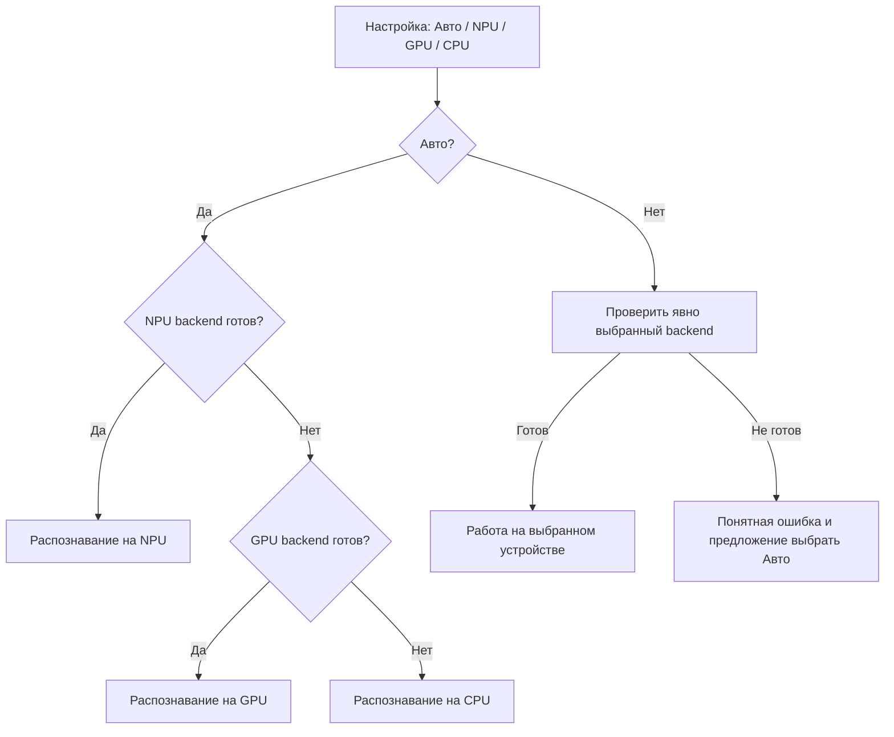

# ADR-003: выбор ускорителя и выпуск Windows-пакета

Дата: 17 октября 2026. Уточнение требований владельцем проекта.
Статус: **выбор и маршрутизация речи реализованы в прототипе 0.3**.
CPU, Intel GPU и NPU проверены на этой машине; Авто выбирает NPU.
Сохранение настройки, план задания, checkpoint/provenance и журнал реализованы.
ZIP/installer и CI/CD остаются следующим этапом. [Доказательства и границы](verification-devices.md).

## Выбор устройства

В настройках распознавания: **Авто (рекомендуется)**, **NPU**, **GPU**, **CPU**.
Авто пробует поддержанные и готовые backend в порядке **NPU → GPU → CPU**.
Недостаточно обнаружить ускоритель в Device Manager: должны подходить driver,
runtime, модель, доступная память и проверка загрузки/готовности pipeline.

Для ручного выбора показать обнаруженные устройства/названия, состояние, backend,
причину недоступности и фактически используемый вариант. Сохранить настройку между
запусками. Недоступный пункт можно показать disabled с объяснением, а не скрывать.
Фиксировать настройку в job при добавлении: её изменение не переключает уже выполняемое задание.

Переход в Auto после ошибки runtime:

1. Ошибку не скрывать: сохранить тип/причину и показать изменение устройства в прогрессе.
2. Повторить только незавершённый фрагмент на следующем совместимом backend.
3. Не считать плохой текст или `end_ts=-1` отсутствием оборудования: это отдельные
   ошибки качества/таймингов, требующие обработки и диагностики.
4. Включить device/backend, digest модели, версии runtime, язык и параметры в identity
   попытки/кэша. Не выдавать сегменты другой модели за тот же результат.
5. Сохранить завершённые фрагменты с provenance. Если форматы/параметры несовместимы,
   создать новую ветку результата с явным сообщением вместо опасного переиспользования.
6. CPU остаётся последней попыткой, но при отсутствии модели/памяти и он может быть
   недоступен: вернуть конкретную причину, а не обещать безусловный успешный результат.

## Устройства зависят от этапа

| Этап | Auto и настройки | Что нельзя предполагать |
|---|---|---|
| Речь / Whisper | NPU → поддержанный GPU → CPU | Intel GPU/OpenVINO, NVIDIA CUDA и AMD backend — разные адаптеры; наличие GPU не гарантирует совместимый runtime. |
| Диаризация | Поддержанный GPU → CPU; отдельный выбор | NPU-профиля pyannote пока нет. Если он появится и будет проверен — добавить capability, а не выдавать NPU-пункт за работающий сейчас. |
| Перевод/конспект | Выбор готового локального провайдера/модели; явное отображение устройства провайдера | Ollama управляет offload сама; нельзя обещать, что переключатель Whisper переключит Qwen на NPU или заставит Ollama использовать конкретный GPU. |
| VAD/медиа | CPU либо явно поддержанная реализация | Отсутствие NPU/GPU не блокирует подготовку аудио/проверки. |

Первый кандидат для Intel ASR — существующий FP16 OpenVINO IR с отдельным CPU/GPU
worker: это позволяет проверить другие устройства без загрузки ещё одной большой
Whisper-модели. Существующий Windows NPU worker/venv не менять. Возможность CPU/GPU
указана в [WhisperPipeline API](https://docs.openvino.ai/2026/api/genai_api/_autosummary/openvino_genai.WhisperPipeline.html),
но конкретный IR/driver/pipeline должен пройти реальный probe.

## История действий

README и Git — история разработки, архитектурных решений и проверок.
Для исполнения приложения нужен отдельный локальный append-only журнал событий
в `runtime/logs/events.jsonl`: время UTC, job/attempt ID, действие, стадия,
запрошенное/выбранное устройство, backend/model identity, результат и причина fallback.
События: добавление/старт/завершение/ошибка/retry, выбор backend, переход устройства,
изменение настроек, загрузка модели, обновление и экспорт.
В журнал не записывать ключи, полный текст речи или содержимое видео. Настройки/данные
в Git не включать. Текущие app.log/run.log остаются диагностикой; единый events.jsonl
ещё требуется реализовать.

## CI/CD и артефакты выпуска

На version tag или ручном release workflow:

1. Windows runner: unit/API/integration tests, проверка зависимостей, сборка
   приложения с собственным Python/runtime; запуск без установленного системного Python.
2. Создать **ZIP** и **Windows installer** из одной версии/manifest, а не два разных
   набора файлов. Формат installer выбрать после проверки lifecycle (например, Inno Setup
   или WiX). Драйверы/модели не устанавливать молча и не запрашивать admin без причины.
3. Исключить из обоих артефактов пользовательские data/output/runtime, `.env`, ключи,
   HF-токены, модели и локальные настройки. Включить licenses/notices и инструкции.
4. Генерировать version, SHA256, manifest/SBOM. Проверять allowlist содержимого,
   а не архивировать всю рабочую папку. Большие модели — отдельные optional downloads
   с размером до загрузки и проверкой checksum.
5. На отдельной чистой Windows VM/runner проверить распаковку ZIP, установку, первый
   запуск, повторный запуск, upgrade/rollback и uninstall с сохранением данных.
   Проверить пути с пробелами/кириллицей и учётную запись без admin.
6. Собирать installer и ZIP как CI artifacts. Публичный release/push и code signing
   настраиваются отдельно; подпись требует сертификата/учётных данных владельца.
   Текущий Install-App.ps1 — подготовка venv, а не готовый Windows installer.

## Матрица проверок

| Уровень | Комбинации | Где запускать |
|---|---|---|
| Детерминированная логика выбора | NPU+GPU+CPU, GPU+CPU, только CPU, все недоступны; ручной выбор; ошибка runtime; неизвестный GPU | Обычные unit/API tests с подстановкой capabilities; это проверка правил, не оборудования. |
| Установка/запуск | ZIP/installer; чистая/повторная установка; без Python/Docker/WSL; update/uninstall; повреждённый config/download | Windows VM / GitHub-hosted Windows runner. |
| Настоящее CPU-распознавание | Короткое/длинное видео, тишина, resume, качество таймингов | Windows runner/VM с нужными моделями и достаточными ресурсами. |
| Настоящее GPU | Intel, затем другие заявленные семейства; явный GPU и Auto при отключённом NPU backend | Отдельные self-hosted Windows runners/машины с нужным GPU/драйвером. |
| Настоящее NPU | NPU+GPU; NPU без готового GPU backend; Auto и ручной выбор; ошибка/восстановление | Реальный Intel NPU host. Не менять драйвер ради имитации отсутствия устройства. |

Отсутствие устройств можно моделировать через capability override/отключение backend,
не отключая физический адаптер в Windows. Реальные результаты должны содержать
device/model/runtime identity и длительность; имитационные результаты помечать отдельно.

**Почему не ограничиваться Windows-контейнером:** контейнер не является чистым
Windows Desktop с полноценной установкой/GUI, а доступ к физическим NPU/GPU зависит
от host/изоляции/драйверов. В GitHub Actions container jobs/service containers требуют
[Linux runner](https://docs.github.com/en/actions/reference/runners/self-hosted-runners).
Для нашего desktop installer правильная основа — Windows VM/runner; контейнер можно
добавить для headless-сценариев, но не считать доказательством всех аппаратных комбинаций.

## Порядок следующей реализации

1. Общий capability registry и device policy, тесты всех веток, настройки UI/job snapshot,
   журнал выбора/переходов устройств.
2. Изолированные CPU/GPU adapters на имеющихся моделях; реальные пробы и честные
   состояния unavailable/experimental/verified.
3. Связать выбор с очередью, checkpoint/provenance и пользовательскими ошибками.
4. После стабильного runtime — сборка ZIP/installer и CI-матрица выше.

Пункты 1–3 выполнены для локального speech-only режима в 0.3. Это не распространяет
настройку Whisper на pyannote/Ollama и не означает поддержку каждого семейства GPU.
Отсутствие устройств и отказы проверены подстановкой backend; аппаратные прогоны
выполнены отдельно, без отключения адаптеров или изменения драйверов.
